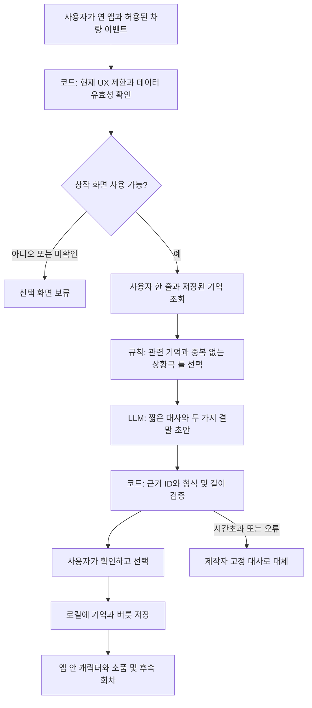

# 차마고치: 우리 차의 버릇 — 내 차와 정드는 지속형 콘텐츠 기획

<callout icon="🚘" color="blue_bg">
추천 제안은 ‘차마고치: 우리 차의 버릇’이다. 내 차에서 있었던 일에 내가 붙인 의미가 다음 인사·소품·짧은 에피소드로 돌아오는 콘텐츠다. 차를 돌보는 숙제보다 ‘우리 차답게 달라지는 모습’을 즐기게 한다.

아래는 공모전 검토용 기획 제안이다. 사용자 수요·애착 상승·차량 화면의 우위·SDK 실차 동작이 검증된 결과는 아니다. 추천안 1개를 자세히 설계하고, 비교안 2개를 같은 다섯 목차로 정리했다.
</callout>

## 먼저 볼 장면 — 다음번에 모카가 어떤 반응을 할까?

설계 예시의 주인공 지우는 자신의 첫 중고차에 ‘모카’라는 이름을 붙였다. 주로 혼자 출퇴근하고, 별일 없는 날이 많다. 세차·정비 기록을 매일 쓰고 싶지는 않지만 차가 조금 더 ‘내 차’ 같았으면 한다. 나이·첫 차 여부는 서비스 필수 조건이 아니다.

| 장면 | 사용자가 실제로 하는 행동 | 앱에서 받는 콘텐츠 | 얻는 만족과 다음 이용 이유 |
| --- | --- | --- | --- |
| 처음, 주차 중 | 내 차의 색·별명과 말투 ‘무심한 동료’를 고른다. 모카를 차 모양 캐릭터로 만든다 | 이름 없는 공용 펫 대신 내 차를 닮은 캐릭터와 빈 기억 선반 | 내가 정한 차라는 느낌. 다른 차주의 캐릭터와 달라질 출발점 |
| 평일 귀가, 주차 완료 후 | 앱을 열고 ‘오늘 한 장면’을 선택한다. “오늘은 집 앞에서 빗소리를 잠깐 듣고 왔어”를 한 줄 남긴다 | ‘모카는 오늘 무엇이었을까?’에 ‘빗소리 감상실 / 퇴근 탈출선 / 직접 쓰기’가 나온다. 지우가 감상실을 선택한다 | 하루 일기가 길어지지 않고, 내가 겪은 평범한 순간을 웃으며 다시 본다 |
| 그 자리에서 20~40초 | 2컷 장면의 마지막 대사를 고른다. “엔진 끄기 전 앙코르?” 대신 “오늘 공연 끝”을 고른다 | 앱 안의 모카가 작은 우산을 접고 ‘오늘 공연 끝’을 말한다. 기억 선반에 빗방울 티켓이 놓인다 | 바로 즐길 수 있는 짧은 장면과 내가 고른 결말. 단순 기록 저장보다 작은 공동 창작에 가깝다 |
| 며칠 뒤, 같은 출퇴근 | 주차 후 다시 연다. 새로운 여행이나 사진은 필요 없다 | 이전에 지우가 고른 표현을 가져와 ‘오늘은 공연장 쉬는 날. 조용히 퇴근할까?’라는 후속 장면을 제시한다. 새 버릇으로 남길지 고른다 | 내 선택을 기억해 다른 반응을 보여준다. 다음 회차에서 버릇이 어떻게 이어질지 궁금해진다 |
| 주말, 여유 있는 주차 시간 | 이번 주 남긴 장면 중 하나를 ‘모카다운 순간’으로 고른다 | ‘빗소리 감상실’과 ‘퇴근 탈출선’ 중 내가 택한 정체성을 담은 60초 주간 에피소드. 원하면 제목과 소품 위치를 바꾼다 | 사용 횟수 보상보다 ‘우리 차만의 한 주’를 완성하는 만족 |
| 2주 쉬었다가 복귀 | 다시 앱을 연다 | 저장된 버릇에서 이어서 시작하거나 새 장면을 선택한다. 빈 기간을 지어내지 않는다 | 밀린 돌봄 없이 바로 돌아올 수 있다 |

위의 비·빗소리·기분·탑승자는 **사용자가 직접 알려준 내용**이다. 센서로 알아냈다고 표현하지 않는다. 대사와 화면은 설계 예시이며 실제 시연 결과가 아니다.

## 세 방향을 비교한 기획 판단

| 후보 | 핵심 놀이 | 애착이 쌓이는 대상 | 반복할 이유 | 가장 강한 반론 | 제안 |
| --- | --- | --- | --- | --- | --- |
| 1. 차마고치: 우리 차의 버릇 | 실제 기억을 함께 해석하고, 다음 회차가 달라지는 짧은 연속극 | 이름·차의 특징·함께 겪은 일이 묶인 ‘이 차’ | 내 선택이 남긴 버릇과 다음 반응 | 차보다 캐릭터에만 정들 수 있고, 휴대폰에서도 가능 | 우선 검증 |
| 2. 내 차 오프닝 스튜디오 | 내 차만의 출발·도착 인사와 짧은 연출을 함께 제작 | 내 차에 남긴 나의 표현 | 만든 결과를 실제 차 안에서 다시 경험하고 고치기 | 한 번 설정하면 끝나는 기능이 될 수 있음 | 1안의 선택형 확장 후보 |
| 3. 우리 차의 보물 상자 | 미래의 내가 같은 차에서 열어볼 짧은 선물 제작 | 시간이 이어지는 차 안의 기억 | 지난 내가 무엇을 남겼는지 열어보기 | 휴대폰 예약편지와 차이가 작고 이용 간격이 김 | 독립 출품보다 보조 콘텐츠 |

판정은 제안자의 정성 판단이며 공식 점수·시장 성공 확률이 아니다. 처음부터 세 서비스를 모두 만들지 않는다.

## 1안 상세 — 차마고치: 우리 차의 버릇

### 1. 페르소나·시나리오

초기 타깃은 **자기 차에 별명을 붙이거나 작은 취향 표현을 즐기지만, 긴 기록과 매일 돌봄은 부담스러운 개인 차주**다. 매일 운전하거나 가족과 탈 필요가 없다. 이미 차에 강한 애정을 가진 사람만 좋아하는지, 애착이 약한 사람도 달라지는지 구분해 검증한다.

이용 동기는 ‘오늘 보상을 받아야 해서’가 아니라 ‘모카와 오늘 한 장면을 만들어보고 싶어서’다. 주된 이용 순간은 목적지에 도착해 주차한 뒤 잠깐 여유가 있을 때다. 급히 내릴 때는 건너뛴다. 시동 종료 후에도 화면을 쓸 수 있다고 가정하지 않으며, 현재 차량에서 앱을 사용할 수 있는 동안만 이용한다.

가설은 **내가 의미를 붙인 경험 → 그 의미가 남은 차의 버릇 → 다음 실제 탑승 때의 재경험**이 이어질수록 내 차가 더 구체적인 존재로 느껴진다는 것이다. 사용자가 이 가설을 승인했거나 효과가 입증됐다는 뜻은 아니다.

### 2. 콘텐츠 설계·확장

기본 단위는 ‘확인된 장면 하나 + 선택 하나 + 즉시 달라지는 연출 하나’다. 앱은 후보를 제시하고, 사용자가 남기기로 한 것만 장기 기억이 된다. 마음에 들지 않는 말투·버릇은 바로 바꾸거나 지울 수 있다.

| 콘텐츠 | 실제 예시 | 1회 보상 | 다음 회차에서 바뀌는 것 |
| --- | --- | --- | --- |
| 오늘 모카의 역할 | 평범한 귀가를 ‘퇴근 탈출선’으로 이름 붙인다 | 탈출선 출입 도장을 찍는 2컷 장면 | 이후 귀가 장면에서 ‘탈출 성공’이라는 우리만의 표현을 선택적으로 재사용 |
| 버릇 만들기 | ‘들어가기 전 조용히 10초’와 ‘오늘 한마디’를 골라본다 | 내가 고른 마무리를 모카가 연기 | 사용자가 버릇으로 저장한 경우 다음 이용 때 그 연출을 먼저 제시. 자동 실행은 가정하지 않음 |
| 기억 소품 | ‘처음 부모님을 모신 날’을 직접 남기고 작은 조수석 리본을 고른다 | 내 차 내부를 본뜬 앱 공간에 그 기억의 소품이 남음 | 리본을 눌러 그날의 내 문장을 보고, 후속 장면에 등장시킬지 결정 |
| 우리끼리 아는 말 | ‘이 차는 커피보다 조용한 퇴근이 필요해’를 직접 고친다 | 내가 만든 말이 결말이 되는 짧은 장면 | 캐릭터의 상용 유행어 대신 소유자가 만든 표현이 누적 |
| 이번 주의 한 컷 | 저장한 장면 두 개로 ‘모카의 이번 주 장르’를 고른다 | 실제 기억을 소재로 한 짧은 시트콤. 창작 부분은 표시 | 선택한 장르·소품을 다음 회차의 출발점으로 사용 |
| 오랜만의 재회 | 기록이 없는 기간 뒤 ‘전에 만든 것 이어보기 / 새 장면’ 선택 | 밀린 과제 없이 바로 즐길 수 있는 회차 | 지난 기간의 운행·감정을 추정하지 않고 기존 기억에서 이어감 |

**평범한 출퇴근도 콘텐츠가 되어야 한다.** 새 여행·사진·특별한 일이 없으면 ‘오늘 모카의 직업’, ‘우리 차다운 한마디’, 기존 소품의 짧은 후일담을 제안한다. 새 사건이 없다는 이유로 운전을 더 하거나 외출할 필요가 없다. 재미있는 답을 고르지 않고 ‘오늘은 기록 없이 보기’로 끝내도 된다.

시간별로는 10초에 기억 후보만 남기기, 20~40초에 한 장면 완성, 1~2분에 주간 에피소드·소품 편집이다. 이 시간은 설계 목표이며 측정된 사용 시간이 아니다. 주행 중에는 이 창작·선택 놀이를 요구하지 않는다.

성장은 숫자보다 **세 가지 눈에 보이는 변화**로 보여준다. 내 차의 표현이 늘고, 내 차 안의 기억 소품이 달라지고, 이전 선택을 참조한 후속 장면이 생긴다. 누적 주행거리·연료 소비·앱 연속 출석으로 애정 순위를 매기지 않는다. 미접속 때 굶거나 아픈 캐릭터도 없다.

첫 콘텐츠 묶음은 ‘출퇴근·조용한 휴식·처음 함께한 일·작은 성취’ 네 주제로 제한한다. 제작자가 쓴 짧은 상황극 틀과 고정 그림 자산을 바탕으로 개인 문장과 선택만 변형한다. 향후에는 계절 묶음, 차주가 만든 말투, 동의한 동승자의 한마디로 확장한다. 사진 생성·하드웨어 제어·오픈 커뮤니티는 첫 버전에 넣지 않는다.

### 3. 실제 자료 조사 — 근거와 차별 가설

차와의 추억·친구 같은 관계가 애착에 관련된다는 탐색 연구와, 차에 이름을 붙이는 행동은 확인된다. 아래 공통 조사 표의 자료는 **기획의 출발점**이다. 이 콘텐츠에 대한 국내 수요와 반복 이용을 증명하지는 않는다.

차별 가설은 ‘캐릭터가 있다’가 아니라 **내가 해석하고 확인한 이 차의 사건이 지속되는 버릇이 되어, 다음 회차의 구체적인 연출과 결말을 바꾼다**는 것이다. 기억 기능과 연속극 자체도 새로운 발명이라고 주장하지 않는다. 자동차 애착 연구에도 추억 재노출과 성격 있는 비서 제안이 이미 있다.

가장 강한 대안은 좋은 차량 비서와 휴대폰의 사진·일기·추억 기능이다. 차마고치가 더 많은 입력을 요구하면서 비슷한 회고만 제공하면 차별성이 없다. 그 경우 기능을 늘리기보다 독립 출품을 재검토한다.

### 4. 차량·Pleos 적합성 — 차에서 써야 할 이유는 조건부다

| 실제로 노릴 추가 가치 | 모바일도 가능한 부분 | 차량 앱의 우위를 확인할 관찰 |
| --- | --- | --- |
| 차량 내비의 도착 이벤트와 현재 주행 제한 상태를 이용해, 허용된 순간에만 해당 차의 기억 후보를 준비 | 휴대폰도 위치·운행 기록·알림을 이용할 수 있음 | 사용자가 목적지와 이동 사실을 다시 입력하는 횟수, 엉뚱한 시점에 뜨는 후보가 줄어드는가 |
| 방금 이용한 실제 차 안에서, 그 차를 닮은 캐릭터와 내 표현을 경험 | 휴대폰에서도 캐릭터와 기록을 볼 수 있음 | 같은 콘텐츠를 휴대폰에서 볼 때보다 ‘이 차와 한 일’로 받아들이고 자발적으로 다시 선택하는가 |
| 특정 차의 기억 선반을 차량 앱에 남기고, 다음 탑승 때 이어서 경험 | 연결 앱도 차량별 프로필을 만들 수 있음 | 앱을 다시 여는 수고보다 차에 돌아온 느낌이 커지는가. 자동 실행 없이도 재선택하는가 |

**차량이 반드시 더 좋다고 결론 내릴 근거는 아직 없다.** 차량 화면은 내리기 직전 접근성이 나쁠 수 있고, 탑승 시간이 길어지는 것도 비용이다. 휴대폰에서 한 번에 끝나는 경험이 더 편하다면 차량판의 우위는 약하다. 큰 화면·SDK 사용·안전 잠금은 그 자체로 콘텐츠의 차별점이 아니다.

첫 버전은 운전자의 주차 중 선택·편집으로 설계한다. 이는 이 놀이의 사용 장면을 정한 것이며 모든 차량 콘텐츠가 주차형이어야 한다는 판단은 아니다. 주행 청취를 나중에 추가하더라도 게임에 오디오 카테고리를 붙여 허용을 가정하지 않는다. 플랫폼의 기능별 제한을 따른다. [Pleos 앱 카테고리](https://document.pleos.ai/en/docs/pleos-only/vehicle-app-planning-guide/app-category), [주행 규제 개발 가이드](https://document.pleos.ai/docs/pleos-only/vehicle-app-developer-guide/driving-restriction-development-guide)

### 5. AI Agent·구현 구조

AI는 ‘내 차의 실제 상태를 판단하는 존재’보다 **기억을 확인하고 후속 회차를 편집하는 작가** 역할이 적합하다. 차량 제한·저장·삭제·사실 확인 상태는 일반 코드가 관리한다.

| 단계 | 구체적 예시 |
| --- | --- |
| 입력 | 별명 ‘모카’, 사용자가 남긴 ‘빗소리를 듣고 귀가’, 직접 선택한 ‘감상실’, 기억 ID M12. 허용된 도착 이벤트가 있으면 시각을 후보 정보로 사용 |
| 기억 조회 | 같은 차량의 같은 사용자 프로필에서 M12와 사용자가 저장한 말투만 선택. 모델이 전체 운행 이력을 알고 있다고 가정하지 않음 |
| 편집 계획 | 기존 ‘공연 끝’ 버릇을 참조하는 2컷 틀을 선택하고, 겹치는 대사는 피함 |
| AI 생성 | ‘감상실은 오늘 휴관. 조용한 귀가도 공연이지.’처럼 짧은 대사와 결말 2개를 초안으로 제시 |
| 검증·확인 | 출력이 참조한 기억 ID가 실제 존재하는지 확인. ‘오늘도 비가 온다’처럼 입력에 없는 사실을 추가하면 제외. 사용자가 저장하기 전에는 새 버릇으로 확정하지 않음 |
| 결과 | 고정 그림 자산으로 짧은 장면을 보여주고, 선택한 버릇·소품만 저장. 창작 대사는 차량의 실제 감정이나 진단으로 취급하지 않음 |

Agent가 하는 일은 기억 검색 → 회차 틀 선택 → 문장 초안 → 사용자 확인 요청이다. 외부 결제·차량 제어를 자율 실행하지 않는다. 단순 규칙 템플릿과 비교해 AI가 더 재미있거나 구체적인 후속 회차를 만들지 못하면, AI를 줄여도 서비스가 성립해야 한다.

## 공통 조사 — 관찰된 사실과 아직 모르는 것

조사 확인일: <date start="2026-11-07" />. 제품 기능 소개는 수요·효과·유지율을 증명하는 자료와 구분했다.

| 자료 | 확인된 사실 | 이번 기획에서의 해석·반증 |
| --- | --- | --- |
| [Braun 외, AutomotiveUI 2018 연구 원문](https://www.medien.ifi.lmu.de/pubdb/publications/pub/braun2018autoAttachment/braun2018autoAttachment.pdf) | 차량 보유자 16명 인터뷰에서 실용적 역량·추억·지위·친구 관계의 애착 유형을 탐색. 추억 재노출과 성격 있는 비서도 제안 | 추억형·친구형 타깃의 간접 근거. 소규모 탐색 연구이며 우리 앱의 효과나 한국 시장 수요를 검증하지 않음. 아이디어의 선행 제안이기도 함 |
| [Capital One, 2019-10-01 공개 조사](https://www.capitalone.com/about/newsroom/nationalnameyourcardaysurvey2019/) | 미국 면허 소지자 약 2,000명 조사에서 40%가 차에 이름을 붙였다고 응답 | 의인화 행동의 존재를 보여줌. 오래된 해외 상업 의뢰·자기보고 조사이며 이름 짓기가 애착을 높인다는 인과나 국내 앱 수요로 환산할 수 없음 |
| [MINI 공식 Spike 안내](https://faq.mini.com.au/s/article/Intelligent-Personal-Assistant-MINI-Spike-Benefits-NqMIq), [MINI Experience Modes](https://www.mini.co.uk/en_GB/home/experience-modes-hub.html) | Spike는 차량 비서의 시각 캐릭터이고, Personal Mode는 개인 이미지를 차량 화면 배경에 활용 | 귀여운 차량 캐릭터·개인화·내 차 꾸미기만으로 차별화하기 어려움. 차종·장비·서비스 조건을 우리 앱에 그대로 적용할 수도 없음 |
| [Renault reno 공식 소개](https://www.renault.co.uk/renault-connect/reno.html) | 개인화 추천, 대화 맥락 기억, ChatGPT 기반 대화와 차량 관련 기능을 안내 | ‘기억하는 AI 말동무’도 이미 경쟁 범위. 사용자가 만든 일화가 후속 콘텐츠를 바꾸는 경험을 따로 입증해야 함 |
| [Volvo Trips 공식 지원](https://www.volvocars.com/us/support/car/ex40/topic/b9e4087e56b545bfa6e39fdf93072a14/dd1471b357704f45a432bd3c148134ff/23f136a55b047cb0c0a801511e5dcacd/) | 동의 후 차량의 위치·시간·거리 등 운행 정보를 기록하고 차량 화면과 휴대폰 앱에서 조회. 제공 범위는 차종·지역 등에 따라 다름 | 자동 운행일지 자체는 강한 차별점이 아님. 차량 데이터가 쓰인다는 사실만으로 차량 화면이 휴대폰보다 낫다고 할 수 없음 |
| [현대차 우수 아이디어 소개, 2026-10-08](https://www.hyundaimotorgroup.com/ko/story/hyundai-motor-company-pleos-connect-app-idea-contest) | ‘창밖동화’는 이동 경로와 AI를 결합한 동화·퀴즈 아이디어로 소개됨 | 경로에 맞춘 AI 이야기만으로 독창성을 주장하기 어려움. 이번 안은 지역 이야기보다 특정 차의 실제 누적 기억에 초점을 둠. 이전 우수작은 상용 이용 성과가 아님 |

확인된 것은 애착을 가진 차주와 관련 제품의 존재다. **한국 차주가 이 앱을 원한다는 직접 수요, 몇 주 뒤의 자발적 재사용, 실제 자동차 애착 상승, 지불 의사는 아직 모른다.**

<toggle heading="h2">
2안 — 내 차 오프닝 스튜디오

### 1. 페르소나·시나리오

개인 사진·문구·작은 액세서리로 차를 꾸미는 것을 즐기는 차주가 대상이다. 수빈은 주말 주차 중 ‘내 차가 영화에 등장한다면?’을 골라 20초 오프닝을 만든다. 차 이름 ‘우주’를 넣고, 영웅 등장 대신 ‘월요일 출근선’ 장르를 택한다. 다음번 주차 중 앱을 열면 자신의 차 모양과 직접 고른 대사가 등장한다. 오프닝을 다시 보니 긴 문구가 어색해 마지막 대사만 고친다.

| 시작 동기 | 행동 | 콘텐츠 결과 | 얻는 가치 |
| --- | --- | --- | --- |
| 내 차에 취향을 남기고 싶다 | 이름·장르·문구를 고르고 두 연출 중 하나를 선택 | 앱 안에서 재생되는 나만의 10~30초 오프닝 | 내가 만든 표현을 실제 내 차 안에서 다시 경험 |

### 2. 콘텐츠 설계·확장

‘출근선 출항’, ‘오늘 운행 종료 자막’, ‘중고차 첫날의 데뷔 장면’, ‘조용한 복귀’ 네 틀을 제안한다. 한 번 저장하면 다음에 다시 보고 고칠 수 있다. 10초 버전은 로고·인사만, 30초 버전은 짧은 선택형 대사, 계절 확장은 같은 취향을 다른 연출로 변주한다. 제작 과정을 즐기지 않는 사용자에게 무한 편집을 요구하지 않는다.

### 3. 실제 자료 조사

MINI의 Personal Mode 등 차량 개인화가 이미 있다. 배경 그림을 바꾸는 것만으로는 차별이 약하다. 제안하는 추가 경험은 제작자가 쓴 오프닝 틀 안에서 차주가 장르와 결말을 함께 만드는 과정이다. 실제로 이 과정과 재생을 반복하고 싶은지는 미확인이다. 설정 후 다시 고치지 않는다면 지속형 콘텐츠로는 약하다.

### 4. 차량·Pleos 적합성

차량판의 가설은 ‘차를 위한 표현이 같은 차 안에서 재생된다’는 맥락이다. 제작은 휴대폰이 더 편할 수 있으므로 모바일 편집도 대안으로 둔다. 앱 내부 화면과 허용된 소리만 대상으로 하며 OS 부팅 화면·차량 전체 테마·조명·시동음 교체를 약속하지 않는다. 시동 때 자동 실행되거나 차량 오디오를 독점한다고 가정하지 않는다.

### 5. AI Agent·구현 구조

입력: 별명·사용자 문장·선택 장르 → 코드: 허용된 연출 자산 선택 → AI: 길이에 맞춘 대사 초안 → 사용자 수정·확인 → 앱 내부 시퀀스로 저장·재생. 오디오 접근이 안 되면 시각 연출만 제공한다. 콘텐츠 잠금·중단은 공통 주행 규제를 따른다.

**판정:** 한 번 꾸민 뒤 끝나는지 먼저 확인한다. 단독 앱보다 1안에서 기억이 쌓인 뒤 열리는 선택형 창작 코너가 타당하다.
</toggle>

<toggle heading="h2">
3안 — 우리 차의 보물 상자

### 1. 페르소나·시나리오

같은 차로 지나온 시간을 기억하고 싶은 개인 차주가 대상이다. 첫 장거리 운전을 마친 현우는 주차 중 “다음번에도 긴장하겠지만 오늘 해냈어”라는 한 줄과 그림 선물을 남긴다. ‘다음 달 이후 내가 이 차에서 앱을 열 때’를 개봉 조건으로 고른다. 조건을 만족한 뒤 주차 중 앱을 열면 과거의 내가 남긴 말이 나온다. 가족·연인 참여는 선택 사항이며 혼자 자신에게도 만들 수 있다.

| 시작 동기 | 행동 | 콘텐츠 결과 | 얻는 가치 |
| --- | --- | --- | --- |
| 오늘을 미래의 내가 기억했으면 한다 | 짧은 문장·소품·개봉 조건 선택 | 같은 차량 프로필에 맡긴 작은 선물 | 시간이 지난 뒤 그 차에서 과거의 나를 만나는 경험 |

### 2. 콘텐츠 설계·확장

‘첫 장거리 뒤의 나에게’, ‘첫 출근을 마친 나에게’, ‘평범했던 주의 작은 칭찬’, ‘차를 바꾸기 전 열어보기’를 제안한다. 날짜가 지나도 앱을 열지 않으면 자동 재생하지 않는다. 특정 장소 재방문 조건은 위치 접근·오인식 문제를 확인한 후 확장한다. 읽고 싶지 않은 내용은 열기 전 삭제할 수 있다. 이용 빈도는 낮을 수 있으며 일간 이용을 목표로 삼지 않는다.

### 3. 실제 자료 조사

추억형 자동차 애착 연구와 연결되지만 예약편지·일기·사진 회상이 강한 대체재다. 차 안에서 연다는 이유만으로 반복 가치가 생기지는 않는다. 차량 경험을 직접 언급하지 않는 선물은 일반 예약편지와 더 비슷해진다. 타인에게 보내는 메시지 기능은 첫 버전에서 제외한다.

### 4. 차량·Pleos 적합성

장점 가설은 ‘그때 이용한 같은 차’가 시간의 연결점이 된다는 것이다. 반면 잊지 않고 열어보기는 휴대폰이 더 쉬울 수 있다. 앱 내부 차량 프로필로 시작하고 차종 변경·소유자 변경 때의 기억 내보내기·삭제를 설계한다. VIN 자동 조회나 인증된 소유권 연동을 전제하지 않는다.

### 5. AI Agent·구현 구조

입력: 사용자 원문·선택 개봉일·차량 프로필 → 코드: 잠금과 개봉 조건 관리 → 선택적 AI: 봉투 문구·짧은 연출 초안 → 사용자 확인 → 로컬 저장 → 허용된 주차 이용 중 개봉. 원문 메시지는 AI가 바꾸지 않는다. 날짜 잠금만으로는 AI가 필요하지 않으며, 모델이 없어도 동작해야 한다.

**판정:** 감정적 깊이의 후보지만 꾸준히 즐기는 주력 콘텐츠로는 빈도가 약하다. 1안의 기념 회차로 남기는 편을 제안한다.
</toggle>

## Pleos 구현 경계 — 공개 문서와 개발 검증을 나눈다

공모전 개발 안내는 Vehicle·NaviHelper·위치·음성 SDK를 소개한다. API 이름이 있다는 것과 참가 계정·특정 차종에서 원하는 기능을 쓸 수 있다는 것은 다르다. [공식 개발 환경](https://appdevchallenge.auto-hmg.io/guide/development)

| 필요한 것 | 이번에 확인한 공식 근거 | 첫 버전의 처리·아직 확인할 것 |
| --- | --- | --- |
| 내비 도착 이벤트 | NaviHelper 문서에 onDestinationArrived 등이 있으며, 전달 이벤트는 내비 구현에 따라 달라질 수 있다고 명시 | 실행 중 구독한 이벤트만 기억 후보로 사용. 모든 운행의 이력·상시 수집·도착 후 자동 앱 실행은 미보장. 이벤트가 없으면 주차 중 사용자가 직접 장면 시작. [공식 이벤트 문서](https://document.pleos.ai/en/docs/pleos-only/connect-sdk-pleos/NaviHelper/event-listeners) |
| 현재 주행 UX 제한 | CarUxRestrictions 상태와 변경 콜백에 따라 제한 적용 | 미확인·제한 상태에는 창작 화면 보류. 속도 0이나 도착 이벤트만으로 게임 허용을 판정하지 않음. [주행 규제](https://document.pleos.ai/docs/pleos-only/vehicle-app-developer-guide/driving-restriction-development-guide) |
| 음성 한 줄·읽어주기 | 릴리스에는 TTS·STT 버전이 있으나 신청 안내에는 준비 중 표기도 남아 있음 | 실제 계정과 에뮬레이터에서 확인. 불가하면 정차 화면 선택·짧은 텍스트와 제작자 사전 음성으로 진행. [2026-10-19 릴리스](https://document.pleos.ai/en/docs/pleos-only/release-note/sdk-release-note), [신청 안내](https://document.pleos.ai/docs/pleos-only/create-my-project) |
| Gleo 음성 진입 | 등록한 앱 기능을 Action·Callback으로 호출하는 인터페이스 | ‘오늘 기억 남기기’ 등 앱 기능 진입 후보. 스키마 승인·호출 가능 범위 별도 확인. 콘텐츠 작문용 범용 LLM API와 구분. [Gleo 공식 구조](https://document.pleos.ai/docs/pleos-only/app-integration-guide/guide/core-concepts) |
| 캐릭터·기억 저장 | 앱이 자체 구현할 영역 | 앱 내부 프로필·고정 그림 자산·로컬 저장으로 시작. 모델이 기억을 직접 덮어쓰지 않음. 클라우드 동기화·운전자 자동 식별은 별도 검증 |
| 차량 하드웨어·사진 | 표준 플랫폼 API를 통한 접근 원칙 | 자동 차량 카메라 촬영·상시 마이크·조명 제어를 핵심 조건으로 두지 않음. 사진이 필요해지면 사용자가 고른 사진부터 검토. [하드웨어 접근 정책](https://document.pleos.ai/en/docs/pleos-only/vehicle-app-planning-guide/platform-api-architecture) |

사용자 문장·기억은 기본적으로 해당 프로필에 저장하고, 공용 탑승자에게 자동 공개하지 않는다. LLM을 외부 서버에서 쓰면 보내는 기억을 최소화하고 전송 동의를 설계한다. 이름·감정·장소를 모델이 추측해 실제 사실로 저장하지 않는다. 위치는 콘텐츠에 꼭 필요한 경우에만 선택적으로 사용한다.

통신이 끊기면 저장된 기억과 고정 장면을 이용한다. 앱 종료·화면 전원 종료·제한 전환 시 현재 선택 지점을 저장하고, 다음 실행에서 제한을 다시 확인한다. 네트워크 복구 후 같은 장면이 중복 저장되지 않도록 이벤트 ID를 둔다. 이는 제안하는 구조이며 구현·실차 검증 완료를 뜻하지 않는다.

## 처음 검증할 범위와 탈락 조건

**작게 만들어 볼 범위:** 차량 프로필 1개, 캐릭터 1종과 고정 그림 자산, 상황극 틀 8개, 기억·버릇 저장, 도착 후보 1종, 주행 제한 연동. 한 줄을 남기고 고른 결말이 다음 회차를 바꾸는 흐름 하나를 완성한다. 실차 연동이 없는 부분은 시연에서 모의 데이터라고 표시한다.

| 판단 기준 | 검증 방법 | 계속할 근거 | 보완·중단해야 할 신호 |
| --- | --- | --- | --- |
| 시나리오 설득력 | 최근 실제 귀가·출퇴근을 기준으로 1회 사용 관찰 | 설명 없이 한 장면을 끝내고 ‘무엇이 재미있었는지’ 구체적으로 말함 | 좋은 취지라는 말만 있고 실제로는 바로 내리고 싶어 함 |
| 반복 재미 | 3~4주 소규모 탐색 사용. 참가자에게 목표 사용 횟수를 강요하지 않음 | 새로운 보상 지급 없이 후속 회차를 자발적으로 다시 고름. 후반부에도 재선택 이유가 남음 | 첫날 외형만 좋아하고 같은 장면은 반복하지 않음 |
| 차량판의 추가 가치 | 동일 기억·동일 캐릭터·동일 콘텐츠를 제공하는 모바일판과 순서를 바꿔 비교 | 입력 수고가 줄고 다음 적합한 탑승 때 차량판을 실제 재선택 | 모바일판이 더 편하고 만족도도 같거나 높음. 차량판은 독립 출품 재검토 |
| 이 차에 대한 애착 | 사용 전후 인터뷰에서 자동차와 캐릭터를 따로 묻고, 떠오른 실제 차의 장면을 확인 | ‘모카 캐릭터가 귀엽다’ 외에 이 차와의 구체적인 경험·의미가 더 생김 | 다른 차로 캐릭터만 옮겨도 전혀 같다고 느낌. 앱 호감만으로 목표 달성 판단 금지 |
| AI의 역할 | 같은 기억을 쓰는 제작자 고정 템플릿과 비교 | 덜 반복적이고 내 경험을 더 정확히 반영하는 회차 | 일반 위로·엉뚱한 기억·대기시간이 늘어남. AI 축소 또는 제외 |

처음에는 사용 맥락을 관찰할 수 있는 6~10명 정도의 탐색 규모를 제안한다. 이는 대표성 있는 시장 검증이나 인과 실험이 아니다. 애착 효과의 확정 판단은 더 긴 관찰과 별도 연구 설계가 필요하다.

재사용 지표는 ‘가입 후 실행 수’만 보지 않는다. **앱 사용이 가능했던 다음 탑승 기회 중 자발적으로 다시 연 비율**, 주차 후 작업에 든 시간, 3~4주차의 재사용 이유, 모바일 대비 선택, 잘못 생성한 기억의 수정·거절을 함께 본다. 차를 이용하지 않은 주와 이용 기회가 있었지만 앱을 안 쓴 주를 구분한다. 숫자 통과선은 파일럿 전에 정하며, 현재 유지율·MAU는 만들어 넣지 않는다.

## 공모전 제안 문장과 사업 가설

> 차마고치는 내가 차 안에서 붙인 이름과 기억을 다음 탑승의 작은 놀이로 돌려주는 앱입니다. 평범한 출퇴근에도 우리 차만의 말과 버릇이 쌓여, ‘그냥 타는 차’에 나만의 의미를 더합니다.

이 문장은 서비스가 지향하는 가치이며 애착 상승을 검증했다는 주장은 아니다.

| 공식 평가 항목 | 제안서에서 보여줄 것 |
| --- | --- |
| 차량특화성 | 같은 모바일 콘텐츠와 비교해 도착 직후 입력 수고와 차량판 재선택이 어떻게 달라지는지 |
| 창의성 | 캐릭터·비서·운행 기록의 기존 사례를 인정하고, 확인된 사건이 다음 회차의 구체 연출을 바꾸는 장면 |
| 기술 활용성 | 실제 도착 이벤트·주행 제한·기억 저장·콘텐츠 변화가 연결되는 시연. 실제/모의 연동을 구분 |
| 사업성 | 초기 타깃의 자발적 반복 이용, 콘텐츠 제작 부담과 AI 비용, 확대 가능한 콘텐츠 묶음 |

[공식 심사기준](https://appdevchallenge.auto-hmg.io/guide/judging-awards)은 차량특화성·창의성·기술 활용성·사업성을 제시한다. 공개되지 않은 배점을 임의 점수로 대신하지 않는다.

초기 유입은 애차 별명·꾸미기 경험이 있는 차주 모임과 첫 차 커뮤니티에서 체험 지원자를 모집하는 가설부터 검증한다. 현대차의 공식 배포·마케팅 제휴가 확보됐다고 가정하지 않는다. 수익은 반복 사용이 확인된 후 선택형 연출·계절 콘텐츠 묶음을 검토하되, 사용자의 기억 열람·수정·삭제를 과금 장벽으로 삼지 않는다. 소품을 팔 수 있다는 것과 지불 의사가 있다는 것도 구분한다.

**이번 제안의 선택:** 1안에서 ‘내가 만든 버릇이 다음 회차에 돌아오는 재미’ 하나를 우선 검증한다. 2안은 표현을 더하고 싶어 하는 사용자에게, 3안은 오래 쌓인 차의 기념 회차로 확장한다. 세 기능을 합쳐 놓은 종합 앱보다 한 장면의 재사용 가치가 먼저다.

근거 자료: 사용자 제공 「차량콘텐츠_조사기준_해석보고서.pdf」 1쪽의 판단 기준·정리 양식, 위에 직접 연결한 연구·조사·경쟁 제품·Pleos 공식 문서. 보고서의 기준을 평가 프레임으로 적용했으며, 본문의 추천·타깃·콘텐츠·검증 규모는 새롭게 제안한 기획 판단이다.
