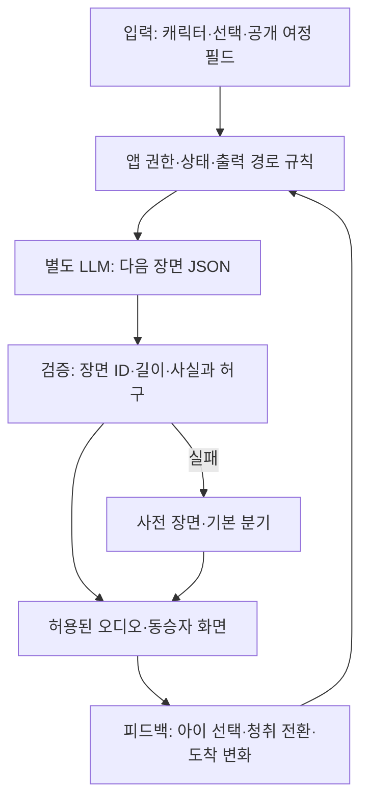

## 1. 페르소나 부여와 시나리오

토요일 오전, 여섯 살 지우는 부모와 수족관에 가는 30분 동안 좋아하는 공룡 이야기를 듣고 싶고, 운전하는 아빠는 계속 놀이를 진행하기 어렵다. 지우는 평소 태블릿에서 영상을 고르는 데 익숙하다. 따라서 ‘가족끼리 대화하자’는 어른의 목표만으로는 이 앱을 켜지 않는다. **오늘 자동차가 공룡 구조대의 이동 기지가 되고, 내가 정한 공룡이 목적지에 도착하기 전 잃어버린 알을 찾는다**는 이야기가 먼저 필요하다. 엄마는 동승하지만 매 순간 화면을 조작하지 않아도 된다. 부모 한 명만 타는 날도 운전자 응답 없이 진행된다.

가칭 ‘우리차 탐험대’는 5~8세 동승자를 위한 30분 연속 오디오 에피소드다. 출발 전 아이가 고른 캐릭터·관심사·선택이 다음 장면에 남고, 이동 중 장면과 도착 전 결말이 실제 여정에 맞춰 이어진다. ‘공룡을 좋아한다’와 ‘특정 유명 캐릭터를 그대로 사용한다’는 구분한다. 초기에는 팀이 만든 공룡 두두·로봇 모모 등 독자 캐릭터를 제공하고, 기존 브랜드 캐릭터·목소리·세계관은 정식 사용 권리 없이 전제하지 않는다.

| 실제 이동 시간 | 아이·부모의 행동과 대사 | 콘텐츠가 진행되는 방식과 계속 쓸 이유 |
|---|---|---|
| 출발 전~3분 | 지우가 ‘공룡 두두’, ‘알 찾기’, ‘무섭지 않게’를 고른다. “두두는 수영 못해. 내가 도와줄 거야.” | 이야기는 이 설정을 기록한다. “오늘 두두가 맡긴 알은 세 개. 바다 기지에 도착하기 전에 집을 찾아주자.” 목적지 입력을 또 요구하지 않고 허용된 내비 연동에서 실제 정보가 확보되면 사용한다. 없으면 부모가 출발 전에 이동 시간을 고른다. |
| 3~7분 | 두두가 강을 건널 생각에 걱정한다. 지우는 “배를 만들자. 노란 배!”라고 말하거나 동승자 화면에서 배를 고른다. | 다음 장면에 노란 배가 등장한다. 두두의 수영 불가 설정을 잊지 않는다. 아이가 말하지 않아도 캐릭터가 기본 선택으로 진행해 이야기가 멈추지 않는다. 지우는 자기 선택의 결과를 확인하고 싶어 계속 듣는다. |
| 7~11분 | 실제 경로에 강을 지나는 구간이 확인되면 “이번 구간에는 강을 지나는 길이 있어. 보이면 네 노란 배를 떠올려 봐.” 지우가 “엄마, 물이다!”라고 말한다. | 특정 창문을 급히 보거나 몸을 돌리라고 요구하지 않는다. 못 보았으면 ‘구름 속 강’ 장면으로 자연스럽게 넘어간다. 지도상의 지점은 시야에 실제 보인다는 보장이 아니므로 ‘지금 오른쪽에 보인다’고 단정하지 않는다. |
| 11~15분 | 첫 번째 알이 부화한다. 지우가 “아기 공룡 이름은 방울이.” 엄마가 “왜 방울이야?”라고 묻자 지우가 설명한다. | 앱은 가족에게 응답 시간을 재촉하지 않고 다음 오디오 장면을 늦출 수 있다. 운전자에게 질문을 돌리지 않는다. 자연스러운 사람 간 대화는 보너스이며, 가족 대화 횟수가 이야기 진행 조건은 아니다. |
| 15~20분 | 지우가 조금 조용해진다. 두두가 발자국 소리를 들려주고 “누가 지나갔을까”라고 혼잣말한다. 아이는 말하거나 그냥 듣는다. | 긴 설명 대신 효과음·반복 대사·짧은 사건으로 리듬을 바꾼다. 선택이 필요한 장면도 무응답이면 자동으로 이어진다. 운전자에게 답변이나 점수를 요구하는 음성 게임으로 만들지 않는다. |
| 20~25분 | 내비의 도착 예상이 늦어진 경우 두두가 잠깐 쉬는 짧은 외전을 듣는다. “아까 만든 배에 방울이를 태워 보자.” | 이동 정보가 검증되면 결말 타이밍을 조정하되, 길을 더 돌아가라고 제안하지 않는다. 정보가 없으면 남은 시간 버튼을 동승자가 조정하거나 원래 30분 대본으로 끝낸다. 새 사건을 무한 생성하기보다 앞선 선택을 재활용한다. |
| 25~30분·도착 | “두두, 이제 수족관에 도착했어.” 아이가 구조한 세 알의 이름을 듣고 탐험이 끝난다. “돌아갈 때 방울이도 같이 가?” | 도착 전에 사건을 닫고 다음 콘텐츠를 자동 재생하지 않는다. 귀로에는 같은 캐릭터가 지난 선택을 기억하는 새 에피소드를 고를 수 있다. 출발 전에 보호자가 동의한 별명·선택만 남기고 원본 음성·정확한 이동 이력은 기본 저장하지 않는다. |

기본 가치는 실제 이동 중 동승자가 듣는 이야기다. 자유 발화·아이 전용 화면의 적용 조건과 출력 경로는 4절에서 구분한다. 주차 시간을 억지로 만들어야 성립하는 제품으로 바꾸지 않는다.

## 2. 시나리오에서 사용된 콘텐츠의 확장성과 종류

에피소드마다 시작·사건·선택 결과·도착 결말을 설계한다. 5세는 그림 선택·듣기 중심, 7~8세는 이유 말하기·단서 연결을 선택하되 나이로 난이도를 강제하지 않는다.

| 구체 에피소드 | 입력 | 아이의 행동 | 보이는·들리는 결과와 반복 변주 |
|---|---|---|---|
| **공룡 두두의 세 알 구조대** | 공룡의 특징, 알 이름, 이동 시간, 검증된 강·공원 구간 여부 | 배·우산 같은 도구 고르기, 알 이름 붙이기, 캐릭터에게 한마디 | 앞서 고른 도구가 위기를 해결한다. 같은 경로도 공룡의 겁·도구·알 성격을 바꾸면 새 사건이 생긴다. 못 본 풍경을 찾아야만 성공하는 규칙은 없다. |
| **로봇 모모의 소리 수리점** | 로봇 취향, 사전 제작 효과음, 여행 길이 | 동물·빗방울·기계 등 허구의 소리를 듣고 로봇의 부품을 선택 | 선택한 부품에 따라 모모의 목소리 리듬과 해결 방식이 달라진다. 실제 경적·사이렌과 혼동할 소리는 피한다. 소리 조합과 고장 원인으로 반복 변주하며 실제 차량 고장을 진단하는 콘텐츠가 아니다. |
| **마법 우체국의 목적지 배달** | 목적지의 넓은 유형, 좋아하는 동물, 선물 후보 | 동물 손님에게 줄 물건 고르기, 짧은 편지 한 줄 만들기 | 수족관·공원·친척 집 같은 목적지 유형에 어울리는 허구의 배달이 도착 직전에 끝난다. 실명·주소를 이야기 소재로 읽지 않는다. 귀로에는 답장이 와서 앞선 선택을 다시 사용한다. |
| **아기 용의 길 찾기 극장** | 용의 성격, 검증된 경로의 대략적 진행, 이전 세션의 선택 | ‘기다려 주기 / 길을 설명하기’ 등 대응 고르기, 캐릭터 대사 따라 말하기 또는 듣기 | 직전의 선택에 따라 조연의 반응이 바뀐다. 실제 운전 경로를 아이가 지시하거나 바꾸는 게임이 아니다. 같은 길도 동행 캐릭터와 목적을 바꾸고, 경로 데이터가 없으면 일반 여행극으로 재생한다. |

네 에피소드는 제작·검증할 원형이다. 유명 캐릭터가 있어야만 이용한다면 제휴 비용과 권리 확보부터 검토한다. 초기에는 독자 캐릭터와 권리 확보한 음원·이미지만 쓴다.

선택의 기억이 반복 동기다. 캐릭터의 상상과 확인된 장소 정보는 구분하고 ‘강 아래 공룡이 산다’를 현실 정보처럼 전달하지 않는다.

## 3. 실제 자료 조사

| 자료·원문·범위 | 사실 | 추론과 반증 |
|---|---|---|
| [Peugeot 공식 조사](https://www.media.stellantis.com/uk-en/peugeot/press/only-8-of-children-never-use-technology-during-long-car-journeys), 2025-07-23. 2025년 6월 영국의 부모인 운전자 2,000명. 조사기관·세부 질문지 미공개. | 부모 보고 기준 자녀 62%가 긴 차 여행 대부분을 개인 기기로 보낸다. 44%는 차 안 놀이를 하며 부모 69%는 기술이 지루함 예방에 유용하다고 답했다. Peugeot는 차량 ChatGPT로 이야기·퀴즈를 제공한다고 설명한다. | 기술 콘텐츠의 사용 맥락은 있으나 태블릿이 강한 경쟁자라는 반증도 된다. 5~8세만의 결과도, 우리 서비스 선호도도 아니다. ‘AI 동화’만으로 차별화하지 못한다. |
| [SCENIC 연구 원문](https://arxiv.org/html/2508.17058v1), arXiv 공개 2025-08-23, UIST 2025 채택. 저자들은 6~11세 대상 위치 기반 시스템을 제안했다. | 현장 사용 평가는 7가구·아동 10명, 실제 참가 연령 6~10세였다. 장소 정보·이야기·질문을 연결했으며 익숙한 경로에서의 경험을 조사했다. 현장 사용에는 동일 가구의 대조 조건을 두지 않았다. | 위치 기반 AI 이야기의 실현 사례이며 새로운 아이디어라는 주장을 약하게 한다. 작은 모집 표본이고 한국 5세 포함 30분 사용·태블릿 대비 우월성을 입증하지 않는다. 연구 개최지가 한국이라는 이유로 한국 아동 조사로 쓰지 않는다. |

‘창밖 동화’ 접근과는 **30분의 사건 구조, 선택 기억, 도착에 맞는 완결**로 비교한다. 선행 제품에 없는 기능이라고 단정하지 않으며, Peugeot의 기능 공급을 이용률·만족도로 해석하지 않는다.

국내에서는 5~8세 자녀가 있는 8~12가구의 탐색 실험을 제안한다. A는 같은 캐릭터·목소리·길이의 고정 오디오, B는 선택 기억과 여정 종료 조정이 있는 버전으로 서로 다른 익숙한 이동에서 순서를 바꿔 비교한다. 아이가 평소 쓰던 태블릿도 선택 가능한 조건을 별도로 두어 경쟁을 숨기지 않는다. 첫 5분·15분·도착 시점의 자발적 계속 듣기, 다른 콘텐츠로 전환한 시점, 부모의 개입 횟수, 잘못된 풍경 안내를 기록한다. 작은 표본으로 통계적 시장 우위를 주장하지 않는다.

## 4. Pleos에 적합하고 최적화된 콘텐츠인가

**조건부 적합이다.** 자동차가 움직인다는 사실만으로 Pleos 전용 서비스가 되지는 않는다. 스마트폰도 위치·오디오·캐릭터를 구현할 수 있다. Pleos에서 기대할 이점은 이미 설정된 여정 정보를 중복 입력 없이 활용하고, 실제 도착 시간 변화에 결말을 맞추며, 내비 안내·전화와 오디오를 조정하는 것이다. 이 연결이 제공되지 않으면 차량 설치보다 모바일 오디오 앱의 설명이 더 정직하다.

아이에게 경로 정보가 필요한 이유도 교육 목적보다 이야기의 시간 구조에 있다. “언제 도착해”라는 추상적 시간을 ‘두두의 마지막 알을 찾으면 도착할 즈음’이라는 예측 가능한 진행으로 바꿀 수 있다. 다만 실제 ETA가 바뀌면 이야기 진행률을 정확한 도착 약속처럼 표시하지 않는다. 장소 관찰은 잠깐의 추가 재미이며 차를 타야만 확보되는 독점 자원은 아니다. 운전자의 길을 바꾸거나 아이가 급히 특정 풍경을 보게 하는 설계는 쓰지 않는다.

| 이용 경로 | 제공할 경험 | 판단·대체 |
|---|---|---|
| 전면 공용 화면·차량 스피커 | 출발 전 설정, 주행 중 구조화된 오디오와 최소 재생 제어 | Music/Audio의 실제 분류·지역 정책·심사 및 MediaBrowserService/MediaSession 등 요구 구현을 확인한다. 운전자에게 정답·자유 발화·게임 조작을 요구하지 않는다. |
| 동승자 개인 휴대전화 | 아이가 선택한 캐릭터·도구·듣기 전환, 허용된 입력 | 휴대전화의 독립 경험이다. 이를 차량 전면 제한을 우회하는 방법으로 사용하지 않는다. 차량과 세션 동기화·데이터 공유·차량 오디오 반영은 별도 허용 범위를 확인한다. |
| 독립 동승자 디스플레이·승객 창 | 지원 기기에서 아이 전용 표시 가능성 검토 | Connect-W의 승객 창 존재가 게임 면제를 뜻하지 않는다. 대상 차량 하드웨어와 해당 기능 승인·제한을 검증하기 전 지원 확정으로 쓰지 않는다. |
| 주차 상태 | 전체 설정·자유 대화·상호작용 원형 테스트 | 주행 제품 가치를 시험하기 위한 개발 경로이며 실제 사용 상황을 주차 30분으로 재정의하지 않는다. |

[Pleos 앱 카테고리](https://document.pleos.ai/en/docs/pleos-only/vehicle-app-planning-guide/app-category)는 Music/Audio의 음악·오디오북·간단한 재생 제어가 주행 중 제한적으로 허용될 수 있다고 설명한다. [주행 제한 개발 안내](https://document.pleos.ai/en/docs/pleos-only/vehicle-app-developer-guide/driving-restriction-development-guide)에 따라 실제 CarUxRestrictions를 적용한다. ‘음성뿐’ 또는 ‘동승자용’이라는 이유만으로 게임이 허용되는 것은 아니다. 승인 미확인 부분은 승인 미확인으로 남긴다.

[SDK 신청 안내](https://document.pleos.ai/docs/pleos-only/create-my-project)는 State·NaviHelper를 사용 가능, Control·FusedLocation·STT/TTS를 준비 중으로 표시한다. 그러나 [2026-10-19 SDK 릴리스 노트](https://document.pleos.ai/docs/pleos-only/release-note/sdk-release-note)에는 STT/TTS v3.3.1과 FusedLocation의 배포 버전이 명시되어 **문서가 불일치한다.** 따라서 일괄 미제공으로 단정하지 않고 참가 계정의 신청·승인 상태, 패키지 접근, 초기화와 실차 기능 지원을 확인한다. 배포 버전의 존재도 해당 계정의 사용 가능 보장은 아니다.

NaviHelper v3.0.5에는 `remainTime`·`remainDistance` 필드와 `onTripInfo` 이벤트가 공개되어 있어 남은 시간 기반 편성의 기술 근거가 있다. 다만 사용 권한, 값의 단위·갱신 주기·미수신 처리, 전체 경로 polyline 제공 범위는 구현에서 검증한다. [이벤트 문서](https://document.pleos.ai/en/docs/pleos-only/connect-sdk-pleos/NaviHelper/event-listeners)도 전달 이벤트가 내비 앱 구현에 따라 달라질 수 있다고 설명한다. 실패 시 출발 전 시간 선택으로 대체하고, 내비·전화 오디오와의 충돌은 앱의 오디오 규칙으로 처리한다.

## 5. AI Agent 도입 가능성과 적용 예시

Agent는 자유롭게 아이를 교육하는 선생님보다 **정해진 세계관과 여정 안에서 다음 장면을 편성하는 진행자**에 가깝다. 캐릭터 규칙, 연령별 문장 길이, 이전 선택, 허용된 장소 사실, 잔여 시간만 입력한다. 장소·차량 상태를 모델이 추측하게 하지 않는다. 부모가 말하지 않아도 진행되고 아이가 답하지 않으면 정해진 기본 분기로 넘어간다.

예를 들어 입력이 ‘두두는 수영 불가, 지우는 노란 배 선택, 강 구간 정보 확인, 예상 8분 뒤 도착’이면 Agent는 새 구조 임무를 추가하지 않고 노란 배를 다시 쓰는 결말을 고른다. 출력은 `scene_id`, `character_line`, `choice_ids`, `memory_delta`, `duration_sec`, `needs_interaction`처럼 구조화한다. 앱이 장면·선택 ID, 길이, 사실·허구 구분, 승인된 출력 경로를 검증한 뒤 재생한다. 여정 변경과 오디오 허용 여부는 모델이 아니라 결정 규칙이 처리한다.

별도 LLM 백엔드에서 생성하고 앱에 API 키를 넣지 않는다. Gleo는 승인된 앱 기능 호출 인터페이스이며 범용 생성 모델로 대신 쓰지 않는다. 연동 시 승인 스키마·콜백과 `actionCalls` 최대 3개 범위를 지킨다. 동적 음성 지원이 확보되지 않으면 사전 녹음된 장면과 실제 LLM이 고른 분기·생성 텍스트를 구분해 시연한다. 사전 오디오를 즉석 생성 음성이라고 설명하지 않는다.

11월 13일에는 한 에피소드의 선택 기억·결말을 실제 백엔드로 연결하고, 미검증 이동 연동은 명시된 모의 데이터로 시연한다. 가족 실험에서 절반 이상이 고정 오디오를 선호하거나 태블릿 전환이 줄지 않으면 차량 맞춤 AI 주장을 보류한다. 이는 통계적 판정선이 아닌 초기 운영 기준이다.

**회의에서 남은 질문:** 실제 경로·도착 연동과 아이의 선택 기억을 제공했을 때, 5~8세 아이가 평소 태블릿 대신 다음 이동에서도 스스로 이 에피소드를 고르는가?
