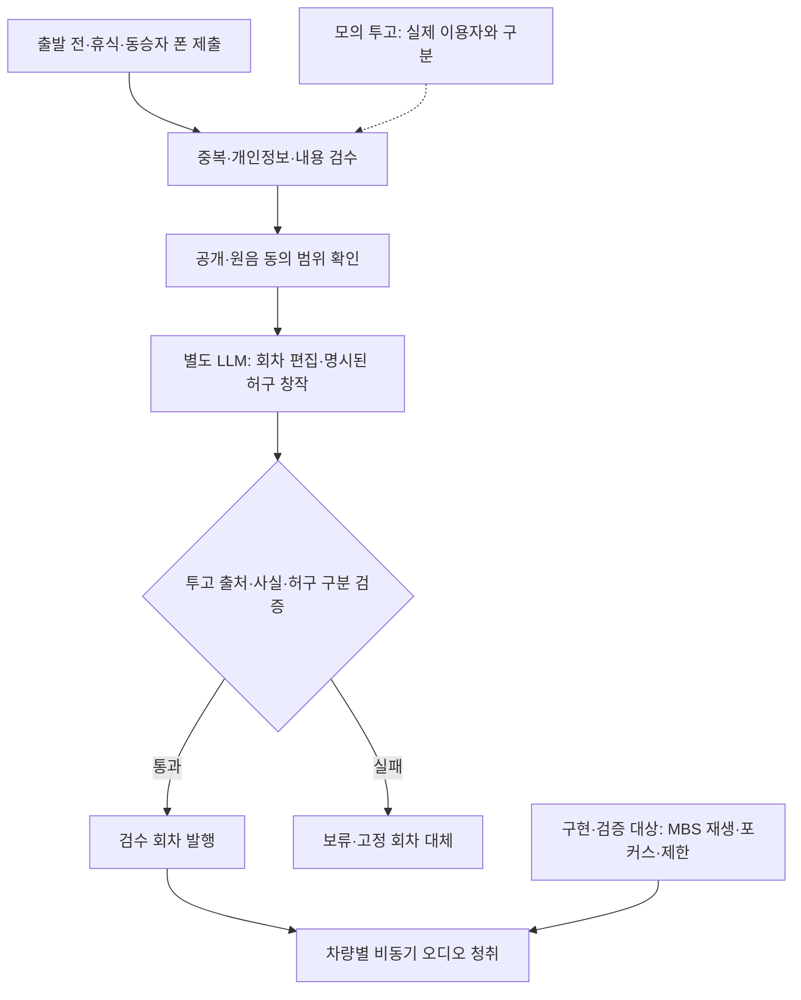

## 1. 페르소나 부여와 시나리오

**가칭 ‘여행릴레이’: 같은 권역의 여행자들이 각자 한 조각을 보태, 길 위에서 들을 여행지 라디오 한 편을 만든다.** 여러 차량 앱이 같은 서버 채널에 접속하지만, 서로를 앞지르거나 같은 박자로 연주하지 않는다. 실시간 음성방도 아니다. 출발 전·휴식 중의 짧은 투고와 동승자 휴대폰의 비동기 선택을 모아, 검수된 공동 에피소드를 각 차량에서 듣는다. 운전자는 응답 의무 없이 청취하며 표준 미디어 제어로 볼륨을 조절하거나 중단한다.

민수는 친구와 양양으로, 수진은 가족과 속초로 간다. 만날 약속은 없지만 오늘 동해안을 여행한다는 공통 맥락이 있다. 함께 콘텐츠를 만드는 재미는 원하되 얼굴 공개와 지속적인 대화는 부담스럽다. 네 차량의 아래 30분 경험은 가상이며 실제 이용량·생성 성능이 아니다.

**0~3분, 출발 전 코믹 라디오극 선택.** 민수는 주차 중 ‘바다를 못 본 갈매기의 하루’를 선택한다. 성인도 가볍게 들을 허구 여행극이며, 낯선 여러 차가 등장인물과 소품을 함께 만든다. 민수는 갈매기 이름으로 ‘영수’를 고른다. 듣기만 해도 되며 실명·얼굴·정밀 위치는 공개하지 않는다. 동승자는 QR로 자체 모바일 웹에 접속한다. QR 연결은 Pleos 전용 컨트롤러 SDK가 아니다.

**3~8분, 운전자는 준비된 회차를 듣는다.** 출발 후 복잡한 채널 편집과 투표 화면은 전면 디스플레이에서 사라진다. 사용자가 시작한 재생 세션 안에서 이전에 검수된 3분 에피소드가 나온다. 처음에는 지역 제작자가 준비한 이야기와 사용 허락된 환경음으로 채널을 채울 수 있다. 이 경우 ‘운영자가 만든 시작 회차’라고 표시하며 실제 여행자 투고인 것처럼 꾸미지 않는다. 새 참가자가 없다면 즉흥적으로 사람 수를 부풀리거나 AI 참가자를 만들어내지 않는다.

**8~12분, 엉뚱한 조각들이 도착한다.** 수진 차의 동승자는 갈매기가 챙긴 짐으로 ‘전기밥솥’, 다른 차의 동승자는 조연으로 ‘휴가 중인 등대’를 고른다. 약 5초짜리 선택이지만 응답 제한시간은 없다. 출발 전 입력도 받으며 운전자에게 녹음·투표를 요구하지 않는다. 다수결로 하나를 탈락시키지 않고 이름·소품·조연을 모두 다음 장면에 넣는다.

**12~17분, 세 선택이 3분 극으로 바뀐다.** 중복·개인정보·욕설을 검수하고 공개 동의를 확인한 뒤 AI가 정해진 사건 틀에 세 조각을 넣는다. 영수는 바다 대신 밥솥 설명서를 지도처럼 펼치고, 등대는 휴가라 길을 알려주지 않겠다고 한다. 이 장면은 명시된 허구이며 참가자의 실제 경험이 아니다. 실제 사연 채널에서는 발언을 왜곡하지 않는다. 원음은 별도 허락 없이 사용하지 않고 불확실한 내용은 발행을 보류한다.

**17~23분, 내 조각이 다른 차에서 웃음으로 들린다.** 다음 회차에서 영수가 말한다. “바다는 못 찾았지만 취사는 가능합니다.” 등대가 답한다. “오늘 휴가라 길 안내 대신 밥 뜸이나 봐드릴게요.” 마지막에는 밥 냄새를 따라 모인 항구 사람들 덕분에 영수가 바다를 찾는다. ‘영수·밥솥·등대’가 모두 장면과 결말에 남는다. 동승자는 기여가 반영된 부분을 폰에서 확인하고 운전자는 답변 없이 듣는다. 검수된 회차는 사용자가 시작한 재생 목록에 이어 붙이며 현재 오디오를 끊지 않는다. 연결·프로필 변경만으로 자동 재생하지 않고, 내비·전화 우선 오디오에 맞춰 중단·조절한다.

**23~27분, 쉬는 차는 다음 회차에 보탠다.** 휴게소에 주차한 가족은 ‘다음 여행자에게 남길 한 문장’을 고르고, 이동하는 차는 듣기만 한다. 다른 차의 답변을 기다릴 필요가 없다. 투고 경쟁 대신 여러 관점을 고르게 편집하고 미채택 이유의 범주를 설명한다. 채택을 보장하거나 발언 공개를 강요하지 않는다.

**27~30분, 공동 결과물이 남는다.** 도착 후 에피소드 카드와 사용된 문장을 확인한다. 저장·외부 공유는 동의된 범위만 허용한다. 다음 채널에 자동 가입하지 않으며, 여행 종료 후 나가거나 다음 여행지의 새 주제를 선택할 수 있다. 결과는 ‘내 작은 선택이 오늘의 여행 소리에 보탬이 됐다’는 경험이다.

## 2. 시나리오에서 사용된 콘텐츠의 확장성과 종류

| 콘텐츠 유형 | 입력 | 사용자가 하는 행동 | 공동 결과 |
|---|---|---|---|
| 오늘의 여행지 라디오 | 주제 선택, 승인된 한 줄, 검증된 지역 정보 | 출발 전·휴식 때 투고하거나 동승자 폰으로 선택 | 3~5분 길이의 편집된 에피소드. 누가 더 인기 있는지 경쟁하지 않음 |
| 공동 코믹 여행극 | 인물 이름·엉뚱한 소품·조연 선택 | 출발 전 또는 동승자 폰으로 한 조각을 선택 | 모든 선택이 장면에 쓰이는 짧은 허구 라디오극. 실제 사연과 구분 |
| 다음 여행자에게 한 문장 | 개인이 남긴 짧은 경험·응원·공개 장소 팁 | 주차 중 작성하고 공개 범위를 확인 | 다음 회차에 이어지는 릴레이 편지. 영업·안전 사실은 따로 검증하며 개인 경험과 구분 |
| 지역 공동 선택 이야기 | 두 개의 허구 장면, 참가자의 비동기 선택 | 동승자 또는 주차 중 이용자가 다음 소재를 선택 | 다음 회차의 허구 이야기가 달라짐. 운전자 실시간 답변·타이머·화면 퍼즐은 없음 |

공통 엔진은 채널, 투고, 검수, 편집, 회차 발행이다. 지역마다 앱을 다시 만들기보다 주제와 검수된 자료를 바꾸는 방식으로 확장한다. 다만 사람 수가 늘면 항상 더 좋아지는 것은 아니다. 내용이 중복되고 발언 채택률이 낮아지면 오히려 참여가 줄 수 있다. 회차별 최대 조각 수를 정하고, 많은 인원은 주제별 소규모 편집 묶음으로 나눈다. 참여자 수가 적을 때는 이전의 동의된 공개 회차나 운영자 콘텐츠를 명확히 구분해 제공한다.

초기에는 주말의 한 관광 권역에 집중한다. 행사·캠핑장 채널 소개는 제휴 가설이며 확보된 고객이 아니다. 행사 이후에도 쓸 이유를 확인하고, 매일 알림보다 다음 여행에서의 자발적 재사용으로 반복 가치를 본다.

## 3. 실제 자료 조사

2026-11-07 원문을 열람했다. 아래의 숫자는 해당 서비스와 조사 표본의 수치이며 여행릴레이의 예상 고객·참여율이 아니다.

| 1차 자료·날짜·표본 | 확인한 사실 | 관련성·한계 |
|---|---|---|
| [Spotify Jam 발표](https://newsroom.spotify.com/2023-09-26/spotify-jam-personalized-collaborative-listening-session-free-premium-users/), 2023-09-26, 본문 추가 안내 2025-08-08 | 친구들이 각자 기기에서 공동 재생 큐에 곡을 보태는 기능을 소개한다. 추가 안내는 Android Auto에서 시작하고 동승자가 폰으로 곡을 추가하는 흐름을 설명한다. | 작은 기여와 공동 청취가 제품화된 사례다. 기존 음원·친구 중심 경험이며 낯선 여행자의 공동 원고 제작 수요를 증명하지 않는다. Spotify의 허용 범위를 Pleos 앱에 그대로 적용할 수 없다. |
| [BMW·AirConsole·Mattel 발표](https://www.press.bmwgroup.com/global/article/detail/T0444302EN/mattel-airconsole-and-bmw-group-announce-world-premiere-of-uno%C2%AE-car-party-for-in-car-gaming), 2024-08-15 | 개인 스마트폰을 컨트롤러로 쓰는 최대 4인 UNO를 소개하며 차량은 주차 상태여야 한다고 명시한다. | 폰을 개인 입력으로, 차량을 공동 출력으로 쓰는 상용 사례다. 같은 차량의 게임이며 여러 차 서버 참여나 주행 게임을 입증하지 않는다. 배포 대상 차량 수는 이용자 수가 아니다. |
| [DTS/Xperi 공식 조사](https://investor.xperi.com/news/news-details/2024/DTS-Reports-Vehicle-Ownership-and-Role-as-Third-Space-Remain-Important-as-Consumers-Increase-Video-Consumption/default.aspx), 2024-12-04 | 2024-09-05~09 미국 차량 소유·리스 성인 3,217명 온라인 조사에서 88%가 차량에서 오디오를 듣는다고 응답했다. | 청취 기반 차량 콘텐츠의 인접 행동 근거다. 오디오 기술 기업의 조사이고 음악·방송을 듣는 것과 투고·제작 참여 의향은 다르다. 한국 수요나 지불 의사로 환산하지 않는다. |
| [현대차 기존 아이디어 소개](https://www.hyundaimotorgroup.com/ko/story/hyundai-motor-company-pleos-connect-app-idea-contest), 2026-10-08 | ‘카-케스트라 비트파티’를 AI·V2V 기반 주변 차량 음악 축제로 소개한다. 당시 아이디어 단계이며 출시·이용 실적을 제시하지 않는다. | 여러 차가 함께 즐긴다는 설명만으로는 차별성이 부족하다. 여행릴레이는 중앙 서버의 비동기 투고·검수·지역 에피소드 제작이며 동시 연주·차량 간 직접 통신을 필요로 하지 않는다. |

실제 수요에서 확인되지 않은 핵심은 ‘내 차에서 듣는 익숙한 음악을 잠시 끄고, 다른 여행자와 만든 회차를 듣고 싶은가’다. 신규 채널에 투고가 없으면 공동 제작의 매력이 약하고, 충분히 사람이 모여도 자신의 조각이 들리지 않으면 재참여하지 않을 수 있다. 또 여행자들은 서로의 평범한 소감을 흥미롭게 느끼지 않을 수 있다. 따라서 네트워크 효과는 장점이 아니라 검증할 가설이다. 접속자 수를 콘텐츠 만족도로 간주하지 않는다.

2대·4대 참여 조건과 운영자 제작 회차를 비교해 청취 완료·건너뛰기·자발적 재투고·다음 여행의 재청취를 관찰한다. 이는 실험 계획이며 결과가 아니다. 의무적 청취와 자발적 재청취를 구분하고 월간 청취자·투고자를 따로 집계한다. 현재 MAU·유지율·매출 근거는 없다.

## 4. Pleos에 적합하고 최적화된 콘텐츠인가

**판정은 미디어 구현 적합성은 긍정적, 수요는 조건부이며 우선순위는 후순위다.** 차량 미디어 목록, 스티어링 휠 제어, 스피커, 내비·전화 우선순위와 연결되면 폰 조작 없이 여행 중 듣는 이유가 생긴다. 동승자는 폰으로 보태고 결과는 차량에서 듣는다. 하지만 블루투스 파일 재생에 그친다면 모바일 라디오와 차이가 작고, 공동 창작의 재미와 반복 수요도 아직 입증되지 않았다.

[Pleos Music/Audio 개발 가이드](https://document.pleos.ai/docs/pleos-only/vehicle-app-developer-guide/music-audio-app-developement-guide)는 라디오·팟캐스트를 포함하며 오디오 재생이 주 기능이어야 한다. MBS와 MediaSession, 미디어 목록·기본 제어 연동이 필요하다. 회차 단위 편집물이라면 팟캐스트 구조가 더 명확하며 ‘라디오’는 사용자에게 설명하는 콘셉트 이름으로 쓸 수 있다. [카테고리 정책](https://document.pleos.ai/en/docs/pleos-only/vehicle-app-planning-guide/app-category)은 단순 재생 제어와 오디오 청취의 제한적 주행 사용 가능성을 제시하지만 실제 지역·주행 상태·심사 결과를 따라야 한다. 운전자 투표 게임이나 전면 채팅창의 허용을 뜻하지 않는다.

앱은 제작·청취를 서로 다른 모드로 처리한다. 주행 중 운전자에게는 검수된 회차 청취와 허용된 최소 미디어 제어를 제공하고, 투고·편집·프로필 화면을 잠근다. 동승자 폰 참여는 자체 서버 설계로 구현하며 차량 플랫폼이 동승자 신원을 자동 보증한다고 가정하지 않는다. 출발 전·휴식 때만 입력해도 회차가 생성되어야 하므로 동승자가 없는 차도 참여할 수 있다. 위치는 꼭 필요하지 않으면 사용자가 권역을 선택하게 하고 전체 이동 기록을 수집하지 않는다.

[2026-10-19 릴리즈 노트](https://document.pleos.ai/docs/pleos-only/release-note/sdk-release-note)는 FusedLocation v1.1.3, TTS·STT v3.3.1을 명시해 신청 안내의 ‘준비 중’과 차이가 있다. 미제공으로 단정하지 않고 계정 권한·차종·런타임을 확인한다. NaviHelper의 `onTripInfo`, `remainTime`·`remainDistance`는 공개됐지만 단위·갱신주기·전체 경로 데이터는 실증이 필요하다. 초기에는 수동 채널과 검수 오디오를 사용한다. 11월 13일 목표는 두 가상 차량과 폰으로 투고·편집·MBS 재생·중단을 시연하는 것이다. 모의 입력·사전 음성을 실제 연동 성공으로 발표하지 않으며 음원·원음 사용 권리를 확인한다.

## 5. AI Agent 도입 가능성과 적용 예시

Agent는 진행자이자 편집 보조다. 원문 없이 이야기를 만들어 참여가 있었던 것처럼 꾸미는 것이 아니라, 승인된 조각을 정리하고 회차에 맞게 엮는다. 도구는 `get_channel_brief`, `fetch_consented_submissions`, `check_submission`, `retrieve_verified_local_context`, `draft_episode`, `validate_episode`, `publish_approved_episode`로 구분한다. 이 명칭은 자체 서버 설계안이다. 발행 도구는 검증 통과와 필요 시 운영자 승인을 요구하며, 모델이 확인 결과를 임의로 만들어 통과시킬 수 없다.

제작과 차량별 재생 상태를 분리한다. 발행이 운전자 응답 요청으로 이어지지 않으며 포커스·기능 제한이 우선한다. 단절 시 받은 검수 회차를 사용하고 이벤트 ID로 중복 발행을 막는다.

‘영수·밥솥·휴가 중인 등대’는 허구 창작 재료이므로 새 사건과 대사를 만들 수 있다. 실제 사연은 인용·요약 범위만 허용한다. JSON의 `episode_id`, `source_ids`, `segments`, `fact_sources`, `review_flags`로 창작 재료·사실·발언 출처를 구분하고 허용 ID·식별정보·길이를 검증한다. 참가자의 실제 위치·날씨·경험은 추정하지 않는다.

사용자는 투고·원음 공개, 수정·삭제, 청취 시작을 결정한다. 발언을 과장하거나 비꼬는 편집은 제외한다. 검수가 불확실하면 발행을 미루고 기존 회차를 제공한다. 삭제 요청은 이후 입력에서 제외하며 이미 배포한 파일의 처리 범위를 안내한다.

Gleo는 [App Schema](https://document.pleos.ai/docs/pleos-only/app-integration-guide/guide/app-capability) 기준 최대 3개 actionCalls 등록과 검토 승인을 전제로 채널 재생·다음 회차·재생 종료 같은 단순 명령을 연결한다. 에피소드 작성은 별도 LLM 백엔드가 담당한다. 기본 재생은 표준 미디어 연동으로 먼저 구현하고, 아직 준비 중인 표준 미디어 기반 음성 확장이 이미 제공된다고 주장하지 않는다. 콘텐츠 생성 실패 시 고정 회차로 대체하고, 사전 오디오를 즉석 생성 성공으로 보여주지 않는다.

**미결 질문: 사용자에게 더 큰 보상이 되는 것은 ‘내 한 줄이 들리는 순간’인가, ‘다른 여행자들이 만든 좋은 회차를 듣는 것’인가?**
