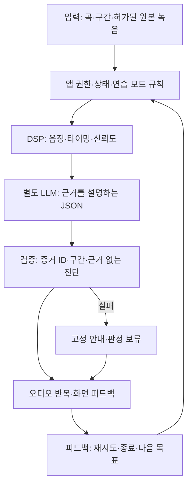

## 1. 페르소나 부여와 시나리오

퇴근 후 아파트 주차장에 도착한 서른한 살 민수는 다음 주 모임에서 부를 노래의 후렴 한 줄을 연습하고 싶지만, 집에서는 가족에게 들릴까 신경 쓰인다. 그는 전문 가수가 되려는 사람이 아니라 좋아하는 곡 한 구간을 덜 불안하게 부르고 싶은 사람이다. 코인 노래방까지 이동하거나 30분을 예약할 생각은 없고, 오늘 차에서 8~12분 정도만 연습한 뒤 집에 들어가려 한다. 자동차를 방음실로 가정하지 않으며 주변에 들릴 수 있다는 현실도 전제한다.

이번 ‘앙코르’는 **혼자 듣고, 주차 후 한 구간을 반복하는 연습**이다. ‘차에서는 혼자 노래할 확률이 높다’는 사용자 가설이며 해외 인접 설문을 한국의 주차 연습 습관으로 확대하지 않는다. 이미 혼자 노래하며 특정 구간을 고치고 싶은 사람을 대상으로 한다.

상황은 두 개로 분리한다. 출근·퇴근 주행 중에는 지원·심사된 Music/Audio 경로로 기준 음원을 **수동으로 듣는 경험**만 제공한다. 운전자에게 따라 부르기, 마이크 녹음, 음정 확인, 질문 응답을 요구하지 않는다. 반복 연습·녹음·시각 피드백은 P 상태가 확인된 뒤 사용자가 별도로 시작하는 세션이다. 두 상황을 하나로 묶어 ‘운전하면서 실력이 느는 AI 코치’라고 홍보하지 않는다.

| 시간·상황 | 민수의 행동과 대사 | 시스템의 동작과 계속 쓰는 이유 |
|---|---|---|
| 이동 전·주행 중 | 출발 전에 “오늘 연습할 후렴”을 골라 둔다. 주행 중에는 원곡 또는 권리 확보된 기준 음원을 듣는다. | 간단한 재생·일시정지만 제공한다. 코칭 질문이나 점수는 나오지 않는다. 허용된 미디어 통합이 없다면 기존 음악 앱으로 듣고 앙코르는 주차 후에만 연다. |
| 주차 후 0~1분 | 민수가 P 상태에서 “후렴 두 번째 줄, 10분만”을 선택한다. | 앞서 고른 구간을 다시 찾지 않도록 이어 준다. 녹음 입력 지원·권한·현재 상태를 확인한다. 자동차 마이크 원본 접근이 안 되면 지원되지 않는다고 명확히 표시한다. |
| 1~3분 | 기준 구간을 한 번 듣고 민수가 8초 정도 노래한다. “끝 음이 자꾸 내려가는 것 같아.” | 반주·노래 신호를 구분할 수 있는 검증된 입력에서만 분석한다. 원본 오디오가 확보되지 않으면 청취·구간 반복 모드로 전환하며 점수를 만들어 내지 않는다. |
| 3~5분 | 결과에 “세 번째 음 끝부분이 목표보다 낮게 유지됐어요”가 표시된다. 민수는 본인 녹음과 기준 구간을 번갈아 듣는다. | DSP가 낸 시간·음정 오차를 바탕으로 해당 부분 하나만 보여준다. LLM은 “이번에는 마지막 2초만 기준음을 듣고 다시 해보세요”처럼 한 가지 제안을 한다. 분석 신뢰도가 낮으면 판단을 보류한다. |
| 5~8분 | 같은 짧은 구간을 두 번 반복한다. 한 번은 좋아지고 한 번은 더 불안정하다. | 전후 결과를 같은 조건으로 비교한다. 음정과 리듬을 모두 고치라는 긴 설명 대신 오늘 선택한 문제 하나에 집중한다. 성과가 없으면 ‘향상’이라는 문구를 붙이지 않는다. |
| 8~10분 | 민수가 “오늘은 여기까지만”을 누른다. | 연습한 구간, 실제 측정 결과, 다음에 이어 들을 위치만 보여준다. 원본 녹음은 사용자가 고른 경우에만 저장하고 전체 공개·자동 공유는 하지 않는다. |
| 다음 이용 | 주차 후 지난 구간을 불러와 한 번 더 해 본다. | 재사용 이유는 새로운 AI 칭찬이 아니라 구간을 다시 찾을 필요가 없고 자신의 두 시도를 비교할 수 있다는 점이다. 출발하려고 P를 해제하면 녹음·분석 UI·연습 재생을 즉시 닫고, 허용된 일반 청취 모드로만 별도 전환한다. |

## 2. 시나리오에서 사용된 콘텐츠의 확장성과 종류

카탈로그를 무한히 늘리기 전에 같은 짧은 곡에서 어떤 반복이 가치 있는지 확인한다. MVP는 팀이 만든 자작곡 3곡과 권리를 확인한 반주·기준 멜로디·가사 구간을 사용한다. 실서비스에서 필요한 음원·가사·반주·편집·녹음·공유 권리 범위는 사용 방식과 계약에 따라 확인하고, 공급 계약 확보를 선행한다. 유명 곡을 모델이 재구성하면 권리 문제가 해결된다고 전제하지 않는다.

| 콘텐츠 | 입력 | 사용자의 행동 | 결과·반복 변주 |
|---|---|---|---|
| **후렴 한 줄 끝 음 잡기** | 곡 ID, 목표 멜로디, 6~10초 구간, 분석 가능한 녹음 | 기준음 듣기 → 한 번 부르기 → 같은 구간 다시 듣기 | 각 시도의 끝 음 유지 구간을 비교한다. 무조건 더 높은 음을 요구하지 않고 다른 구간·다른 곡으로 바꾸거나 종료할 수 있다. |
| **박자 진입 맞추기** | 기준 시작 시각, 박자·구간 메타데이터, 녹음 신호 | 카운트 뒤 짧은 한 줄을 시작한다. | 목표 진입 대비 앞섬·늦음을 표시한다. 템포 변경이 허용되고 구현 검증이 된 자작곡에서만 느린 버전으로 반복한다. STT의 단어 타임스탬프만으로 정확한 보컬 리듬을 평가하지 않는다. |
| **원곡 듣기와 내 녹음 비교** | 권리 확보 기준 오디오, 사용자가 저장한 자기 녹음 | A/B를 번갈아 듣고 ‘다시 해볼 구간’을 직접 고른다. | 분석 성능이 부족해도 제공할 수 있는 기본 가치다. LLM이 음성 특징을 직접 들었다고 주장하지 않고 사용자의 선택을 다음 세션에 반영한다. |
| **모임 전 한 곡 준비** | 곡의 허용된 구간 목록, 남은 연습 시간, 지난 결과 | 도입·후렴 중 한 곳을 선택해 짧게 연습한다. | 10분 안에 한 구간만 마친다. 목표를 달성하지 못해도 전체 곡을 끝까지 부르게 강요하지 않는다. 다음에는 실제 결과가 불안정했던 구간부터 시작한다. |

자작곡의 사용성 결과를 선호곡 서비스의 수요로 해석하지 않는다.

## 3. 실제 자료 조사

| 원문·발표일·조사 범위 | 사실 | 추론과 반증 |
|---|---|---|
| [Cepsa GOW 공식 발표, 현 Moeve 사이트](https://www.moeveglobal.com/en/press/three-out-of-four-spaniards-admit-they-sing-in-their-car), 2023-04-24. 스페인 운전자 2,500명. 표집·조사 기간·문항별 분모 미공개. | 74.3%가 차에서 노래하기를 좋아한다고 발표했다. 63.7%는 혼자 탈 때 노래하기를 선호하고, 배우자와 함께 20.8%, 자녀와 함께 12.5%가 제시된다. | 혼자 노래하기 선호에 직접 가까운 해외 근거다. 한국 전체 운전자·주차 연습·유료 코칭 수요로 확대할 수 없다. 집중이 좋아진다는 응답도 자기평가일 뿐 안전성 검증이 아니므로 제품 근거로 쓰지 않는다. |
| [Fiat / OnePoll 공식 조사](https://www.media.stellantis.com/uk-en/fiat/press/fiat-study-reveals-over-three-quarters-of-brits-admit-to-singing-in-the-car), 2023-04-28. 영국 운전자 2,000명. 세부 조사일·질문지 미공개. | 78%가 차에서 노래하고, 노래하는 사람 중 자기 실력이 좋다고 생각하는 비율은 21%다. 보도자료는 노래 수업을 고려한 응답 18%도 제시한다. | 가벼운 노래 행동과 실력 자신감 사이의 간격은 보인다. 낮은 자신감이 곧 교정 수요라는 결론은 안 된다. 18%를 차량 AI 코칭 구매 의향으로 쓰지 않는다. |
| [Stingray × BYD 공식 발표](https://corporate.stingray.com/products-and-services/next-generations-karaoke-experience-byd/), 2025-09-08. 대상 차량 기능 발표. | 마이크, 점수화, 실시간 음정 보정, 보컬 효과·코칭을 발표했다. 일부 설명은 향후 제공 표현이다. | 차량 보컬 코칭·점수 자체는 신규 아이디어가 아니다. 실제 이용률·효과·전 차종 배포 완료를 입증하지 않는다. |

[Tesla Caraoke 설명서](https://www.tesla.com/ownersmanual/model3/en_ie/GUID-7A85FB6B-9DF6-4C55-A2F9-793207E48E9D.html)와 [Ford Stingray 발표, 2024-09-17](https://corporate.stingray.com/products-and-services/stingray-karaoke-ford/)도 기존 반주·가사 기능을 확인해 준다. 공급 사례는 보컬 연습 수요의 증거가 아니다.

국내 조사에서는 이미 차에서 혼자 노래하는 성인 8~12명을 우선 만나고, 주차 후 별도 연습 시간을 실제로 쓰는지부터 확인한다. A는 기존 휴대전화 재생·녹음 방식, B는 동일 음원으로 구성한 앙코르의 구간 반복·비교 흐름이다. 수행 순서를 바꾸고 첫 연습까지 걸린 시간, 구간 탐색 조작 수, 피드백 신뢰도, 7일 내 자연스러운 재사용을 비교한다. 소규모 탐색 결과는 대표 수요 비율이나 가창 향상 효과로 보고하지 않는다.

## 4. Pleos에 적합하고 최적화된 콘텐츠인가

**기술·가치 확인 전까지 보류 가능한 조건부 후보**다. 차 안은 혼자 시간을 확보하기 쉬울 수 있지만 모든 사용자에게 그렇지 않고, 스마트폰도 녹음·반복·분석을 구현할 수 있다. Pleos의 후보 이점은 차량 오디오와 안정적인 재생, 주행 청취에서 주차 연습으로 이어지는 상태 전환, 별도 기기를 들지 않는 조작이다. 큰 화면이나 AI라는 이유만으로 설치할 이유가 생기지는 않는다.

| 이용 모드 | 허용하려는 경험 | 확인해야 할 기술·정책 |
|---|---|---|
| 주행 중 수동 청취 | 기준 음원·일반 음악 듣기, 최소한의 재생 제어 | Music/Audio 분류, 지역 정책, 심사, MediaBrowserService/MediaSession과 미디어 제어 지원을 확인한다. 녹음·점수·코칭 대화·연습 지시는 제공하지 않는다. |
| P 상태의 반복 연습 | 구간 선택, 녹음, 분석 결과, A/B 청취 | P 상태와 CarUxRestrictions 확인, 녹음 권한과 원본 마이크 신호, 오디오 동기화·반주 누설 처리 가능성을 실증한다. |
| 마이크 접근 불가 | 구간 반복·기준음 듣기만 제공 | STT 텍스트로 음정 분석을 흉내 내지 않는다. 휴대전화로 녹음한다면 별도 기기의 역할과 지연·동기화 한계를 드러낸다. |
| 차량 연동 불가 | 독립 스마트폰 원형으로 사용성 평가 | Pleos 구현 성공으로 발표하지 않는다. 차량 전용 이점이 남지 않으면 플랫폼 제안을 보류한다. |

[Pleos 카테고리 정책](https://document.pleos.ai/en/docs/pleos-only/vehicle-app-planning-guide/app-category)은 오디오 소비와 간단한 제어의 제한적 주행 허용 가능성을 설명한다. [주행 제한 구현 안내](https://document.pleos.ai/en/docs/pleos-only/vehicle-app-developer-guide/driving-restriction-development-guide)의 CarUxRestrictions를 기능별로 적용한다. 앱 전체를 무조건 주차 전용으로 묶기보다 청취와 연습을 분리하되, 실제 승인 전에는 주행 재생 가능을 보장하지 않는다.

[SDK 신청 안내](https://document.pleos.ai/docs/pleos-only/create-my-project)는 Control·FusedLocation·STT/TTS를 준비 중으로 표시하지만, [2026-10-19 릴리스 노트](https://document.pleos.ai/docs/pleos-only/release-note/sdk-release-note)는 STT/TTS v3.3.1과 FusedLocation의 배포 버전을 명시한다. **문서 불일치가 있으므로 미제공으로 단정하지 않고** 계정 권한·패키지 접근·초기화·기기 지원을 실증한다. 배포와 참가 계정의 접근 가능성은 구분한다.

NaviHelper의 `remainTime`·`remainDistance`와 `onTripInfo`도 공개되어 있다. 향후 도착 전 청취 길이 조정에 쓴다면 사용 권한·단위·갱신 주기·미수신 처리를 확인하고 전체 경로 polyline은 별도 검증한다. 보컬 MVP의 필수 기능은 아니다. **차량 마이크 원본 오디오의 접근·형식·지연은 아직 미확인**이며 STT 배포가 가창 신호 제공을 뜻하지 않는다. 반주 누설·차량 음성 처리로 인한 분석 오차도 검증해야 한다.

MVP는 반주 누설의 영향을 줄이기 위해 기준음 듣기와 무반주 녹음을 먼저 분리해 검증한다. 외부 마이크·휴대전화가 필요하면 연결 부담까지 스마트폰 대안과 비교한다.

## 5. AI Agent 도입 가능성과 적용 예시

이 서비스에서 **DSP는 측정하고 LLM은 설명한다.** DSP는 원본 오디오의 기본 주파수 추정, 발성 구간, 목표 멜로디 대비 음정 차이, 시간 정렬과 신뢰도를 계산한다. LLM에게 STT 텍스트를 주고 ‘음정이 낮았다’고 판단시키는 구조는 성립하지 않는다. 별도의 검증된 오디오 모델을 쓴다면 그 모델의 출력도 신뢰도·적용 범위를 확인해야 한다. 언어 모델의 그럴듯한 평가는 실제 측정이 아니다.

DSP가 ‘3.2~4.1초에서 목표보다 낮은 음정, 신뢰도 충분’이라고 측정하면 LLM은 “끝음을 기준보다 낮게 유지했어요. 마지막 구간을 다시 들어보세요”라고 설명한다. 신뢰도가 낮으면 판정을 보류하고 호흡·성대 상태·재능을 추측하지 않는다.

| 처리 단계 | 일반 코드·DSP | LLM Agent | 실패 대체 |
|---|---|---|---|
| 목표 선택 | 권리 확보 곡 ID·구간·길이 확인 | “후렴 끝 음” 같은 요청을 허용된 구간으로 구조화 | 터치 구간 선택 |
| 녹음·정렬 | 원본 신호 수집, 기준음과 시간 정렬, 잡음·누설 확인 | 없음 | 분석 없는 A/B 청취 또는 녹음 미지원 표시 |
| 측정 | 음정·시작 시점·유효 구간·신뢰도 계산 | 없음 | 낮은 신뢰도는 판정 보류 |
| 코칭 | 출력 가능한 측정 사실과 제한 목록 제공 | 짧은 설명과 다음 연습 하나 제안 | 검증된 고정 문구 |
| 다음 세션 | 남은 시간·완료 구간·저장 동의 확인 | 이미 확보된 결과를 읽어 연습 순서 추천 | 마지막 구간에서 수동 시작 |

백엔드 JSON은 `target_segment_id`, `observed_issue`, `evidence_ids`, `confidence_band`, `coach_text`, `next_action_id`처럼 제한한다. 출력이 실제 DSP 증거 ID를 참조하는지, 권리 확보된 구간인지, 점수·향상을 새로 지어내지 않았는지 검사한다. 근거 없는 진단은 폐기하고 한 번 수정하거나 고정 안내로 바꾼다. 타임아웃 중에도 정지·종료는 로컬에서 즉시 동작한다. 원본 녹음의 보관·외부 전송은 명시적 선택으로 분리한다.

Gleo는 승인된 기능 호출 인터페이스이며 범용 코칭 LLM이 아니다. `actionCalls` 최대 3개와 승인 스키마를 지키고 분석·생성은 별도 백엔드가 맡는다. 11월 13일에는 자작곡 3곡의 구간 반복·DSP 측정·LLM 설명을 시연한다. 차량 마이크 대신 테스트 오디오를 쓰면 명시하고, DSP 미구현 상태를 가상 측정값으로 숨기지 않는다.

절반 이상이 스마트폰을 더 편하게 느끼거나 원본 입력 분석이 반복 실패하면 차량 전용 개발을 보류한다. 이는 탐색 단계 운영 기준이며 시장 규모·지불 의사·실력 향상은 후속 검증 없이 수치화하지 않는다.

**회의에서 남은 질문:** 실제 차량에서 신뢰할 수 있는 원본 녹음과 구간 반복을 확보했을 때, 사용자가 기존 스마트폰 앱보다 편하다고 느껴 주차 후 연습을 자발적으로 다시 시작하는가?
