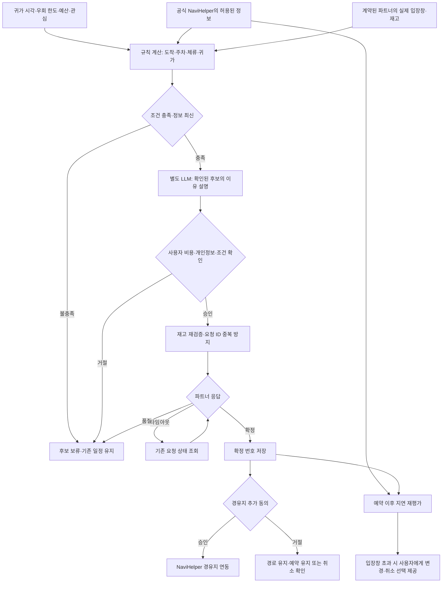

## 1. 페르소나 부여와 시나리오

토요일 오후 3시 40분, 수원에서 서울 집으로 돌아가는 지훈과 소연에게는 오후 6시까지 여유가 있다. 원래 목적지까지 55분. 지훈은 출발 전에 “추가 운전은 10분까지, 집에는 6시 전에, 체험은 둘이 4만원 이하”로 정한다. 소연은 “쇼핑보다 전시나 만들기, 줄 서서 기다리는 건 싫어”를 고른다. 차가 출발한 뒤 앱은 매력적인 장소를 무한히 보여주지 않고, 이 조건에 실제로 맞는 기회가 있을 때만 동승자에게 후보 두 개를 보낸다.

후보 A는 이동 경로 근처 작은 사진전의 16:20–16:40 입장창이다. 차량에서 전시장 주차장까지 예상 16:15–16:22, 주차·이동 여유 8분, 관람 25분, 귀가 예상 17:25. 후보 B는 16:10 도자기 체험이지만 현재 도착이 늦어질 수 있어 제외된다. 이 수치와 재고는 모두 **설계를 설명하는 가상 예시**다. 앱은 실제 제휴 데이터 없이 이런 빈자리가 존재한다고 말하지 않는다.

소연이 “사진전은 25분만 봐도 되고, 주차장도 있어. 집엔 5시 반 전이래”라고 알려준다. 지훈은 “우회 10분 안이면 좋아. 예약 조건은 네가 확인해줘”라고 답한다. 소연은 휴대폰에서 가격·취소 조건·입장 마감·전송할 개인정보를 확인하고 ‘이 자리 요청’을 누른다. 서버가 확정 번호를 돌려준 뒤 지훈이 경유지 추가에 동의하면 기존 내비 경로에 연결한다. 앱은 새 길을 자체 안내하거나 운행을 자동 제어하지 않는다.

사진전 도착 전 정체로 입장창을 놓칠 가능성이 생기면 앱은 “서두르면 된다”고 말하지 않는다. 동승자에게 늦은 입장 허용 여부를 확인하도록 안내한다. 운영자가 변경을 허용하지 않으면 취소 조건을 보여주고, 사용자가 원래 귀가 경로로 돌아갈지 정한다. 기회가 사라져도 원래 여행은 망가지지 않게 설계한다.

1. 출발 전 설정: 최종 귀가 시각·최대 추가 운전·예산·인원·관심 경험·주차 필요를 정한다.
2. 이동 중 매칭: 현재 경로에서 파트너 입장창까지의 도착 범위와 체류 후 귀가 범위를 계산한다. 조건에 맞지 않는 후보는 알리지 않는다.
3. 동승자 확인: 후보는 최대 2개, 왜 맞는지와 어떤 조건이 바뀌는지 함께 보여준다. 주행 중 거래 확인은 동승자 폰에서 한다. 혼자 운전할 때는 출발 전 또는 주차 후 확인한다.
4. 실제 확정: 파트너의 재고 재검증·요청 응답을 받은 경우에만 확정으로 표시한다. 알림·추천·자리 확보를 구분한다.
5. 경로 반영: 사용자 동의 후 공식 내비의 경유지 기능을 이용한다. 비용 증가·귀가 시각 초과·새 경로 변경은 다시 확인한다.

**실패 분기와 구체 결과:** 빈자리가 먼저 팔리면 ‘확정 실패’로 끝내고 같은 요청을 반복 결제하지 않는다. 10분 우회 조건을 넘으면 더 좋은 후기의 장소도 제외한다. 제휴 데이터가 없으면 ‘오늘 가능한 체험 목록’이 아니라 ‘모의 후보’라고 표시한다. 성공 결과는 예약 1건과 경유지 1개, 실패 결과는 아무 거래 없이 기존 경로 유지다. 두 결과 모두 사용자가 다음 행동을 이해할 수 있어야 한다.

<toggle heading="h2">
2. 시나리오에서 사용된 콘텐츠의 확장성과 다양한 종류

- **퇴근길 30분 사진전:** 운영자가 제공한 실제 입장창·권장 관람시간·주차 정보로, 늦은 귀가 부담 없이 짧게 즐길 수 있는 경우만 제안한다.
- **두 명이 남은 공방 체험:** 정해진 시작 시각과 준비 시간이 있는 40분 체험. 도착 범위가 시작 시각보다 충분히 앞설 때만 노출한다.
- **돌아오는 길의 작은 식사:** 식당의 실제 2인 입장창과 예상 식사 길이를 매칭한다. 할인·추천 광고보다 ‘지금 경로에서 무리 없이 가능한가’를 우선한다.
- **지역 양조장·로스터리 투어:** 운전자는 음주가 포함된 체험을 제외하도록 사전 설정하고, 논알코올·커피 체험 등 선택한 조건에 맞는 목록만 제공한다. 운영자의 실제 상품 정보를 사용한다.

콘텐츠의 단위는 글·영상이 아니라 **시간·인원·가격·체류시간이 있는 경험 상품**이다. 공연, 전시, 공방, 맛집으로 확장할 수 있지만 각 업종의 입장 규칙이 달라 파트너 데이터 정규화가 필요하다. 좋은 이야기보다 실제 이용 가능한 재고가 서비스 가치를 좌우한다.
</toggle>

<toggle heading="h2">
3. 실제 자료 조사 — 수요·경쟁·반증

1. **OpenTable 공식, 2020-06-25·2026-11-07 본문 확인.** [Notify Me](https://www.opentable.com/blog/notify-me/). 원하는 날짜·시각·인원으로 빈자리 알림을 설정하고, 자리가 생기면 알림에서 예약 절차로 이동한다. 다른 사람이 먼저 예약하면 해당 자리를 얻지 못할 수 있다. **빈자리 발견과 신속한 예약은 이미 해결되는 문제**다. 차량까지 추가한 서비스의 차별점은 알림 자체가 아니라 실제 도착 가능성과 귀가 제약이다. 이 자료는 Pleos 연동용 API 제공을 뜻하지 않는다.
2. **OpenTable 공식 앱 소개, 게시일 미표시·2026-11-07 확인.** [OpenTable 앱](https://apps.apple.com/us/app/opentable/id296581815). 날짜·시각·장소별 이용 가능 시간 검색, 취향 기반 AI 추천, 막판 빈자리 알림, 예약 관리를 제공한다고 안내한다. 식당 경험 발견까지 기존 앱의 범위이므로 ‘식당에 빈자리가 생기면 추천’만으로 경쟁하기 어렵다. 국내 네이버·캐치테이블과도 같은 검색·예약 경쟁 구도이며, 이들의 연동 권한은 별도 확보해야 한다.
3. **Booking.com 공식 조사, 2025-04-22.** [지역사회와 여행 경험 조사](https://news.booking.com/bookingcoms-2025-research-reveals-growing-traveler-awareness-of-tourism-impact-on-communities-both-at-home-and-abroad/). 34개국 32,000명 대상 조사에서 77%가 지역 문화를 대표하는 진정성 있는 경험을 찾는다고 응답했다. 현지 체험을 찾는 관심의 근거지만, 운전 중 일정을 바꿀 의향이나 예약 전환율을 입증하지는 않는다. 한국 응답자도 포함되지만 여기 인용한 수치는 전체 표본 결과다. **도착창 매칭 서비스의 직접 수요·지불 의사는 미확보**다.
</toggle>

<toggle heading="h2">
4. Pleos에 적합하고 최적화된 콘텐츠인가

**차량에서 강해질 부분:** 이미 실행 중인 내비 경로·현재 목적지·도착 상태를 이용해 ‘지금 갈 수 있는가, 다녀와도 원래 약속에 늦지 않는가’를 계산한다. 후보의 유명세보다 운전자의 우회 허용·주차·최종 도착 제한이 순위를 결정한다. 이는 앱을 여럿 오가며 장소–지도–예약을 맞추는 부담을 줄일 가능성이 있다.

**반론:** 네이버·캐치테이블·OpenTable에서도 장소를 찾고 빠르게 예약할 수 있다. 동승자가 폰에서 예약하고 지도 경유지를 추가하는 일이 어렵지 않다면 새 앱은 불필요하다. 운전 중 갑자기 일정이 바뀌면 기대감보다 피로가 커질 수 있다. 따라서 기회 알림은 출발 전 선택한 사용자에게만, 기본 최대 1회로 제한하는 설계가 필요하다. 기회를 놓칠까 서두르게 만드는 카운트다운·경쟁 문구는 쓰지 않는다.

**기존 수상작과 구분:** 현대차의 ‘(현)대신 웨이팅’은 ETA에 맞춘 식당 웨이팅 접수 아이디어다. [공식 소개, 2026-10-08](https://www.hyundaimotorgroup.com/ko/story/hyundai-motor-company-pleos-connect-app-idea-contest). 새 안은 사용자가 정한 여유시간·추가 운전·원하는 경험과 파트너의 입장창을 함께 만족시키는 ‘작은 외출’을 제안한다. 다만 레스토랑만 연결하면 차별성이 다시 작아진다.

**기술 근거:** [NaviHelper 이벤트](https://document.pleos.ai/en/docs/pleos-only/connect-sdk-pleos/NaviHelper/event-listeners)와 [2026-10-19 릴리스](https://document.pleos.ai/en/docs/pleos-only/release-note/sdk-release-note)는 경로·목적지 이벤트, remainTime/remainDistance 관련 모델 변경을 명시한다. 경유지 요청도 공개 SDK의 범위다. 다만 임의 후보 전체에 대한 다중 경로 ETA 계산·정확한 갱신 빈도는 확인되지 않아 별도 지도 파트너 또는 제한된 후보 비교가 필요하다. [내비 정책](https://document.pleos.ai/en/docs/pleos-only/vehicle-app-developer-guide/navigation-app-development-guide)은 단일 경로와 사용자 선택에 따른 전환을 요구한다. 정산·재고 확보·예약 API는 Pleos 기능이 아니다.

**MVP와 판정:** 한 지역의 모의 경험 5개, 우회·귀가시간 필터, 후보 2개, 동승자 폰 확인, 성공/품절/지연 분기를 시연한다. 실제 파트너 계약이 없으면 접수·결제를 수행하지 않고 모의 상태를 명확히 표시한다. 실시간 재고 확보와 상용 제휴에 의존하므로 **조건부·후순위**다. 엔터테인먼트만 요구하는 출품 방향이라면 부적합할 수 있으며, 여정 서비스로 범위를 넓히는 데 동의할 때만 발전시킨다.
</toggle>

<toggle heading="h2">
5. AI Agent 도입 가능성 및 적용 예시

**계획:** ‘집에 6시 전, 우회 10분 이내, 2인 4만원 이하, 만들기·전시 선호’를 제약조건으로 정리하고 가능한 후보를 찾는다. **상태:** 원래 목적지·ETA 수신 시각·추가 운전 한도·파트너 재고 버전·요청 ID·예약 상태·사용자 동의를 저장한다. **도구:** 내비 정보 어댑터, 경험 카탈로그, 허용된 지도 계산, 계약된 재고/예약 API를 사용한다. 시간 가능성·가격·재고는 규칙으로 계산하고 LLM은 이유 설명과 조건 질문을 맡는다.

**적용 예시:** 후보 5개 조회 → 도착·체류·귀가 가능 후보 2개 필터 → 동승자에게 ‘사진전은 귀가 17:25, 추가 운전 7분’ 설명 → 사용자 확인 → 재고 재검증 → 파트너 확정 → 운전자 경유지 동의 → 내비에 반영. 이 숫자는 데모에서는 모의라고 표시한다.

**실패 처리:** 품절이면 대체 예약을 자동 실행하지 않는다. 요청 타임아웃이면 같은 거래를 다시 만들기 전에 기존 요청 ID의 상태를 조회한다. ETA가 오래됐으면 후보를 잠정 보류한다. 경로가 늦어져 입장창을 넘으면 조건 변경·취소를 확인하며 속도를 올리라는 조언을 하지 않는다. 네트워크가 끊기면 기존 예약 정보를 로컬로 보여주되 최신 재고로 표시하지 않는다.

**사용자 확인:** 개인정보 전달, 유료 예약·보증금, 취소 조건, 경로 변경은 실행 전에 확인한다. Gleo는 승인된 ‘후보 듣기/선택 보류/세션 종료’ 등 입력을 담당하고, 거래 판단과 외부 도구 실행은 별도 에이전트가 관리한다.

**Agent 기술 파이프라인**

NaviHelper는 공식 SDK이며, 시간 계산·LLM 설명·요청 ID·중복 방지·거래 상태 관리는 **자체 설계**다. 파트너 재고·예약·결제는 Pleos API가 아니라 계약된 외부 연동이다. 계약이나 실제 API가 없으면 재고·확정 번호·품절 응답 모두 **모의**로 표시하고 실제 접수는 하지 않는다. 공식 SDK에 임의 후보의 전체 경로 계산 기능이 있다고 가정하지 않는다. 도착창 계산은 검증한 데이터 범위에서만 수행하며, 외부 지도 계산이 필요하면 별도 연동 조건을 확인한다. 거래 확인은 출발 전·주차 후 또는 동승자 폰에서 진행한다.

**핵심 미결 질문:** 실제 운전자·동승자가 ‘오늘 예정에 없던 30분 외출’을 원하는 순간이 충분히 자주 있고, 그때 품질 좋은 실제 빈 입장창을 제공할 파트너를 확보할 수 있는가?
</toggle>