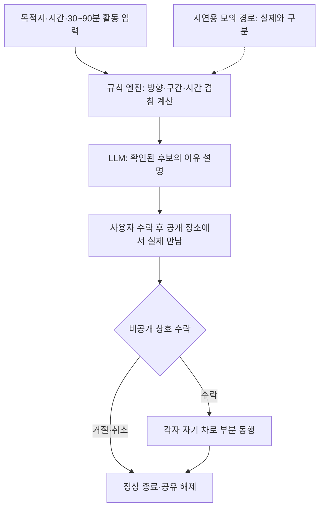

## 1. 페르소나 부여와 시나리오

**가칭 ‘같이길’: 목적지는 달라도, 겹치는 여행 한 구간은 함께.** 같은 권역의 새로운 사람을 익명 기본 프로필과 짧은 사전 조사로 추천받고, 공개된 첫 만남 장소에서 실제로 만나 동행 여부를 정한다. 기본 단위는 카페·산책 등 30~90분의 활동 하나다. 활동이 끝나면 자연스럽게 헤어지며, 당일 전체 동행을 요구하지 않는다. 각자 자기 차로 이동한다. 카풀, 앞차를 따라 달리는 대열 주행, 운전자 상시 음성 채팅은 핵심 경험에 포함하지 않는다.

31세 서윤은 혼자 동해안으로 여행하지만 카페에서 한 시간은 새로운 사람과 이야기하고 싶다. 준호의 최종 목적지는 속초, 서윤은 양양, 민지는 남쪽의 숙소다. 겹치는 오전 구간의 활동 하나만 함께한다. 아래 인물·경로·시간은 가상이며 실제 소요시간·매칭 성공률이 아니다.

**출발 전 5분: 내가 원하는 동행의 크기를 정한다.** 서윤은 집에서 휴대폰으로 목적지 권역, 출발 시간대, 추가 이동 허용 시간, 활동 하나, 함께할 시간을 고른다. ‘카페’, ‘60분’, ‘조용한 대화’, ‘최대 3명’, ‘활동 후 각자 여행’을 선택한다. 30·60·90분은 약속 길이이며 머무를 의무가 아니다. 프로필에는 별명, 성인 여부 확인 상태, 명시적 관심사와 동행 원칙만 보인다. 실명·전화번호·집 주소·정밀 현재 위치는 추천 카드에 나오지 않는다. 인증 표시가 안전성을 보증한다고 설명하지 않는다.

**출발 전 3분: 조건이 맞는 방을 본다.** ‘동해권 오전, 카페 60분’ 방에 공통 이동 구간, 시작 시간 창, 활동, 정원, 첫 만남 장소가 보인다. “98% 일치” 대신 “시간이 겹치고, 카페를 원하며, 추가 이동 허용 범위 안에 있는 후보”처럼 확인 가능한 이유를 보여준다. 방이 없으면 다른 시간대나 직접 만들기를 선택한다. 가짜 참가자를 넣지 않는다.

**출발 전 확인: 방 참여와 실제 동행을 구분한다.** 서윤은 방의 조건을 보고 ‘첫 만남 참여’를 누른다. 다른 사람은 참여 요청을 수락하거나 거절할 수 있다. 첫 만남은 접근 가능한 공개 장소의 주차장에 인접한 카페 등으로 정하고, 영업 여부·주차 가능 여부는 확인된 자료가 없으면 직접 확인이 필요하다고 표시한다. “만나보고 정하므로 여기서 동행을 약속하는 것은 아니다”라는 조건을 모두 확인한다. 특정 집이나 외진 지점을 첫 만남 장소로 제안하는 기능은 MVP에서 두지 않는다.

**이동 중 20분: 운전자는 매칭 화면을 보지 않는다.** 출발하면 방 탐색·프로필 비교·참여 승인·채팅 입력은 차량 화면에서 잠긴다. 이미 수락한 공개 장소는 지원이 확인된 내비 연동 경로로 넘긴다. 주행 중에는 기존 내비 안내와, 별도 허용 범위가 확인된 최소 도착 상태 안내만 사용한다. 상대의 정밀 이동 궤적이나 “곧 따라잡을 수 있다”는 표시를 보여주지 않는다. 동승자가 있다면 자체 모바일 웹에서 예정 시간 변경 요청을 검토할 수 있지만, 운전자가 즉시 답해야 한다는 알림은 보내지 않는다. 늦는 사람 때문에 다른 차가 속도를 높이는 구조를 만들지 않는다.

**첫 만남 10분: 추천을 실제 판단으로 바꾼다.** 각자 주차한 후 공개 장소의 정해진 구역에서 공통 만남 코드를 확인한다. 차 번호나 얼굴 인식으로 상대를 찾지 않는다. “함께할 활동과 종료 시각”을 확인하고 짧게 대화한다. 서윤·준호는 카페 60분을 원하지만 민지는 만나보니 혼자 쉬고 싶다. 앱은 선택을 정리하며 성격이나 궁합을 판정하지 않는다.

**서로 따로 결정: 안 맞아도 편하게 끝낸다.** 각자가 ‘카페 동행 수락’ 또는 ‘오늘은 따로 여행’을 비공개로 고른다. 제한시간과 거절 순위는 없다. 서윤·준호는 서로 수락한 뒤 활동을 확정하고 민지는 이유를 설명하지 않고 나간다. 타인의 선택을 무단 공개하지 않는다. 모두 거절해도 패널티 없이 위치 공유와 알림을 종료한다. 괴롭힘·강요는 차단·신고할 수 있다.

**동행 확정 후: 각자 자기 차로 활동에 간다.** 같은 장소에서 활동을 이어도 되고, 합의한 카페로 각자 내비를 이용해 이동해도 된다. 다른 경로를 택해도 괜찮다. 공통 구간에서 원하면 미리 선택한 지역 오디오를 듣되 응답이나 통화를 요구하지 않는다. 다시 주차한 뒤 카페에서 한 시간을 함께한다. 수락 후에도 참여를 취소할 수 있다.

**활동 종료: 헤어짐은 기본이고, 연장은 다시 동의한다.** 약속한 60분이 끝나면 ‘오늘의 카페 동행 완료’로 방을 정리한다. 혼자 여행을 계속하는 사람은 거절 이유를 설명하지 않아도 된다. 다른 활동은 원한 사람끼리 새로 제안·수락해야 하며 자동 연장하지 않는다. 감사 한 줄과 친구 추가도 선택이다. 상호 친구 수락 후에만 이후 초대를 허용하고, 상시 위치공유로 전환하지 않는다. 최종 목적지·귀가 경로를 공개하지 않고 현재 여행방을 닫는다.

<toggle heading="h2">
2. 시나리오에서 사용된 콘텐츠의 확장성과 다양한 종류

| 콘텐츠 유형 | 입력 | 사용자가 하는 행동 | 남는 결과 |
|---|---|---|---|
| 짧은 활동 동행방 | 목적지 권역, 시간, 식사·산책·전시 등 활동, 추가 이동 허용량 | 방을 비교하고 공개 장소에서 만난 뒤 활동 하나를 수락 | 하루 전체 약속 없이 성립한 부분 동행과 합의한 종료 지점 |
| 테마 여행방 | 사진·풍경·카페·반려동물 동반 등 명시적 관심사와 필요한 조건 | 참가 전에 조건을 확인하고 현장에서 서로의 기대를 조정 | 같은 주제를 다른 목적지에서도 반복할 수 있는 방 템플릿 |
| 첫 만남 대화 카드 | 각자가 직접 고른 기대 활동과 참여 시간 | 주차 후 짧게 대화하고, 함께할 활동을 비공개로 선택 | 합의·불합의가 드러나는 활동표. 성격 점수나 매력 순위는 만들지 않음 |
| 구간 여행 기록·지역 오디오 | 승인된 활동명·공개 관광 정보·참가자가 남긴 한 줄 | 주행 시 허용된 미디어로 청취하고, 주차 후 기록을 승인 | 해당 구간의 짧은 여행기와 선택적 친구 관계. 타인의 발언·사진은 별도 동의 |

확장은 먼저 특정 주말·행사·관광 권역에 집중한다. 전국 모든 길에서 방이 생기길 기대하기보다, 실제 여행 수요가 모이는 시간에 점심·산책처럼 짧은 활동을 구성한다. 반려동물·아이 동반 등은 공개 여부를 이용자가 정하고 필요한 조건만 사용한다. 개인 특성을 추론해 자동으로 누군가를 배제하지 않는다. 초기의 성인 이용자 실험에서 만남과 거절 흐름을 검증한 후 동반 가족 등 복잡한 형태를 검토한다.

주요 마찰은 회원가입보다 일정 조율, 우회 시간, 현장 어색함, 취소와 무응답이다. 상대가 오지 않으면 사용자가 정한 기다림 한도를 넘겨 대기하도록 유도하지 않는다. 반복 취소 이력은 확인 가능한 사건과 이의 제기 절차를 전제로 다뤄야 하며, 후기 몇 개로 ‘안전한 사람’이라고 표시하지 않는다. 운영 대응이 준비되지 않았다면 공개 베타 범위를 늘리지 않는 것이 설계 조건이다.
</toggle>

<toggle heading="h2">
3. 실제 자료 조사 — 수요·경쟁·반증

2026-11-07 원문 본문을 확인했다. 아래 자료는 여행 동행 또는 그룹 드라이브의 인접 행동을 보여줄 뿐, 한국에서 이 매칭 모델의 성공률이나 재사용률을 입증하지 않는다.

| 1차 자료·발표일 | 직접 확인한 사실 | 관련성과 한계 |
|---|---|---|
| [Porsche ROADS 공식 발표](https://newsroom.porsche.com/en/2023/products/porsche-roads-by-porsche-app-update-31243.html), 2023-02-17 | 당시 사용자 18만 명 이상이며 경로 공유, 공개·비공개 그룹을 통한 드라이브 조직을 소개했다. | 각자 차로 함께 드라이브하는 인접 사례다. 전체 앱 사용자 수이지 낯선 사람 매칭 완료자·활성 이용자가 아니다. 브랜드 애호가 맥락의 차이도 있다. |
| [트립소다 공식 모집 안내](https://tripsoda.tistory.com/35), 2025-03-21 | 일정·루트 등 조건을 맞추기 어려운 이용자를 정해진 날짜에 모으며, 6명 모집 시 확정하는 여행상품을 소개했다. | 여행 동행의 조건 조율과 밀도 문제를 보여준다. 해외 다일 투어이고 운영사가 차량 등을 제공하는 상품이므로 각자 자가용 부분 동행과 다르다. |
| [Life360 자사 조사](https://www.life360.com/en-gb/blog/gen-z-location-sharing-study), 2023-08-24, 수정 2024-01-30 | 미국 성인 1,200명 조사에서 Gen Z 응답자의 87%가 장거리 운전 시 위치공유를 사용한다고 설명한다. | 여행 위치공유의 인접 근거다. 세부 연령 표본과 표집 정보가 충분히 공개되지 않았고, 주로 친지 간 공유여서 낯선 사람 공개 의향을 증명하지 않는다. |
| [ACM CCS 위치공유 연구 원문](https://cccblog.org/wp-content/uploads/2024/12/Interpersonal-Discomfort-Study.pdf), 2024-10-14~18 학회 | 3,000명 스크리닝, 사용자 896명 설문, 부정 경험자 23명 인터뷰를 통해 지속 위치공유의 경계 침범·불편을 분석했다. | 여행 단위 공유·종료권을 설계할 근거. 부정 경험자 인터뷰를 전체 이용자의 피해율로 바꾸어 해석하지 않는다. |
| [현대차 기존 아이디어 소개](https://www.hyundaimotorgroup.com/ko/story/hyundai-motor-company-pleos-connect-app-idea-contest), 2026-10-08 | ‘로드시그널’은 유사 경로 운전자 소개, ‘마! 어데고!’는 친구 위치·목적지 공유로 설명된다. 당시 아이디어 단계다. | 유사 경로 추천만으로는 차별성이 약하다. 첫 만남 후 상호 결정, 부분 활동·서로 다른 최종 목적지, 관계 종료 흐름을 구체적으로 보여줘야 한다. |

카풀 실적을 이 서비스의 수요로 대체하지 않는다. 비용을 나누는 카풀과 달리 사용자는 추가 이동과 낯선 만남의 부담을 감수해야 한다. 현재 매칭 정확도, 한국의 잠재 이용자 수, 결제 의향, MAU와 유지율은 모른다. 검증에서는 ‘추천 카드 클릭→첫 만남 참여 수락→실제 도착→활동 상호 수락→활동 완료’를 단계별로 기록한다. 방을 추천한 것을 여행메이트를 찾은 성공으로 세지 않는다. 후속 여행 기회가 있었던 사람의 재사용을 따로 보아야 낮은 여행 빈도와 제품 불만을 구분할 수 있다.
</toggle>

<toggle heading="h2">
4. Pleos에 적합하고 최적화된 콘텐츠인가

**판정은 조건부 적합이다.** 여행방 탐색과 관계 형성만 놓고 보면 휴대폰이 더 자연스럽다. 목적지·시간·진행 구간을 차량의 이동 맥락과 연결하고, 출발 후 복잡한 매칭 조작을 멈추며, 합의된 장소 안내와 여행 미디어를 이어주는 부분에서 차량 앱의 이유가 생긴다. 차량 탑재가 매칭 밀도를 자동으로 높이거나 신뢰를 보증하지는 않는다. 모바일 검색과 같은 화면을 옮기는 데 그친다면 Pleos 전용 콘텐츠로의 우선순위는 낮다.

출발 전·주차 시에는 추천·수락·취소를 하고, 주행 중에는 승인된 내비·미디어의 최소 기능을 이용한다. [Pleos 앱 카테고리](https://document.pleos.ai/en/docs/pleos-only/vehicle-app-planning-guide/app-category)는 음악 청취와 단순 재생 제어, 내비 안내의 제한적 주행 사용 가능성을 명시한다. 이것이 소셜 매칭 화면·실시간 게임까지 허용한다는 뜻은 아니다. 같이길은 사회적 연결이 중심이므로 보조 오디오를 붙여 Music/Audio 분류를 받는다고 가정하지 않는다. 소셜 기능과 주행 시 제공할 기능의 범위는 실제 앱 심사에서 확인한다.

[SDK 신청 안내](https://document.pleos.ai/docs/pleos-only/create-my-project)와 [최신 릴리스](https://document.pleos.ai/docs/pleos-only/release-note/sdk-release-note)의 상태 표기가 다르다. STT/TTS/FusedLocation을 미출시로 단정하지 않으며, 참가 계정의 제공·권한과 대상 기기 동작을 확인한다.

NaviHelper의 `onTripInfo`, `remainTime`·`remainDistance`는 공개돼 있다. [이벤트 문서](https://document.pleos.ai/en/docs/pleos-only/connect-sdk-pleos/NaviHelper/event-listeners)를 기준으로 단위·갱신·누락 처리와 경로 중첩 계산에 필요한 좌표 범위를 실증한다. 검증 전에는 모의 경로를 표시한다. [CarUxRestrictions](https://document.pleos.ai/docs/pleos-only/vehicle-app-developer-guide/driving-restriction-development-guide)를 기능별로 적용해 매칭 UI를 잠그며, 허용된 미디어 청취와 구분한다.

11월 13일까지는 3명의 가상 참가자와 2개의 차량 클라이언트로 방 추천, 공개 만남 장소 확인, 거절, 부분 동행 확정, 종료를 시연하는 것이 현실적인 범위다. 실제 낯선 사람의 공개 모집과 운영 검증은 별도 단계다. 모의 경로·가상 참가자·실제 LLM 편집을 화면에 구분한다. 이 MVP는 매칭 알고리즘의 정확도나 실제 수요를 입증한 결과가 아니라 핵심 의사결정 흐름을 검토할 재료다.
</toggle>

<toggle heading="h2">
5. AI Agent 도입 가능성 및 적용 예시

Agent의 역할은 ‘사람을 알아서 만나게 하기’보다 조건을 정리하고 후보와 합의를 설명하는 것이다. “바다 보러 가고 점심까지만 같이하고 싶어”를 `activity=meal`, `end_window`, `region`, `detour_budget` 같은 필드로 바꾸되 빠진 값은 확인한다. 규칙 엔진은 도로 진행 방향, 공통 구간, 시간 창, 우회 한도, 방 정원을 계산한다. LLM이 실제 지도 없이 경로가 겹친다고 판정하거나 성격·안전성을 추정하지 않는다.

도구는 `normalize_trip`, `find_candidate_rooms`, `compare_route_windows`, `read_public_meeting_place`, `draft_activity_agreement`, `close_trip_session`으로 나눈다. 이름은 자체 백엔드 설계안이며 Pleos 공식 API가 아니다. Agent가 읽는 도구와 사용자의 확인 후 실행하는 도구를 분리한다. 방 참여·만남 장소 확정·위치 공개·동행 수락·친구 추가는 사용자가 결정한다. 도구 결과에는 계산 시각과 데이터 출처, 모의 여부를 붙인다.

만남은 현장에서 확인한다. 거절은 정상 종료이며 동행·연장·새 그룹은 명시 수락이 필요하다.

LLM 응답은 후보 ID, 추천 이유, 미확인 조건, 활동 합의 초안의 JSON으로 받고 존재하는 방·장소 ID와 원문을 검증한다. 위치 응답이 오래되거나 경로 계산이 실패하면 ‘조건 확인 불가’로 낮추고 수동 확인을 제공한다. 생성 오류 시 정해진 카드 문구를 사용하며, 낮은 후보 수를 숨기기 위해 조건을 몰래 완화하지 않는다. 차단·신고한 상대는 이후 후보에서 제외하고, 콘텐츠 검수 실패는 운영 검토 대상으로 보낸다.

Gleo는 스키마 검토 승인 후 사용하는 기능 호출 입구다. [App Schema](https://document.pleos.ai/docs/pleos-only/app-integration-guide/guide/app-capability)의 등록 `actionCalls`는 최대 3개이므로 방 열기·내 활동 확인·여행 종료 정도를 후보로 두고 상세 매칭은 주차 UI에서 한다. 별도 LLM 백엔드가 설명과 합의 초안을 작성한다. 승인되지 않은 기능을 일반 음성 대화로 우회하지 않는다.

**미결 질문: 30~90분의 부분 동행을 위해 사용자가 허용할 첫 만남 장소까지의 추가 이동 시간은 어느 정도인가?**
</toggle>