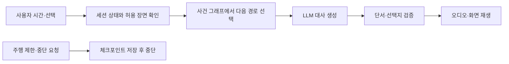

## 1. 페르소나 부여와 시나리오

**민재, 29세. 퇴근 후 지하 주차장에서 지인을 12분 기다린다. 지금 원하는 것은 휴식 치료나 집중력 훈련이 아니라, 짧은 시간이 심심하지 않게 지나가는 것이다.** 이 안은 기존 ‘캐빈 퀘스트’를 ‘짧은 틈새 놀이’로 다시 정의한 검토안이다. 주력 후보에서는 보류한다.

민재는 평소라면 휴대폰으로 짧은 영상을 본다. 이번에는 차량 화면에서 ‘12분짜리 잠수함 무전’을 고른다. 자동차 스피커가 무전 소리를 재생하고, 화면에는 무전기의 채널과 두 개의 선택만 나온다. “상대가 보낸 숫자 중 하나가 좌표인지, 시간인지 골라 보세요.” 민재가 시간이라고 답하자 다음 대사가 바뀐다. 마지막 3분에는 지인이 곧 도착한다는 연락이 와 ‘지금 끝내기’를 누른다. 앱은 아직 모은 단서 안에서 짧은 결말을 보여 준다. 출발할 때는 중단한다.

이 시나리오는 성립하지만, **왜 유튜브·모바일 게임·오디오북 대신 이 앱을 켜는지 아직 설득하지 못한다.** 큰 화면과 좋은 스피커는 도움이 되지만, 익숙한 휴대폰 콘텐츠를 포기할 정도의 이유인지 불명확하다. 문제를 맞혀야 하므로 ‘푹 쉬는 휴식’이라고 설명하는 것도 부적절하다. 12분이라는 길이는 설계 가정이며 조사로 확인한 최적 길이가 아니다.

| 순간 | 사용자가 하는 일 | 시스템이 하는 일 | 납득되지 않으면 중단할 가설 |
|---|---|---|---|
| 대기 시작 | 5·10·15분 중 선택 | 선택 시간에 맞는 완결 사건 불러오기 | 앱을 켜고 시간까지 고르는 수고가 가치보다 크지 않은가 |
| 중간 | 한두 번의 선택 또는 단서 추리 | 검수된 사건 안에서 대사·결과 변경 | 영상 소비보다 더 재미있다는 증거가 있는가 |
| 지인 도착 | 짧게 끝내기 또는 저장 | 결말 축약·진행 저장 | 중단 복구는 모바일 앱도 가능한데 왜 차량 앱인가 |

<toggle heading="h2">
2. 시나리오에서 사용된 콘텐츠의 확장성과 다양한 종류

종류를 늘리면 이용 장면은 설명할 수 있다. 다만 종류가 많다는 사실이 차량 적합성을 해결하지는 않는다.

| 구체적인 콘텐츠 | 실제 한 회차에서 하는 일 | 결과·변주 | 차량을 써야 할 이유의 한계 |
|---|---|---|---|
| 잠수함 무전, 8분 | 세 번의 무전에서 맞는 신호를 골라 생존자를 찾는다 | 구조 대상과 무전 순서가 달라짐. 끝내기 요청에는 확인한 정보만으로 결말 제공 | 차의 밀폐감·스피커는 분위기를 만들지만 이어폰으로도 재현 가능 |
| 정차한 우주선, 10분 | 두 사람이 각각 받은 단서를 설명해 항로를 고른다 | 한 명은 별자리, 다른 한 명은 연료 조건을 보며 협동 | 함께 설명하는 재미는 있지만 실내 보드게임·모바일 협동 게임과 차이가 약함 |
| 라디오 탐정, 5분 | 용의자 세 명의 짧은 증언을 듣고 모순 하나를 찾는다 | 난도·사건 테마만 바뀌며 별도 장비 없이 실행 | 가장 만들기 쉽지만 차량 고유성은 가장 약함 |
| 선택형 코미디, 7분 | 정답 없이 주인공이 할 말을 고른다 | 선택에 따라 다른 농담과 엔딩. 피곤한 사용자는 듣기만 가능 | 인지 부담은 낮지만 휴대폰 인터랙티브 오디오와 직접 경쟁 |

사운드와 좌석·조명을 맞춰 연출하면 차량의 장점이 커질 수 있다. 그러나 미공개 제어 기능과 지원 차종을 핵심 전제로 놓으면 지금의 공모전 구현안은 약해진다. 미래 기능을 붙여 현재의 부족한 가치를 설명하지 않는다.
</toggle>

<toggle heading="h2">
3. 실제 자료 조사 — 수요·경쟁·반증

| 출처 | 확인한 사실 | 이번 안에 대한 해석과 반증 |
|---|---|---|
| [DTS/Xperi 조사 발표, 2024-12-04](https://investor.xperi.com/news/news-details/2024/DTS-Reports-Vehicle-Ownership-and-Role-as-Third-Space-Remain-Important-as-Consumers-Increase-Video-Consumption/default.aspx) | 미국 차량 소유·리스 성인 3,217명의 온라인 조사에서 차를 개인 공간으로 쓰고 주차 중 콘텐츠를 소비하는 행동이 나타남 | 차 안 체류 수요의 근거다. 퀘스트·방탈출·AI 게임 수요의 근거는 아니다. 해외·공급자 후원 자기보고 조사 |
| [BMW·AirConsole·Mattel UNO Car Party 발표, 2024-08-15](https://www.press.bmwgroup.com/global/article/detail/T0444302EN/mattel-airconsole-and-bmw-group-announce-world-premiere-of-uno%C2%AE-car-party-for-in-car-gaming) | 차량 화면과 각자의 스마트폰을 사용하는 주차형 공동 게임 소개 | 차량 놀이가 이미 있고, 스마트폰 연결·대형 화면만으로 차별화하기 어렵다. 출시 대상 차량 수는 활성 이용자 수가 아님 |
| [Asahi Kasei 조사 설명, 2024-12-11](https://asahi-kasei.eu/consumer-survey-automotive/) | 미래 자율주행 차량에서도 음악·대화와 조용한 객실에 대한 선호가 중요하다고 설명 | 자율주행 시대에는 모두 게임을 할 것이라는 확장 논리를 반박한다. 한국의 현재 대기 상황을 직접 조사한 자료는 아님 |

확인된 것은 ‘차에서 기다리고 콘텐츠를 소비하는 사람도 있다’까지다. 이 안을 계속하려면 차량 대기 경험이 있는 사용자에게 같은 10분 동안 휴대폰의 자기 콘텐츠와 이 체험 중 무엇을 실제로 고르는지 비교해야 한다. 호감 질문만으로는 충분하지 않다.
</toggle>

<toggle heading="h2">
4. Pleos에 적합하고 최적화된 콘텐츠인가

**결론: 독립 공모전 주제로는 적합성이 약하다. 현재 후보에서는 보류한다.** 자동차를 무대로 꾸민다는 이유만으로 차량 특화가 되지는 않는다. 차량 데이터가 없어도 사건과 선택이 그대로 작동하기 때문이다.

| Pleos 요소 | 만들 수 있는 가치 | 현재 판단 |
|---|---|---|
| 주차·주행 상태와 UX 제한 | 출발 시 중단·재개를 올바르게 처리 | 필요한 플랫폼 대응이지만 독창적인 콘텐츠 가치 자체는 아님 |
| 스피커·화면 | 함께 듣고 하나의 장면을 보는 공간감 | 장점은 있으나 폰+블루투스 스피커와 비교해야 함 |
| Vehicle State 충전 상태 | 충전 중 콘텐츠 제안·종료 맥락 | 지원 확인 필요. 충전 종료가 곧 출발 의사인 것은 아니며 이용을 강제 종료하지 않음 |
| 공조·조명·시트 | 잠수함·우주선 분위기를 객실에 구현할 가능성 | 현재 일반 개발자 접근을 전제할 수 없어 MVP의 핵심으로 채택하지 않음 |

게임·영상의 차량 화면 사용은 [운전자 주의 분산 심사 가이드](https://document.pleos.ai/en/docs/pleos-only/distribute/app-review-guide/review-driver-distraction-elements)의 제한을 따른다. 이 콘텐츠에 주차 조건을 적용하는 것은 자연스럽지만, 가족 주행 콘텐츠까지 같은 조건으로 묶는 것과는 다른 문제다.

살릴 수 있는 경로는 ‘게임 플랫폼’ 단독 출품보다, 향후 권한을 확보한 특정 차종·전시 공간에서의 체험 콘텐츠다. 현재 일정에서는 가족 이동·여행 메이트·공동 라디오 등 이동 맥락이 실제로 경험을 바꾸는 후보에 자원을 먼저 배분한다.
</toggle>

<toggle heading="h2">
5. AI Agent 도입 가능성 및 적용 예시

AI를 넣을 수는 있다. 사용자의 시간과 선택을 기억하고, 사건 그래프에서 다음 장면을 고르고, 이미 확인된 단서를 바탕으로 결말 길이를 바꾸는 진행자가 된다. 하지만 ‘AI가 가능하다’는 판단과 ‘차량 서비스로 해야 한다’는 판단은 별개다.

예를 들어 ‘2분 안에 끝내줘’ 요청을 받으면 Agent는 현재 장면과 필수 단서를 조회하고, 제작자가 허용한 단축 결말을 선택한다. 모델이 정답을 새로 만들어서 시간을 줄이는 방식은 쓰지 않는다. 네트워크가 끊기면 로컬 결말을 사용한다. Gleo 연동은 승인된 앱 시작·변경·종료의 입구이며 사건 생성은 별도 서버 역할이다.

**회의에서 남은 질문:** 차량 조명·좌석·특수 음향 없이도 휴대폰보다 다시 하고 싶은 장면을 만들 수 있는가? 현재 답이 없으므로 이 안을 살리기 위해 기능을 계속 붙이지 않는다.
</toggle>