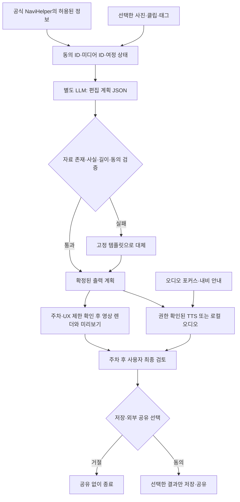

## 1. 페르소나 부여와 시나리오

주말마다 여행하는 32세 운전자 민수와 동승자 유나는 사진은 많지만 함께 본 장면의 이야기를 잘 남기지 못한다. 이번 강릉 여행에서는 유나가 출발 전에 ‘오늘의 영화’를 연다. 돌아오는 차 안에서 함께 들을 3분짜리 회고와, 도착 후 볼 60초 예고편을 선택한다.

바다에 도착했을 때 유나는 휴대폰으로 사진 한 장을 찍어 공유 목록에 넣는다. 이동 중 기억할 장면이 나오면 승인된 Gleo 입력 또는 동승자의 허용된 입력으로 ‘이 순간 표시’를 남긴다. 이 동작은 시각과 짧은 태그를 남길 뿐 차량 카메라를 켜지 않는다. 귀가 길에서 둘은 사진을 들여다보는 대신 ‘오늘 여행의 오프닝’을 함께 듣는다. 내비게이션 안내가 나오면 이야기가 잠깐 멈춘다. 집에 도착한 뒤 두 사람이 남길 장면과 제외할 장면을 확인하면 사진·짧은 클립·여행 챕터를 엮은 예고편이 완성된다. 공유는 마지막에 직접 선택한다.

1. 출발 전: 참여자 동의, 오디오 길이, 공유할 사진 범위를 선택한다.
2. 여행 중: 사용자 선택 미디어와 순간 표시를 모은다. 운전자에게 촬영·영상 확인·응답을 요구하지 않는다.
3. 귀가 주행: 현재 여정의 남은 시간에 맞춰 완결 가능한 오디오 회고를 재생한다. 시각 편집 화면은 제한한다.
4. 도착 후: 원본 포함 여부·인물·위치 노출을 확인하고 60초 예고편을 만든다.
5. 동승자 창: Connect-W에서 지원되는 창을 활용하되 주행 중 이미지 선택·영상 미리보기 허용 여부는 별도 확인한다. 불확실하면 동승자 폰이나 주차 후 화면으로 옮긴다.

**실제 에피소드로 따라가기 — 아래 인물·대사·장면은 검증용 가상 시나리오다.**

오전 10시, 출발 직전 유나가 말한다. “오늘도 사진만 200장 쌓이면 지난번처럼 안 볼 것 같아. 딱 다섯 장만 고르자.” 민수는 “나는 운전하느라 못 찍으니까, 돌아올 때 무슨 장면 골랐는지 들려줘”라고 답한다. 둘은 ‘사진 많이 찍기’가 아니라 ‘오늘 우리에게 중요했던 장면을 서로 알려주기’를 선택한다.

점심 무렵 바다 앞에서 산 커피를 바람에 쏟는다. 유나는 컵만 한 장 찍어 ‘첫 바다보다 첫 얼룩’이라는 태그를 붙인다. 앱은 이를 불운으로 해석하거나 위로 문구를 자동 생성하지 않는다. 휴게소에서 민수가 “커피 사진은 꼭 남겨. 오늘 제일 많이 웃었잖아”라고 말하고, 유나가 그 의미를 태그로 확인한다. 미디어의 미적 품질보다 두 사람에게 왜 중요한지가 기록된다.

귀가 중 유나가 회고 재생을 누르면 “오늘의 첫 장면은 바다가 아니라, 커피 한 잔의 대참사였습니다”라는 짧은 오프닝이 나온다. 민수는 화면을 보지 않고 웃는다. 내비가 진출 안내를 시작하면 이야기는 멈추고, 안내 후 허용되는 재생 정책에 따라 이어진다. 앱은 운전자에게 장면을 고르라고 재촉하지 않는다.

**도착 후 볼 60초 예고편의 5장면**

| 구간 | 실제 입력 자료 | 출력 장면·대사 |
|---|---|---|
| 0–8초 | 출발 전 찍은 두 사람의 신발 사진 | ‘이번 영화의 목적지는 바다. 결말은 아직 모릅니다.’ |
| 8–20초 | 쏟은 커피 컵 사진과 확인된 태그 | ‘첫 번째 사건. 바다보다 먼저 만난 커피 파도.’ |
| 20–34초 | 유나가 직접 고른 해변 클립 | ‘계획에는 없던 십 분이 오늘의 메인 장면이 됐습니다.’ 단, 사용자가 실제 체류를 확인한 경우만 사용 |
| 34–48초 | 식사 사진과 휴게소에서 남긴 짧은 메모 | ‘이 집을 기억하는 이유는 음식보다, 그때 나눈 이야기.’ 문구는 둘의 확인 후 사용 |
| 48–60초 | 귀가 전에 찍은 빈 해변 사진 | ‘촬영 유나, 길 안내 민수, 다음 편은 함께.’ 공유 버튼은 아직 누르지 않은 상태 |

**분기와 결과:** 사진을 하나도 고르지 않았다면 존재하지 않는 장면을 생성하지 않고 ‘오늘의 다섯 문장’ 오디오만 만든다. 유나가 얼굴 공개를 원치 않으면 해당 컷을 제외하고 풍경 컷으로 교체한다. 시간이 부족하면 3분 회고를 다음 주차 후로 미룬다. 결과물은 사용자 확인을 거친 60초 영상 1개와 3분 오디오 1개이며, 실제 촬영한 자료와 텍스트 카드가 구분된다. ‘멋있게 자동 편집됐다’보다 ‘그 장면이 왜 기억나는지 둘이 다시 이야기했다’를 성공 기준으로 둔다.

<toggle heading="h2">
2. 시나리오에서 사용된 콘텐츠의 확장성과 다양한 종류

- **오늘의 예고편:** 선택한 사진 5장과 ‘처음 본 바다/길을 잘못 든 순간/집으로’ 같은 확인된 사건만으로 60초 구성. 촬영량보다 함께 고른 장면의 순서가 제품 가치다.
- **귀가길 엔딩 크레딧:** 차량 스피커로 듣는 3분 오디오 회고. ‘길 찾기 담당/간식 담당’처럼 사용자가 정한 역할을 넣고 마지막에 감사 한 문장을 남긴다.
- **세대별 감독판:** 가족이 고른 장면으로 차분한 다큐·유쾌한 여행 코미디 등 표현 양식만 바꾼다. 없던 사건을 실제처럼 추가하지 않는다.
- **같은 길, 다른 계절:** 반복 여행의 동의된 챕터를 비교해 ‘지난번 비 오는 바다, 이번 맑은 바다’ 같은 회고를 만든다. 계절·날씨를 데이터 없이 추정하지 않는다.

여행별 입력이 바뀌므로 반복 이용할 이유가 있다. 다만 AI 스타일만 바꾸는 기능은 기존 휴대폰 편집기와 차이가 약하다. 차량의 여정 구간·귀가 시간·함께 듣는 오디오가 실제로 연결되어야 한다.
</toggle>

<toggle heading="h2">
3. 실제 자료 조사 — 수요·경쟁·반증

1. **Apple 공식 사용자 가이드, 게시일 미표시·2026-11-07 본문 확인.** [Photos의 추억 동영상](https://support.apple.com/en-ie/guide/iphone/iphee2ee53fe/27/ios/27). 사용자가 설명을 입력하면 사진·동영상을 선택해 챕터와 이야기 흐름, 음악이 있는 memory movie를 만드는 기능을 안내한다. ‘AI가 여행 사진을 영화로 바꾼다’만으로는 차별성이 없다. 차내 공동 회고·여정 연결이 더해져야 한다. 기기·지역 조건이 있으며, 이 문서는 사용률이나 차량용 수요를 입증하지 않는다.
2. **GoPro 공식 Quik 제품 페이지, 게시일 미표시·2026-11-07 본문 확인.** [Quik](https://gopro.com/en/us/shop/quik-app-video-photo-editor?iframe=yes). GoPro·휴대폰·다른 카메라 자료를 가져오며, GoPro 충전 중 클라우드 업로드와 자동 하이라이트 영상 생성을 제공한다. 자동 선별·음악 동기화도 이미 경쟁 기능이다. 차량 카메라가 없어 사용자 미디어를 쓰는 것 자체는 혁신이 아니다. 구독·장치·연결 조건과 무관하게 모든 사용자가 같은 기능을 얻는다는 뜻은 아니다.
3. **Popsa/Censuswide, 2026-04-17 — 인접 수요 근거.** [2026 Memory Economy 조사](https://popsa.com/en-gb/perspectives/memory-economy-2026-photo-trends-report/). 미국·영국·프랑스·독일 8,000명 조사에서 사진 정리 상태로 스트레스를 느낀다는 응답 49%, AI의 사진 도움을 조건부 수용한다는 응답 73%를 발표했다. 기록을 다시 정리하고 보고 싶은 문제는 뒷받침하지만, 사진 상품 판매 업체가 발주한 해외 조사이며 여행·한국 운전자에 한정되지 않는다. **국내 여행객의 차내 공동 편집 이용 의향·지불 의사·실제 반복 사용을 입증하는 직접 수요 자료는 미확보**다. 이를 시장 검증 완료로 표현하지 않는다.
</toggle>

<toggle heading="h2">
4. Pleos에 적합하고 최적화된 콘텐츠인가

기존 현대차 수상작 ‘아그들아, 여행가자!’는 차량 카메라 기반 여행 브이로그다. [현대차그룹 공식 소개, 2026-10-08](https://www.hyundaimotorgroup.com/ko/story/hyundai-motor-company-pleos-connect-app-idea-contest). 본 안의 차이는 카메라 접근 규모가 아니라, 두 사람이 선택한 기억의 의미를 현재 여정에서 함께 듣고 확정하는 과정이다. 이 차이가 사용자에게 약하면 기존안의 축소판으로 남는다.

**차량에서 성립하는 핵심:** 같은 여정을 공유한 사람들이 이동 중 차량 오디오로 회고를 함께 듣고, 목적지 도착 전후에 콘텐츠 형식이 바뀐다. 휴대폰의 자동 편집은 결과물 제작에 강하지만, 현재 차량의 경로 상태·주행 UI 제한·내비 안내와 충돌하지 않는 공동 재생을 자동으로 맞추는 지점은 Pleos의 장점이다.

**폰으로도 가능한가라는 반론:** 순간 표시, 사진 수집, AI 편집은 폰으로 충분히 가능하다. 차량 신호 없이 사진 편집만 시연하면 차량특화성은 약하다. 더 많은 촬영을 못 하는 ‘축소판 자동 브이로그’로 설명해서도 안 된다. 차별점은 무차별 수집 대신 공동으로 선택한 기억과 현재 귀가 여정에 맞춘 오디오 편집이다.

**공개 API와 실제 범위:** NaviHelper에는 목적지·경로 상태·현재 위치 정보 요청과 관련 이벤트가 문서화되어 있다. [이벤트 가이드](https://document.pleos.ai/en/docs/pleos-only/connect-sdk-pleos/NaviHelper/event-listeners). 상세 좌표·ETA의 정확한 필드와 갱신 조건은 대상 버전에서 확인해야 한다. 주행 오디오는 [Music/Audio 가이드](https://document.pleos.ai/en/docs/pleos-only/vehicle-app-developer-guide/music-audio-app-developement-guide)의 미디어 재생·백그라운드·차량 컨트롤 요건을 따라야 한다. 영상이 주기능인 앱을 오디오 카테고리로 우회 등록하면 안 된다.

**MVP와 판정:** 11/13까지는 사진 5장·표시 3개·로컬 오디오 회고·주행 UI 잠금·정차 후 예고편을 시연한다. 사용자 선택 이미지 업로드는 자체 모바일 웹 구조로 구현하고 Pleos 전용 SDK 제공 기능처럼 설명하지 않는다. NaviHelper 이벤트·차량 미디어 통합이 실제 동작하면 **조건부 적합**; 카메라 자동 촬영을 중심에 두거나 폰 편집기 수준에 머물면 **약함·후순위**다. 출품 시 카테고리 정합성을 확인한다.
</toggle>

<toggle heading="h2">
5. AI Agent 도입 가능성 및 적용 예시

**계획:** 입력된 장면을 ‘출발–전환–도착’ 챕터로 묶고 현재 남은 시간에 맞는 회고 길이를 제안한다. **상태:** 동의, 선택 미디어 ID, 사용자가 붙인 태그, 여정 구간, 재생 위치, 공개 범위를 앱이 관리한다. **도구:** 허용된 NaviHelper 정보, 미디어 메타데이터, 자체 편집기, 차량 오디오 플레이어를 호출한다. LLM은 편집안을 JSON으로 제안하고 앱이 실제 자료 존재·길이·동의 범위를 검증한다.

예: ‘우리 여행을 3분으로 들려줘’ → 선택 자료 확인 → 3개 챕터 계획 → 없는 사건 제거 → 오디오 재생 → 내비 안내에 양보 → 도착 후 영상 초안 확인. 경로 정보를 못 받으면 사용자가 지정한 3분 길이를 쓰고 ‘차량 ETA 연동’이라고 표시하지 않는다. 네트워크가 끊기면 고정 템플릿과 로컬 음원으로 회고한다. 생성 실패 시 원본 사진과 태그만 남긴다.

**사용자 확인:** 사진·음성의 서버 전송, 영상에 포함할 인물과 장소, 최종 저장·외부 공유를 확인한다. 상시 녹음은 기본값이 아니다. Gleo는 승인된 ‘순간 표시/회고 재생/일시정지’ 같은 최대 3개 앱 명령의 입력 통로로 설계한다. 별도 LLM 백엔드가 편집을 맡으며 Gleo를 임의 생성 API처럼 호출한다고 설명하지 않는다.

**Agent 기술 파이프라인**

NaviHelper와 CarUxRestrictions는 공식 연동 지점이며, 동의 ID·편집 JSON·검증기·렌더러는 **자체 설계**다. TTS의 문서 존재를 계정 사용 권한으로 간주하지 않는다. Gleo를 입력에 연결하면 별도 스키마 승인이 필요하다. 차량 카메라 취득을 전제하지 않으며 시연용 이미지·수동 여정은 **모의 자료**로 표시한다. 오디오는 허용된 미디어 정책과 포커스를 따르고, 영상은 주행 중 열리지 않도록 별도로 제한한다. 사용자 검토가 주행 제한 상태에서 요구되면 주차 후로 미룬다.

**핵심 미결 질문:** 여행자들이 이미 있는 Apple·Quik 편집 대신, 귀가 차 안에서 동승자와 장면의 의미를 함께 고르고 듣는 과정에 반복해서 참여할 만큼 가치를 느끼는가?
</toggle>