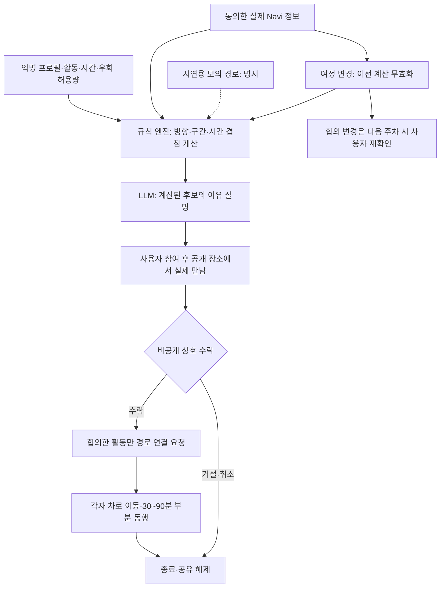

## 1. 페르소나·시나리오

**같이길 — 여행 전체를 맞추지 않아도, 좋은 한 시간은 함께.** 가까운 목적지와 겹치는 이동 구간을 가진 낯선 여행자가 공개 장소에서 먼저 만나고, 서로 원하는 경우에만 카페·산책 등 30~90분의 활동 하나를 함께한다. 이동은 각자 자기 차로 한다. 최종 목적지가 같을 필요는 없다.

31세 서윤은 혼자 양양으로 가지만 카페에서는 누군가와 이야기하고 싶다. 속초로 가는 준호는 여행 사진을 서로 찍어줄 사람을 찾는다. 둘 다 하루 전체 동행은 원하지 않는다. ‘함께할 활동, 가능한 시간, 감수할 이동량’을 맞춘다. 인물·시각·우회 시간은 설명용 가정이다.

| 시간 | 화면 | 행동 | 시스템 | 결과 |
|---|---|---|---|---|
| 출발 전 08:50 | 휴대폰의 짧은 사전 조사 | 서윤이 ‘카페 60분·조용한 대화·사진 한 장·추가 이동 10분까지’를 선택한다. 별명과 공개 관심사만 채운다. | 시간대·활동·우회 허용량을 저장한다. 신원 확인 정보와 다른 이용자에게 보이는 익명 기본 프로필을 분리한다. | 어떤 사람을 만나고 싶은지 장문 소개 없이 오늘의 기대가 정리된다. |
| 출발 전 08:55 | 주차 중 차량의 후보 방 | 내비 목적지 사용에 동의하고 ‘11시 바다 카페, 60분’ 방을 연다. | ‘시간 가능, 허용 우회 이내, 사진에 관심’처럼 계산된 이유를 보여준다. | 얼굴 목록보다 함께할 일이 보인다. 근거 없는 일치율은 없다. |
| 출발 전 08:58 | 첫 만남 카드 | 공개 카페의 만남 구역, 10분 대화, 각자 결제, 활동 종료 예정 시각을 보고 참여한다. | 첫 만남 참여와 이후 활동 수락을 다른 상태로 저장한다. 영업·주차 정보의 확인 시점을 표시한다. | ‘한 번 만나보기’로 시작해 하루 전체를 약속하는 부담을 줄인다. |
| 이동 중 09:00~10:50 | 기존 내비 안내 | 각자 운전한다. 여정이 바뀌어도 상대에게 즉답하지 않는다. | 검증된 내비 이벤트로 조건을 다시 계산한다. 매칭 조작은 잠그고 재확인은 다음 주차 시 제시한다. | 오래된 계획을 유효한 약속처럼 유지하거나 상대를 따라잡게 하지 않는다. |
| 첫 만남 11:00~11:10 | 주차 후 만남 코드·대화 카드 | 서윤·준호·민지가 공개 장소에서 만난다. ‘오늘 보고 싶은 풍경’과 ‘12시 이후에는 각자 일정’을 이야기한다. | 같은 방임을 확인하고 각자가 고른 기대 활동을 보여준다. 대화 내용을 몰래 평가하거나 녹음하지 않는다. | 실제 분위기를 확인한다. 앱의 추천과 사람의 판단이 구분된다. |
| 11:10 | 비공개 선택 | 서윤과 준호는 서로 카페 활동을 수락한다. 민지는 ‘오늘은 혼자 쉬기’를 선택한다. | 상호 수락한 사람에게만 활동 확정을 알린다. 누가 먼저 거절했는지나 이유를 공개하지 않는다. | 민지는 패널티 없이 떠나고, 두 사람은 원하는 만남만 이어간다. |
| 11:10~12:10 | 확정된 활동 카드·필요 시 내비 | 같은 카페에서 서로 고른 음료 이야기를 나누고 바다를 배경으로 사진을 찍어준다. 다른 장소를 골랐다면 각자 차로 이동한다. | 합의한 장소만 사용자 확인 후 경로에 연결한다. 사진 공유는 촬영·전달에 동의한 것만 허용한다. | 혼자라면 없었을 대화와 여행 사진이 남는다. 누구의 차에도 함께 탈 필요가 없다. |
| 12:10 이후 | 활동 종료·개인 기록 | ‘여기까지 함께하기’를 누르고 각자의 목적지로 떠난다. 원하면 사진과 감사 한 줄을 주고받는다. | 방과 공유를 종료한다. 친구 추가·다음 활동·연장은 각각 다시 상호 동의한다. | 자연스럽게 헤어지는 것까지 성공이다. 다음 여행에서 같은 활동 조건을 다시 사용할 수 있다. |

방이 없으면 그대로 알린다. 상대가 나타나지 않으면 정한 대기 시간 후 개인 일정으로 돌아간다. 혼자 이용할 장소 정보는 남기되 가짜 참가자나 몰래 완화한 조건으로 방을 채우지 않는다.

## 2. 구체 콘텐츠·보상·재사용

핵심 콘텐츠는 사람 목록이 아니라 **끝이 정해진 함께할 일**이다. 활동 카드는 함께해서 좋은 이유와 종료 시점을 먼저 설명한다.

| 콘텐츠 | 간단한 입력 | 함께 하는 행동 | 보상과 재사용 |
|---|---|---|---|
| 바다 카페 한 시간 | 대화량·음료 취향·시간 | 서로 고른 메뉴와 오늘 본 풍경을 이야기한다. | 잠깐의 교류와 새 취향 발견. 다음 지역에서도 ‘카페 60분’ 조건을 재사용한다. |
| 사진 산책 한 구간 | 걷기 시간·사진 교환 의향 | 공개 산책로의 합의한 구간을 걷고 원하는 사람끼리 사진을 찍어준다. | 혼자 찍기 힘든 여행 사진과 관점. 사진은 승인한 상대에게만 전달한다. |
| 전시 감상 짝 | 전시·가능 시간·대화 방식 | 같은 전시를 보고 각자 인상 깊었던 작품 하나를 이야기한다. | 같은 장소를 다르게 보는 재미. 다음 전시에서도 활동 형식을 쓴다. |
| 여행 한 조각 기록 | 활동명·공개할 사진·한 줄 | 활동 후 각자 남긴 내용을 확인해 한 장의 기록을 만든다. | 실제로 만난 경험의 기록. 공개 게시와 친구 연결은 선택이며 자동 공개하지 않는다. |

보상은 좋은 활동, 사진, 기억, 원할 때 이어지는 관계다. 금전 보상이나 출석 점수는 두지 않는다. 동의받아 활동 길이·대화 선호를 기억하고 새 여정의 후보를 찾는다. 헤어짐을 이탈로 취급하거나 친구 추가를 성공 조건으로 삼지 않는다. 매일 접속보다 다음 여행 때 다시 찾는지를 본다.

## 3. 휴대폰 유사 서비스 비교

2026-11-07 공식 본문을 확인했다. 기능 존재와 실적을 구분한다. 페이지에 없다는 이유로 경쟁사의 기능 부재를 단정하지 않는다.

| 서비스·공식 원문·날짜 | 확인한 기능 | 같이길과의 관계·실적 한계 |
|---|---|---|
| [트립소다 공식 모집 안내](https://tripsoda.tistory.com/35), 2025-03-21 | 일정과 루트를 맞추기 어려운 여행자를 운영사가 모집하고, 정해진 날짜에 6명이 모이면 확정하는 몽골 투어를 소개한다. | 여행 동행 조율은 이미 존재한다. 이 사례는 차량이 제공되는 다일 여행상품이다. 앱 전체를 장기 여행 전용이라고 판단할 수 없고, 각자 차로 짧게 만나는 수요의 증거도 아니다. |
| [당근모임 공식 발표](https://about.daangn.com/company/pr/archive/당근모임-러닝-기록-꾸미기-기능-출시/), 2026-09-18 | 외부 앱의 러닝 기록을 불러와 꾸미고 모임 인증글이나 이미지로 공유하는 기능을 출시했다. | 관심사 활동과 공동 기록은 휴대폰에서도 자연스럽다. 발표에는 이 기능의 이용자 수·재사용률이 없다. 당근 전체 이용자 수를 모임의 성과로 쓰지 않는다. |
| [Porsche ROADS 공식 발표](https://newsroom.porsche.com/en/2023/products/porsche-roads-by-porsche-app-update-31243.html), 2023-02-17 | 경로 생성·저장·공유, 공개·비공개 그룹과 그룹 드라이브, CarPlay 화면 연계를 소개한다. | 차량 경로를 활용하는 커뮤니티도 이미 있다. 당시 전체 사용자 18만 명 이상은 MAU나 낯선 사람 만남 완료자 수가 아니다. 2026년 운영 상태는 이 과거 발표만으로 확정할 수 없다. |

휴대폰에서도 목적지·시간·관심사로 약속하고 차량 화면에 연결할 수 있다. 같이길은 **짧은 활동을 만나본 뒤 결정하는 경험에, 실제 여정과 약속의 어긋남을 줄이는 연동을 붙인다**는 가설이다. 체감 효과가 작으면 모바일 서비스 대비 우위도 작다.

## 4. 차량 특화 근거·반증

| 차량 연동 가설 | 줄이려는 수고 | 반증·확인할 조건 |
|---|---|---|
| 동의하에 실제 내비 목적지를 가져온다. | 방에 입력한 여행 계획과 차에서 실제 선택한 목적지를 다시 맞추는 수고를 줄인다. | 휴대폰 지도 연동으로도 가능하다. 목적지 재입력이 드물면 이득이 작다. |
| 목적지 변경·재탐색 후 약속 조건을 다시 계산한다. | 사용자가 방에 직접 변경 사실을 옮기기 전에 시간 창·추가 우회 조건이 유효한지 확인한다. | 이벤트와 필요한 경로 데이터가 실제 제공돼야 한다. 지연을 자동으로 만남 취소나 장소 변경의 동의로 해석하면 안 된다. |
| 서로 동의한 활동 장소를 현재 여정에 연결한다. | 장소를 검색해 복사하고 최종 목적지를 다시 넣는 작업을 줄인다. | 기존 지도 앱의 경유지 기능과 겹친다. 클릭 수 감소와 잘못된 목적지 설정 감소를 비교해야 한다. |

주행 중 매칭 잠금은 필수 조건이며 독창성은 아니다. ‘운전 중 답장하지 않아도 되는 약속’으로 안내하고 변경 검토를 주차 시 모으면 관계의 부담을 줄일 가능성은 있다. 이동 중에는 기존 내비로 정한 약속에 이어진다. 운전자 대상 실시간 대화·질문 게임의 허용은 확인되지 않았다.

[NaviHelper 이벤트 문서](https://document.pleos.ai/en/docs/pleos-only/connect-sdk-pleos/NaviHelper/event-listeners)는 `onDestinationChanged`, `onReRouteEnded`, `onTripInfo`를 공개하지만 실제 이벤트는 내비 구현에 따라 다를 수 있다. `remainTime`·`remainDistance`의 단위·주기·누락 처리, 전체 경로 좌표 범위는 실증해야 한다. 부족하면 수동 계획 기반이라고 표시한다.

## 5. 실제 수요·경쟁 조사

앞의 세 자료는 인접 행동의 제품화 사례이며 이 모델의 표본조사가 아니다. 한국의 자가용 여행자가 우회해 낯선 사람과 30~90분 함께하고 재사용한다는 직접 검증 자료는 확보하지 못했다.

[현대차 기존 아이디어 소개](https://www.hyundaimotorgroup.com/ko/story/hyundai-motor-company-pleos-connect-app-idea-contest), 2026-10-08의 ‘로드시그널’은 유사 경로 운전자 소개, ‘마! 어데고!’는 친구 위치·목적지 공유다. 당시 아이디어 단계였다. 같이길은 소개를 넘어 실제 만남 후 상호 결정, 활동 종료, 여정 변경에 따른 약속 재검토를 시연해야 한다. 수상은 수요나 출시 승인의 증거가 아니다.

첫 만남의 어색함·우회·대기가 활동의 즐거움보다 클 수 있다. 가까워도 시간과 활동이 안 맞을 수 있다. 카풀 실적을 각자 차를 모는 동행 수요로 쓰지 않는다. MAU·유지율·매칭 정확도·지불 의향은 모른다.

## 6. Pleos·AI 파이프라인

규칙 엔진이 시간 창·방향·경로·우회 한도·정원을 계산하고 차단한 상대를 제외한다. LLM은 “점심 전까지만 사진 산책”을 구조화하거나 확정된 후보를 설명한다. 성격·안전성·경로를 추측해 매칭하지 않는다. JSON의 후보·장소 ID와 계산 근거를 검증하고 오류면 정해진 설명문을 쓴다. 후보 부족과 데이터 만료는 숨기지 않는다.

[경유지 경로 요청 문서](https://document.pleos.ai/en/docs/pleos-only/connect-sdk-pleos/NaviHelper/route-with-waypoints)는 최종 목적지·경유지 전달과 `NAVI_ROUTE_SEARCH` 권한을 명시한다. 사용자 확인 뒤 요청해 완료·오류 콜백을 확인하며 약속을 자동 변경하지 않는다.

공모전 개발과 상용 배포는 구분한다. 사용자 제공 설명회 전사본 22:02·29:11은 미공개 SDK 제공 계획과 개발 시 별도 권한 승인 없이 manifest 선언으로 에뮬레이터 테스트가 가능하다고 설명한다. [공식 개발 안내](https://appdevchallenge.auto-hmg.io/guide/development)도 SDK·에뮬레이터 활용을 안내한다. 따라서 경로 API의 실증 과제를 MVP 불가로 해석하지 않는다. 실제 배포 때는 별도 심사 조건을 확인한다.

[2026-10-19 릴리즈 노트](https://document.pleos.ai/docs/pleos-only/release-note/sdk-release-note)에 FusedLocation v1.1.3, TTS·STT v3.3.1 배포가 있어 ‘미제공’으로 단정하지 않는다. Gleo는 스키마 심사 후 쓰는 선택 기능이며 [App Schema](https://document.pleos.ai/docs/pleos-only/app-integration-guide/guide/app-capability)의 등록 `actionCalls`는 최대 3개다. 설명은 별도 LLM 백엔드로 생성한다. 참여·동행·친구 추가·공개 범위는 사용자가 정한다. 소셜 앱의 주행 기능 범위는 심사에서 확인한다.

## 7. 판정·검증

**부분 동행은 유지하고 차량 연동 효과를 검증할 후보**다. 한 관광 권역·주말 시간대에서 휴대폰으로 모집하고 주차 시 선택하게 한다. 차량은 여정 변화 추적과 약속점 연결을 맡는다. 모집망을 Pleos 보유자로만 좁히면 밀도 확보에 불리하다. 기존 커뮤니티 유입과 모바일 참가를 허용하되 연동 차량 여부를 구분해 실험한다. 누적 가입자보다 같은 시간에 조건이 맞는 실제 후보 수를 본다.

| 검증 항목 | 측정 방법 | 판단에 필요한 의미 |
|---|---|---|
| 초기 참여 밀도 | 같은 권역·시간 창에서 조건을 만족한 실제 후보 수, 후보 없음 비율, 첫 추천까지 대기 시간 | 가입자 수가 있어도 추천이 안 되는 원인을 구분한다. |
| 실제 첫 만남 | 실제 도착한 사람 수 ÷ 첫 만남 참여 확정자 수. 취소·무응답·일정 변경을 구분한다. | 카드 클릭과 현실 행동의 간격을 확인한다. |
| 선택의 성공 | 상호 수락한 활동 수와 완료 수, 활동 후 ‘다시 이런 만남을 원하는가’ 및 이유 | 비공개 거절 자체는 실패가 아니다. 원하는 활동으로 이어졌는지를 본다. |
| 추가 이동 부담 | 원래 여정 대비 추가 거리·시간, 대기 시간, 스스로 정한 한도 초과 비율 | 즐거운 활동보다 이동 비용이 커지는지 확인한다. |
| 차량 연동 효과 | 같은 후보를 제시한 수동 입력·지도 방식과 Navi 연동 방식의 재입력 횟수, 변경 누락, 약속 조정 시간 비교 | 차량 데이터가 실제 수고를 줄였는지 확인한다. |
| 재사용 | 후속 여행 기회가 있었던 참여자 중 다시 이용한 비율과 미이용 이유 | 낮은 여행 빈도와 경험에 대한 불만을 구분한다. |

11월 13일까지는 가상 참가자 3명, 차량 에뮬레이터 또는 가상 클라이언트 2대로 경로 변경·규칙 계산·LLM 설명·수락과 거절·종료를 시연한다. 실제 연결과 모의를 표시하며 수요 검증으로 포장하지 않는다. 공개 모집 전 개인정보 처리와 신고 대응을 준비한다. 우회 부담이 크거나 차량 연동 효과가 작으면 모바일 중심으로 재평가한다. 수익 모델과 규모 목표는 행동 검증 후 정한다.
