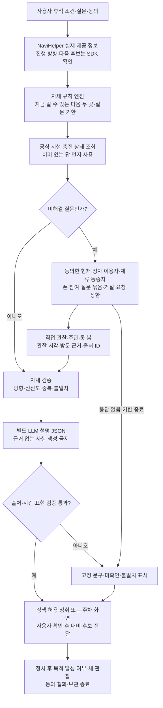

# 다음 휴식 소식 — 다음 두 곳에 필요한 질문만 전달하는 차량 채널

검토일: 2026-11-07. **실제 정차 선택을 돕는 여정 지원 서비스로 조건부 추천한다.** 엔터테인먼트에서 실질적인 여행 경험 지원으로 주제를 넓힌 안이다. 차별성 가설은 **진행 방향의 다음 두 후보 → 미해결 질문 → 현장에서 확인한 답 → 선택 결과**다. 리뷰를 읽어주기만 한다면 추천하지 않는다. 아래 가족·A/B 휴게소·제보·시간은 가상 시나리오다.

## 1. 시나리오표

초등학생 딸과 부모가 일요일 귀가 중이다. 아이가 “다리 좀 펴고 싶어. 아까처럼 닫혀 있으면 싫어”라고 한다. 조수석의 엄마는 휴게소 검색 결과에서 놀이시설 사진을 찾았지만 오늘 운영하는지는 알 수 없다. 출발 때 켜둔 가족 휴식 조건은 ‘앞으로 25분 안, 아이가 잠깐 움직일 공간, 추가 우회 없음’이다. 앱은 전국 인기 휴게소 대신 지금 도로에서 진입할 수 있는 A와 B만 남긴다.

| 단계 | 가족과 다른 차량의 행동 | 서버가 전달하는 내용 | 실제 선택에 남는 결과 |
|---|---|---|---|
| 질문 만들기 | 엄마가 동승자 폰에서 ‘놀이공간 오늘 이용 가능?’을 선택한다. | A는 12분, B는 21분 예상. 두 곳의 해당 시설·방향·답변 유효시간을 묶는다. | 무엇을 알아야 결정할지 한 가지로 좁힌다. |
| 관련 방문자에게 배달 | A/B에 현재 정차·체류 중이며 수신에 동의한 이용자나 동승자에게 질문이 간다. | ‘직접 보셨나요? 운영 중 / 닫힘 / 못 봄’과 관찰 시각을 받는다. | 방문자 전체에게 잡담을 방송하지 않는다. |
| 서로 다른 근거 도착 | A에서 쉬는 두 이용자가 임시운휴 안내문을 봤다고 답한다. B에서 체류 중인 이용자는 ‘아이와 방금 이용했다’고 답한다. | A: 9분 전·6분 전 관찰 제보 2건. B: 공식 정규 운영정보와 5분 전 이용 제보 1건. | 정규 시간표와 오늘의 관찰을 구분한다. |
| 답을 듣고 비교 | 승인된 청취 흐름에서 “A는 임시운휴 제보가 두 건입니다. B는 최근 이용 제보가 한 건 있고 21분 예상입니다. 도착 때 상태는 달라질 수 있습니다”를 듣는다. | ‘B가 더 재미있다’는 평가를 사실로 바꾸지 않는다. | 아빠가 “그럼 B에서 쉬자”, 아이가 “이번엔 열었대?”라고 묻고 출처를 다시 확인한다. |
| 정차와 환류 | 가족이 B에 도착한다. 엄마가 ‘이용했어요’를 선택하고 관찰 시각을 남긴다. | 목적을 달성했는지와 새 관찰을 별개 기록으로 받는다. | 다른 가족에게 새로운 답이 되고, 우리 가족은 실패한 정차를 한 번 줄인다. |

즉답이 필요한 질문은 현재 응답 가능한 현장 이용자에게만 배달한다. 이미 출발한 운전자에게 즉답 알림을 보내지 않는다. 최근 방문자는 다음 정차 때 회신할 수 있지만 질문 기한이 지나면 오늘의 결정 자료로 쓰지 않는다. 반대로 B 답변이 없으면 “공식 운영시간은 있으나 오늘 이용 여부는 미확인”이라고 말한다. A의 이용 가능·불가 답이 엇갈리면 관찰 시각과 대상 시설을 확인하고 ‘제보 불일치’로 남긴다. 답을 기다리는 동안 A 진입로를 지났다면 A 질문은 종료한다. 아이의 필요가 급해지면 가장 가까운 적절한 휴식 후보를 우선하며, 답을 얻으려고 휴식을 늦추는 제품이 되어서는 안 된다. 운전자의 경로 결정은 사용자가 확인한다.

## 2. 콘텐츠·보상·재사용

콘텐츠는 **방문 결정을 바꾸는 한 질문과 답**이다. 시설 ID·대상·방향·관찰 시각·출처를 붙인다. ‘방금’이라는 표현만으로 지연과 오래된 관찰을 숨기지 않는다.

- 가족 휴식: ‘놀이공간을 실제 이용했나요?’에 ‘열린 문을 봄’과 ‘아이와 이용함’을 구분한다. ‘아이가 좋아함’은 주관적 경험이다.
- 화장실: ‘여성 화장실 입구에 대기줄이 있었나요?’처럼 대상과 관찰 시점을 한정한다. 한 사람의 대기 경험으로 현재 평균 대기시간을 만들지 않는다.
- 간단한 식사: ‘해당 매장이 지금 주문을 받고 있었나요?’와 ‘커피를 주문한 뒤 약 10분 기다림’을 구분한다. 맛있다는 평가와 운영 여부를 섞지 않는다.
- 충전: 공식 충전기 상태를 우선 표시하고, 이용자는 ‘기기에는 사용 가능으로 나왔지만 내가 충전 시작에 실패함’ 같은 현장 경험을 보탠다. 빈 충전기 수와 줄 선 차량 수는 다르다.
- 접근성: ‘수유실 앞 이용 안내문이 있었나요?’ 등 확인 가능한 질문으로 확장한다. 한 번의 관찰로 안전성·접근성 전체를 보증하지 않는다.

보상은 필요한 최신 답을 얻어 정차 실패를 줄이는 것이다. 답변자에게는 “다음 가족의 선택에 도움이 됐다”는 익명 감사가 돌아간다. 포인트·쿠폰이나 매번 제보할 의무는 없다. 다음 여행에서 질문자가 되며 재사용할 수 있지만 일상 통근 수요는 약하다. 반복성은 **다음 장거리 이동에서 휴식 결정을 다시 맡기는가**로 본다. 같은 장소·시설의 동일 질문은 하나로 묶고, 짧은 유효기간 안의 답은 관찰 시각을 유지해 공유한다. 새로운 요청은 거절·수신 중지할 수 있고 방문별 요청 상한을 둔다. 구체 상한·유효기간은 항목별 파일럿으로 정한다. 요청 피로가 도움보다 커지면 순환은 깨진다.

## 3. 휴대폰 유사 서비스

| 기존 서비스 | 이미 해결하는 부분 | 이 안이 추가로 증명해야 할 부분 |
|---|---|---|
| Waze | 현재 위치 기반 현장 제보, 음성 제보, 다른 이용자의 반응에 따른 제보 유지·해제. AAOS와 Android Auto도 지원한다. | 차량 간 공유나 음성만으로는 차별화되지 않는다. 휴식 시설의 특정 미해결 질문을 관련 방문자에게 보내는 효과가 필요하다. |
| Google Maps | 충전소 위치 안내를 리뷰로 요약하고 대기 경험을 수집하며, Google built-in 차량에 실시간 포트 상태와 경로상 충전 추천을 발표했다. | 충전소 상태 읽기·경로 추천을 복제하지 않고 가족의 구체적 휴식 조건을 해결해야 한다. |
| PlugShare | 체크인, 최근 경험 요약, 여행 계획, 이용자 메시지까지 제공한다. | ‘체크인 요약+오디오’는 거의 겹친다. 질문을 받을 사람을 골라 답을 기다리고 미확인을 관리하는 흐름의 추가 효용을 입증해야 한다. |
| TMAP·도로공사 정보 | 도로·방향·시설 기반 검색에 더해 TMAP은 일부 휴게소 화장실 혼잡도를 제공한다. | 해당 공식 정보가 있는 질문은 다시 사람에게 묻지 않는다. 운영 중인지 모르는 개별 시설 같은 공백만 다룬다. |

휴대폰 GPS·모바일 웹으로도 방문 후보 식별·질문 전달·음성 재생은 가능하다. 답변 공급을 Pleos 차량으로 한정하지 않고 현장에 있는 폰 이용자도 참여시킨다. 출처에는 차량 상태 근거·폰 위치 근거·자기 신고를 구분한다. 실제 차량 경로와 휴식 상태로 후보를 자동 갱신하는 편의가 폰 버전보다 충분히 큰지 비교해야 한다.

## 4. 차량 특화 가치와 반론

차량의 이점은 **지금 갈 수 있는 곳과 곧 지나칠 곳을 구분하는 것**이다. 반대 방향 휴게소를 제외하고, 시간 예산이 바뀌면 질문과 후보를 갱신한다. 내비·오디오 우선순위에 맞춰 답을 전달해 가족이 여러 앱을 읽어줄 부담을 줄이는 동작을 데모로 보여줘야 한다.

정차 상태와 위치는 시설 근처에 머물렀을 가능성만 보강하며, 시설을 직접 이용했다는 증거는 아니다. 폰 위치보다 정확하다는 실측도 없다. **‘방문 근거가 있는 관찰 제보’**로 표시한다. 복수 일치도 확정 사실이 아니다. 중복 방문 제보를 제외해도 베낀 답·악의적 제보는 남는다.

서버에는 궤적·VIN 대신 동의한 장소 ID·방향·대략적 시간대·단기 방문 토큰을 보내고 보관 기간·철회를 정한다. 자체 토큰은 제조사 방문 인증서가 아니다. 정차/GPS로 차량 수·대기시간을 추정하지 않으며 카메라·블랙박스를 전제하지 않는다.

[Pleos 카테고리 가이드](https://document.pleos.ai/en/docs/pleos-only/vehicle-app-planning-guide/app-category)는 Mobility Services의 제한적 주행 허용 예로 현재 위치 기반 즉시 정보와 충전소 검색·경유지 설정을 든다. 따라서 이 안은 Mobility Services를 중심으로 검토하는 것이 합리적이다. 오디오가 있다는 이유로 Music/Audio 승인을 가정할 필요는 없다. 다만 타인에게 질문을 배달하는 Q&A는 Communication 성격도 있으므로 실제 기능별 심사 범위를 확인한다. 질문 작성·세부 제보 검토는 출발 전, 주차 또는 동승자 폰에서 구성하고, 주행 중 답 청취는 위치 기반 즉시 정보의 허용 사례를 바탕으로 구현·검증한다. 자동 회신 알림·Gleo 요청의 허용이 미확인되면 사용자 시작 청취 또는 주차 후 확인으로 전환한다. 동승자 창 자체는 제한 면제 근거가 아니다.

## 5. 실제 수요·경쟁 근거

공식 원문 본문 확인 자료다. 경쟁 기능의 존재는 우리 서비스의 수요 증명이 아니다.

| 원문·날짜 | 확인한 사실 | 판단과 한계 |
|---|---|---|
| [PlugShare 체크인 요약 발표](https://company.plugshare.com/checkin-summaries-what-8-million-drivers-built-together.html), 2026-07-01 | 누적 1,030만 체크인, 미국 1만+ 장소 요약. 해당 요약의 35%에 화장실·음식 등 편의시설, 17%에 대기·혼잡이 등장한다. | 시설 경험을 공유하는 행동은 존재한다. 분모는 이용자 수가 아닌 요약 대상 장소이며, 업체 자체 분석이다. 동시에 가장 강한 중복 반증이다. |
| [J.D. Power 충전 경험 조사](https://www.jdpower.com/business/press-releases/2025-us-electric-vehicle-experience-evx-public-charging-study), 본문 발표일 2025-08-13 | 미국 BEV/PHEV 소유자 7,428명, 2025년 1~6월 조사. 14%가 충전소에 갔으나 충전하지 못한 경험을 응답했다. | 실패한 방문을 줄일 문제는 실재한다. 전체 충전 방문의 14%라는 뜻이 아니며 한국 가족 휴게소 수요를 직접 입증하지 않는다. PlugShare와 협력한 조사다. |
| [TMAP 설 연휴 안내](https://www.tmapmobility.com/story/pr/detail/214), 2026-02-11 | 죽전 서울 방향, 하남드림, 여주 강릉·서창 방향 휴게소 화장실 혼잡도 제공을 발표했다. | 국내에서도 유사 문제를 서비스화했다. 발표 범위를 전국 모든 휴게소의 상시 제공으로 확대 해석하면 안 된다. |
| [Google Maps 충전 업데이트](https://blog.google/products-and-platforms/products/maps/new-ways-to-power-up-your-electric-vehicle-adventures-with-google-maps/), 2024-04-17 | 충전 리뷰에 대기시간 등 세부 경험을 묻고, 리뷰 요약·차량 내 포트 상태·경로상 충전 추천을 발표했다. | 내비와 리뷰 결합은 이미 경쟁 영역이다. 발표가 한국 지원이나 외부 앱의 데이터 이용 권한을 뜻하지 않는다. |
| [Waze 현장 제보 도움말](https://support.google.com/waze/answer/13739290?hl=en), 게시일 미표기 | 실제 본 현장 제보를 권고하고, 이용자 반응으로 표시 시간을 조절하며 잘못된 제보를 해제한다. | 신선도와 정정의 제품 선례다. 휴식 질문 응답률이나 가족 수요 근거는 아니다. |
| [도로공사 편의시설 공식 메타데이터](https://www.data.go.kr/catalog/15076645/openapi.json), 본문 게시일 미표기 | 주유소 편의시설의 노선·방향·시설명·설치 여부 등을 공개한다. | 정적 시설은 공식 자료를 우선해야 한다. 이 자료는 주유소 대상이며 놀이시설의 오늘 운영이나 실시간 줄을 제공한다는 근거가 아니다. |

현재 확보한 자료로는 **한국 가족이 다른 차량의 답을 기다릴 의향, 필요한 시점의 응답률, 오디오가 실제 선택 실패를 줄이는 효과는 미검증**이다. 이 빈칸을 외국 충전 통계나 가상 시나리오로 채우지 않는다.

## 6. Pleos와 AI 적용 파이프라인

[NaviHelper 이벤트 문서](https://document.pleos.ai/en/docs/pleos-only/connect-sdk-pleos/NaviHelper/event-listeners)는 위치·목적지·경로 상태 관련 이벤트를 제공한다. 이를 후보 갱신에 활용하되 전체 경로 선형, 방향 판정에 필요한 실제 필드와 갱신 주기는 SDK에서 확인한다. 공모전 제공 OT 22:02~23:09는 미공개 SDK 제공 예정, 29:11은 문서상 권한을 Manifest에 선언해 승인 없이 에뮬레이터 개발 가능하다고 설명한다. 따라서 개발을 권한 승인 대기로 막지 않는다. 실차 지원과 상용 배포 심사는 별개다. 공개 신청 안내와 2026-10-19 릴리스 상태 차이는 최신 SDK 실험으로 해소한다.

[Gleo App Schema](https://document.pleos.ai/docs/pleos-only/app-integration-guide/guide/app-capability)는 앱 기능 호출 연계다. 자체 함수 후보는 ‘다음 휴식 질문’, ‘도착한 답 듣기’, ‘관찰 내용 남기기’ 3개이며 공식 API 이름이 아니다. Gleo를 앱이 임의로 호출하는 생성 LLM으로 가정하지 않는다. 별도 LLM은 사용자 질문을 구조화하고 관찰 기록을 출처 ID에 연결해 설명하는 역할만 맡는다. 후보 도달시간·방향 필터·신선도·다수 일치·요청 종료는 규칙 엔진이 처리한다.

상태는 질문 생성→답 수집→비교 가능/불일치/미확인→사용자 선택→종료다. 도구는 차량 SDK·공식 정보 조회·자체 질문 서버다. 연결이 끊기면 기준시각이 있는 공식 캐시만 보여주고 최신 답은 미확인으로 둔다. 경로 변경·후보 통과·동의 철회 시 요청을 취소하며 경유지 변경은 사용자가 확인한다.

[CarUxRestrictions 가이드](https://document.pleos.ai/docs/pleos-only/vehicle-app-developer-guide/driving-restriction-development-guide)에 따라 제한 대상 기능을 제어하고 초기·신호 소실 시 해당 UI를 잠근다. 모든 오디오를 일괄 중지하는 신호로 해석하지 않는다. 오디오 포커스 상실·내비 안내·통화 우선순위는 별도로 처리한다. 수동 입력한 경로, 에뮬레이터 정차 신호, 운영자가 작성한 답은 각각 ‘모의’로 표시한다. 공식 문서가 있는 것, 공모전에서 실행한 것, 실제 이용자 데이터인 것을 구분한다.

## 7. 판정과 먼저 할 실험

**조건부 우선 검증 후보다.** 다만 방문 인증·AI 요약·라디오가 독자적 차별점이라는 주장은 기각한다. 두 차량 화면과 질문 서버로 ‘시설 상태를 물어 답을 받고 정차 선택을 바꾸는 경험’을 시연할 수 있다. 구현 시연은 수요 검증과 구별한다.

한 구간의 휴게소 두 곳과 실제 가족 운전자 소수로 실험한다. 최근 정차 실패와 빠졌던 정보를 묻고 기존 앱에서 해결되는지 확인한다. 같은 질문을 ①기존 앱 검색 ②경로별 기존 정보 요약 ③방문자에게 새 질문 전달로 비교한다. 결정 시간·추가 사실·진입 전 응답 도착·현장 상태 일치·답변 부담을 기록한다. 운영자 대리 답변은 ‘운영자 파일럿’으로 표시하고 자연 발생 응답률에서 제외한다.

기존 정보만으로 충분하거나, 답이 늦거나, 답변 요청이 부담이면 독립 서비스 추천을 철회하고 내비 기능으로 축소한다. 질문자만 있고 자발적 응답 공급이 유지되지 않으면 독립 후보를 즉시 철회한다. 미해결 질문이 반복되고 적시에 온 답이 실제 실패를 줄일 때만 확장한다. 파일럿 전에 평가 기준과 표본을 정하고 미측정 개선율은 약속하지 않는다.

**핵심 미결 질문: 다음 진입로를 지나기 전에 도착하는 ‘새로운 답’이 기존 내비·최근 리뷰보다 실제 정차 실패를 줄이는가?**
