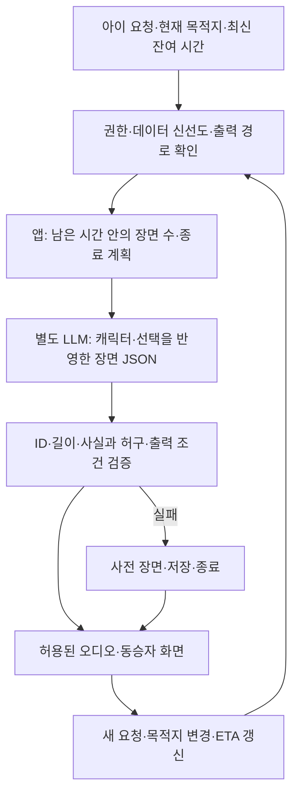

## 1. 페르소나·시나리오

| 단계·상황 | 사용자 행동 | 앱·화면 반응 | 사용자에게 남는 결과 |
| --- | --- | --- | --- |
| 주말 가족 여행 출발 전, 예시 18분 | 여섯 살 지우가 “공룡 두두가 알 찾는 이야기!”를 고른다. 부모는 실제 목적지를 차량 내비에 이미 설정했다. | 현재 위치에서 해당 목적지까지의 최신 남은 시간을 받아 사건을 편성한다. 30분 고정 상품이 아니다. 아래 시간은 설명용 가상 값이며 SDK 실측값이 아니다. | 현재 여정만큼 들을 이야기로 시작한다. |
| 이동 중, 갱신된 잔여 13분 | 지우가 듣다가 “이제 공룡 말고 로봇이 좋아”라고 요청한다. 운전자는 답하지 않는다. | 허용된 동승자 입력 경로에서 요청을 접수한다. 기존 이야기를 짧게 닫고 **현재 위치·현재 목적지의 최신 잔여 시간**으로 로봇 이야기를 다시 편성한다. 최초 18분에서 재생 시간만 빼서 계산하지 않는다. | 바뀐 취향을 현재 남은 여정에 맞춰 이어 듣는다. |
| 정체 발생, 잔여 시간이 16분으로 늘어남 | 로봇이 잃어버린 부품을 찾고 있다. 지우는 앞서 고른 ‘노란 날개’를 기억한다. | 시간 증가만으로 새 임무를 계속 추가하지 않는다. 현재 장면을 끝내고 선택적 짧은 외전을 붙인다. 잔여 시간의 작은 변동마다 대본을 재생성하지 않는다. | 이미 고른 설정을 유지하며 정체 시간을 보낸다. |
| 부모가 내비 목적지를 변경, 새 잔여 7분 | 부모가 실제 운행 목적에 따라 목적지를 바꾼다. 지우는 “그럼 로봇도 같이 가?”라고 묻는다. | 목적지 변경·경로 갱신을 수신한 뒤 현재 사건을 결말 중심으로 축약한다. 아이의 이야기 요청이 실제 운전 경로를 바꾸는 명령이 되지는 않는다. | 실제 목적지 변경 뒤에도 사건을 짧게 닫을 수 있다. |
| 잔여 2분·도착 | 로봇이 노란 날개로 부품을 돌려주고 이야기가 끝난다. 지우가 “다음에는 물속 로봇”을 고른다. | 하차 전에 짧은 결말을 제공한다. 도착이 예상보다 빨라지면 저장·즉시 종료가 우선이다. 끝내지 못한 장면을 듣기 위해 차에 더 머물도록 요구하지 않는다. | 하차를 늦추지 않고 완결하거나 저장한다. |

아이는 캐릭터의 사건에 참여하려고, 부모는 계속 진행하지 않아도 되기를 바라며 이용한다. ‘랩타임’은 **요청 순간부터 실제 목적지까지 남은 경로 시간**이다.

아이가 답하지 않아도 오디오는 기본 분기로 이어지고 운전자에게 응답을 요구하지 않는다. 공모전 구현과 상용 주행의 적용 조건은 4절에서 구분한다.

<toggle heading="h2">
2. 구체 콘텐츠·보상·반복 사용

| 콘텐츠 | 입력·행동 | 결과·다시 쓰는 이유 |
|---|---|---|
| 공룡 두두의 알 구조대 | 공룡 성격·도구를 고르고 알에 이름 붙이기 | 고른 도구가 사건을 해결한다. 다음 이동에는 내가 이름 붙인 아기 공룡이 동행한다. |
| 로봇 모모의 수리 여행 | 부품·소리·로봇의 목표 선택 | 선택한 부품이 로봇의 행동을 바꾼다. 같은 길에서도 고장 원인과 해결 순서를 바꿀 수 있다. |

보상은 **내 선택이 뒤의 장면에 남는 것**이다. 유명 IP·목소리의 권리를 전제하지 않고 독자 캐릭터의 흥미를 검증한다. 잔여 시간에 따라 사건 수를 조절하며 부족한 시간을 빠른 낭독으로 메우지 않는다.

캐릭터 기억·아이 취향은 태블릿에서도 가능한 콘텐츠 경쟁력이다. 화면을 줄이려는 부모의 바람이 아이의 제품 선호를 대신하지 않는다.
</toggle>

<toggle heading="h2">
3. 휴대폰 유사서비스 비교

| 비교 항목 | 휴대폰·태블릿으로 가능한 것 | 차량 앱이 추가로 입증해야 할 것 |
|---|---|---|
| **Gemini Storybook: 부모가 만드는 실제 모바일 대안** | 요청으로 삽화·낭독이 있는 이야기 생성. 2025년 공식 소개는 10쪽, 현재 도움말은 보통 10~12쪽을 안내한다. | 이야기·그림·오디오만으로 차별화 불가. 현재 18세 미만은 이용 불가여서 부모가 준비하는 대안이다. 차량 ETA 연동은 확인되지 않았다. |
| 보기·고르기 | 아이 가까이에서 직접 선택하고 익숙한 콘텐츠를 바로 실행 | 뒷자리 아이가 불편 없이 조작·청취한다는 실증. 차량 화면이 크다는 설명은 대체 근거가 아니다. |
| 이야기 생성·선택 기억 | 같은 LLM과 캐릭터 저장 구조를 구현 가능 | 차량판만의 이점 없음. 콘텐츠 품질을 플랫폼 우위로 계산하지 않는다. |
| ETA 맞춤 | 위치·지도·내비 기능을 가진 모바일 구현도 남은 시간을 얻어 편성 가능 | **실제 사용 중인 차량 내비 경로**와 목적지 변경을 추가 입력 없이 따라가는 이점이 있는지 확인한다. |
| 오디오 | 기기 스피커·이어폰·차량 연결로 재생 가능 | 안내·전화 뒤의 복구와 가족 전체의 조작 부담이 실제로 더 낮은지 비교한다. 오디오라는 이유만으로 차량 전용이 되지 않는다. |
| 중간 취향 변경 | 요청 시점의 위치·목적지·시간으로 새 이야기 생성 가능 | 모바일보다 재설정·연결·부모 개입이 적고 이야기는 자연스럽게 이어지는지 증명한다. |

**태블릿이 기본 대안으로 더 강하다는 판단**이다. 익숙한 콘텐츠와 직접 조작의 편의에 맞서 차량판이 부모 개입·연결 부담을 줄여야 한다. 휴대폰에서도 가능해서가 아니라 차량판이 더 번거로우면 탈락이다.

차량 내비의 목적지·변경 경로를 모바일에 옮기는 불편이 실제로 반복되는 가족에게 가능성이 남는다. 원래 휴대폰 내비를 쓰는 가족은 이점이 약하다. 모바일 비교군을 고정 타이머·수동 입력으로 불리하게 만들지 않는다.
</toggle>

<toggle heading="h2">
4. 차량특화성 근거·반증

[2026-10-19 Pleos SDK 릴리스 노트](https://document.pleos.ai/docs/pleos-only/release-note/sdk-release-note)는 NaviHelper v3.0.5의 `remainTime`·`remainDistance` 필드와 `onTripInfo` 추가를 명시한다. **공개 필드·이벤트의 존재는 사실**이다. 사용 권한, 단위·갱신 주기, 실제 내비 구현의 전달 범위, 전체 경로 polyline은 실증해야 한다. [NaviHelper 이벤트 문서](https://document.pleos.ai/en/docs/pleos-only/connect-sdk-pleos/NaviHelper/event-listeners)는 목적지 변경·도착·경로 재탐색 이벤트를 설명하면서 전달 이벤트가 내비 앱 구현에 따라 달라질 수 있다고 명시한다.

모바일 내비도 목적지와 ETA를 계산한다. 차별화 후보는 **이미 선택한 차량 내비의 실제 여정을 별도 복사 없이 따라가는 연결**이며 모바일보다 편한지는 미검증이다. 센서 데이터를 더 수집하는 것만으로 차별화되지 않는다.

화면은 더 엄격히 구분한다. [Pleos Window Policy](https://document.pleos.ai/en/docs/connect/guide/docs-design/getting-started/window)는 Connect-W의 승객 쪽 앱 런처와 passenger window 동작을 설명한다. **이것은 뒷좌석 화면의 존재·시야·손 닿음·5~8세 사용성을 증명하지 않는다.** 대상 차종·좌석·화면 크기·장착 위치를 확인하지 않은 ‘뒷자리에서도 잘 보인다’는 설명은 삭제한다. 승객 창이 있다는 사실도 게임 주행 허용을 의미하지 않는다.

상용 주행의 전면 공용 UI는 승인 범위의 최소 미디어 제어를 적용한다. 아이 휴대폰을 붙이면 차량 앱의 추가 역할을 다시 설명해야 하며 독립 화면은 실물을 확인한다. STT/TTS는 배포 버전이 있어 미출시로 단정하지 않는다.

사용자 제공 설명회 전사 22:02/29:11에 따르면 공모전에 미공개 SDK도 제공할 예정이며, 개발 단계에는 별도 승인 없이 manifest 권한 선언으로 에뮬레이터 테스트가 가능하다. 실제 배포에는 심사가 있다. **SDK 승인 부족을 MVP 불가 사유로 삼지 않는다.** 상용 실차·화면·원본 마이크 지원은 별도 검증한다.
</toggle>

<toggle heading="h2">
5. 실제 수요·경쟁 조사

| 직접 읽은 1차 자료 | 직접 확인 사실 | 이 아이디어에 대한 추론·한계 |
|---|---|---|
| [Peugeot 공식 조사](https://www.media.stellantis.com/uk-en/peugeot/press/only-8-of-children-never-use-technology-during-long-car-journeys), 2025-07-23. 영국 부모 운전자 2,000명, 조사 2025년 6월. | 부모 보고상 자녀 62%가 긴 차 여행 대부분을 개인 기기로 보낸다. 차량 ChatGPT 이야기·퀴즈도 소개한다. | 제조사 후원·질문지 미공개. 5~8세만의 결과나 ETA 서비스 수요가 아니다. |
| [SCENIC 원문](https://arxiv.org/html/2508.17058v1), 2025-08-23 공개, UIST 2025. | 위치 기반 이야기·질문을 7가구·6~10세 아동 10명으로 현장 평가했다. 현장 대조 조건은 없었다. | 가까운 선행사례이나 한국 5~8세의 반복 이용·태블릿 대비 우위를 입증하지 않는다. |
| [Google 공식 소개](https://blog.google/intl/ko-kr/products/gemini-storybook-kr/), 2025-08-05, [Android 휴대폰·태블릿 도움말](https://support.google.com/gemini/answer/16434396?co=GENIE.Platform%3DAndroid&hl=en), 게시일 미표시·2026-11-07 확인. | 요청 기반 삽화·낭독, 모바일 제공을 확인했다. 발표는 10쪽, 현재 도움말은 보통 10~12쪽·변경 요청에 따른 재생성을 설명한다. | 현재 18세 미만 이용 불가: 부모가 만들고 함께 보는 대안이다. 이동 중 연속 분기·실제 차량 ETA 맞춤은 확인되지 않았으며 판매·수요 조사가 아니다. |

‘창밖 동화’와 AI 이야기는 선행 접근이다. ETA 재편도 세계 최초라고 확인되지 않았다. 자료는 **차량 엔터테인먼트의 맥락**을 보여주며 우리 제품의 선택·구매를 입증하지 않는다.
</toggle>

<toggle heading="h2">
6. Pleos·AI Agent 구현 파이프라인

앱이 최신 잔여 시간으로 장면 수를 정하고 LLM은 문장을 만든다. 중간 요청은 이전 생성을 무효화하고 요청 ID·여정 버전이 맞는 응답만 재생한다. 데이터 단절 시 짧은 독립 장면·수동 종료로 전환한다.

JSON의 장면·선택 ID와 길이를 검증하고 Gleo는 승인된 기능 호출만 연결한다. 미검증 음성·내비 연결은 모의 입력임을 밝힌다. 11월 13일 원형은 **잔여 시간 변경·중간 요청에서의 일관된 재편**을 확인한다.
</toggle>

<toggle heading="h2">
7. 판정·검증

**현시점 판정: 독립 출품 후보에서 탈락.** 이야기 생성·캐릭터 기억·ETA 맞춤·오디오만으로는 차량에서 해야 할 UX 우위가 확인되지 않는다. 뒷좌석 화면 가시성을 근거로 살릴 수도 없다. 좋은 모바일 콘텐츠가 될 가능성과 Pleos 독립 출품 적합성은 별개의 판단이다.

재상정 조건은 세 가지다. 실제 차량 내비의 여정 변경이 추가 입력 없이 연동되고, 아이에게 편한 출력 경로가 실증되며, 최선의 모바일 원형보다 부모 개입이 줄면서 자발적 재사용은 나빠지지 않아야 한다. 상용 주행 적용은 별도 심사한다. 고유 센서가 꼭 필요한 것은 아니지만 **차량 통합으로 좋아진 실제 행동**은 있어야 한다.

5~8세 자녀가 있는 8~12가구에서 순서를 바꿔 비교한다. 양쪽 콘텐츠 품질·ETA 맞춤을 동등하게 제공하고 부모 조작, 요청 변경 후 재편, 도착 시 미완결·대기, 다음 여행의 자발적 선택을 기록한다. 평소 태블릿 콘텐츠로 전환하는 선택도 허용한다.

공모전 구현 가능성은 열려 있다. 그러나 차량 연동이 부모 개입을 줄이지 못하거나 더 번거로우면 탈락을 유지한다. 작은 탐색 표본을 시장이나 전체 아동 선호로 확대하지 않는다.
</toggle>