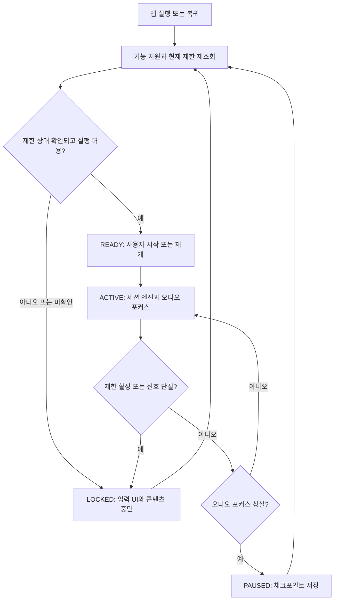

## 기술·플랫폼 판정 기준

조사 확인일: <date start="2026-11-07" />. 아래는 공개 문서 검토 결과이며 실제 참가 계정의 승인 상태, SDK 설치·빌드·실차 동작을 검증한 결과는 아니다.

**정확한 플랫폼 표현:** 앱 실행 환경은 **Pleos Connect(AAOS 기반)**, 개발 도구·문서·에뮬레이터 환경은 **Pleos Playground**, 음성 AI 명칭은 **Gleo AI**다. Vehicle OS와 차량용 앱 실행 환경을 동일하게 부르지 않는다. [현대차그룹 Pleos 공식 발표, 2025-03-28](https://www.hyundaimotorgroup.com/en/news/hyundai-motor-group-launches-pleos-software-brand-unveiling-new-sdv-technologies-and-collaborations)

| 필요한 기능 | 공개 근거 | 기획에 적용할 경계 |
|---|---|---|
| Vehicle State·NaviHelper | [프로젝트·SDK 신청 안내](https://document.pleos.ai/docs/pleos-only/create-my-project)에서 즉시 사용 가능으로 안내 | 문서 확인과 실제 계정·차량 호환 검증을 구분. 특정 잔여시간·좌석 인원·경로 필드가 전부 제공된다고 추정하지 않는다. |
| Vehicle Control·FusedLocation·Pleos TTS/STT | 같은 안내에서 준비 중·신청 불가로 표시 | 소개 문서가 있어도 현재 일반 개발자의 사용 가능으로 확정하지 않는다. MVP는 수동 입력·사전 오디오·허용된 외부 서비스로 대체 경로를 둔다. |
| 속도·기어 | [Pleos FAQ](https://document.pleos.ai/en/docs/pleos-only/vehicle-app-developer-guide/vehicle-app-faq), [API 구분](https://document.pleos.ai/en/docs/pleos-only/vehicle-app-planning-guide/pleos-connect-sdk-api)에서 AAOS Car API 경로 설명 | CarPropertyManager와 지원 속성·권한을 점검한다. 속도 0만으로 주차라고 판단하지 않는다. |
| 주행 제한 | [Pleos 주행 제한 개발 안내](https://document.pleos.ai/docs/pleos-only/vehicle-app-developer-guide/driving-restriction-development-guide) | CarUxRestrictions를 실행 허용의 기준으로 사용. 상태 모름·이벤트 단절은 잠금. 신호대기에서 게임을 풀지 않는다. |
| 미디어·게임 분류 | [주의 분산 심사](https://document.pleos.ai/en/docs/pleos-only/distribute/app-review-guide/review-driver-distraction-elements), [앱 카테고리](https://document.pleos.ai/en/docs/pleos-only/vehicle-app-planning-guide/app-category) | 영상·게임은 주차형 MVP. ‘음성만’ 또는 ‘동승자 전용’이라는 이유로 주행 허용을 가정하지 않는다. 순수 청취 기능은 별도 정책·심사 확인 후 확장한다. |
| Gleo 앱 기능 호출 | [Core Concepts](https://document.pleos.ai/docs/pleos-only/app-integration-guide/guide/core-concepts), [스키마 승인](https://document.pleos.ai/docs/pleos-only/app-integration-guide/guide/deliver-schema) | assets/schema.json, Intent/Broadcast, Callback 구조. 검토 승인 후 활성화. 범용 텍스트 생성 API와 다르다. |
| Gleo 액션 수·응답 | [App Schema](https://document.pleos.ai/docs/pleos-only/app-integration-guide/guide/app-capability), [Action Callback](https://document.pleos.ai/docs/pleos-only/app-integration-guide/guide/action_callback) | actionCalls 최대 3개, 인자 누락 검증 필요. Callback의 7초 취소 조건에 맞춰 긴 작업은 앱 내부로 분리하고 이미 접수한 세션 상태를 명확히 반환하도록 설계·검증한다. |
| 오디오 | [Audio Focus Guide](https://document.pleos.ai/en/docs/pleos-only/vehicle-app-developer-guide/audio-focus-development-guide/audio-focus-development) | Gleo·전화·내비 등 우선 오디오에 대응. 포커스 상실 시 즉시 중단. 여러 TTS를 동시에 재생하지 않는다. |
| 스마트폰 참여 | 본 조사에서 전용 공개 Pleos 컨트롤러 SDK 미확인 | QR/코드 → 모바일 웹 → 자체 서버 → 차량 앱은 자체 설계안이다. 토큰 만료·역할·재연결·중복 이벤트 처리가 필요하다. |
| Vehicle Data API REST | [API 소개](https://document.pleos.ai/api-reference/vehicle-data-api/intro)는 2026년 8월 기준 유럽 제공을 안내 | 국내 차량의 실시간 주행 잠금을 REST 텔레매틱스 이력으로 구현하지 않는다. 차량 내 신호와 구분한다. |

## 공통 안전·실행 상태 머신

이 그림은 제안하는 앱 구조다. 실제 OS가 별도로 수행하는 차단을 대체하거나 우회하지 않는다. 재생 허용 판단은 LLM 결과와 무관하게 동작해야 한다. 앱 재시작·네트워크 재연결 시 과거의 ‘주차 중’ 값을 믿고 바로 재생하지 않는다.

## LLM을 꼭 써야 하는 지점과 코드가 맡을 지점

| LLM이 유용한 작업 | 일반 코드·검증된 API가 맡는 작업 |
|---|---|
| 가족 발언을 연결하는 짧은 후속 질문, 취향 설명을 필드로 정리, 실제 제출된 여행 조각 편집, 정해진 사건 안의 NPC 대사 | 차량 상태·권한·주행 잠금, ETA·경로 계산, 세션 참여 승인, 음원 이용 권리 목록, 콘텐츠 선택지 유효성, 저장·삭제, 결제 |

구조는 **입력 최소화 → 서버 요청 → LLM 구조화 응답 → 형식·허용 ID·길이·내용 검증 → 로컬 상태 엔진 → 출력**이다. 외부 API 키는 서버에서 관리한다. 모델이 지어낸 사실·장소·노래 ID가 실제 상태로 기록되지 않도록 한다. 음성은 버튼을 눌러 말하거나 승인된 명령 세션으로 시작하고 상시 녹음은 기본 설계에 넣지 않는다. 아동 참여에서는 보호자 설정과 참여자의 패스·삭제 선택을 제공하며 관계 평가·감정 진단·민감한 비밀 유도를 하지 않는다.

**품질 목표는 아직 성능 결과가 아니다.** 화면 입력 반응, LLM 대기, 오디오 시작 지연의 p50/p95를 에뮬레이터에서 따로 측정한다. 검증 재시도 1회, 타임아웃 후 로컬 대체, 중복 요청 방지용 세션·이벤트 ID, 스킵·종료 동작을 먼저 구현한다. 사전 오디오를 재생한 장면을 실시간 음성 생성 성공으로 발표하지 않는다.

## 개발 전 가장 먼저 통과시킬 6개 확인

1. 현재 참가 계정에서 SDK 의존성 다운로드·빌드·앱 실행이 가능한가.
2. CarUxRestrictions 현재 상태·변경 이벤트와 P/D 전환을 에뮬레이터에서 재현하는가.
3. 필요한 Vehicle State 및 NaviHelper 필드가 실제로 오고, 미지원·권한 거절을 처리하는가.
4. Gleo 등록·심사·에뮬레이터 호출 경로가 열려 있는가. 불가하면 일반 UI를 사용하고 승인 연동은 모의라고 표시하는가.
5. 마이크·동적 TTS·외부 API가 실제 환경에서 동작하는가. 실패 시 시연 가능한 대체 경로가 있는가.
6. 주행 전환·포커스 상실·통신 단절·잘못된 LLM JSON·중복 요청에서 콘텐츠가 멈추거나 일관되게 복구되는가.

이 여섯 항목은 구현 전 확인 계획이다. 이번 조사에서 APK를 제작하거나 실제 SDK 호출에 성공했다고 주장하지 않는다.
