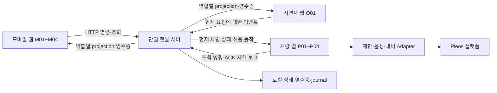

# wayMate 개발 아키텍처 및 분담 가이드

> 2026-11-11 구현 상태: my_trip 공통 JSON·최소 서버·웹 저장·실제 차량 제한 확인·HTTP 이어받기/ACK를 구현했다. [07 실행·지원 범위](07_첫_전달_실행_및_계약.md)를 참고한다. 아래 전체 설계·W/Q/V 조건의 완료를 뜻하지 않으며 상대 연결·음성·내비·O01·RESET은 후속이다.

작성일 2026년 11월 11일 · 버전 0.2 · 협업 구조 기준

**전체 팀은 5명이며, 개발 인원·역량·실제 담당자·기한은 미정이다.** 역할은 사람이 아니라 책임의 구분이다. 한 사람이 여러 역할을 맡을 수 있고, 기획서·디자인·소재·검증·발표도 별도의 산출물로 관리한다. 아래 인원별 배치는 선택 예시이며 실제 배정이 아니다.

이 문서는 [01 범위](01_목업_기획_범위_정의서.md)·[02 대본](02_시연_시나리오_및_대본.md)·[03 화면](03_화면_및_상호작용_설계서.md)·[04 연동 계약](04_개발_및_연동_명세서.md)·[05 작업·검수](05_제작_일정_업무_및_검수표.md) v0.6을 개발 경로와 인계 단위에 연결한다. 기능·API의 의미는 01~04, W/Q/V의 완료 조건은 05가 기준이다. v0.6은 자유 입력 온보딩을 기본 필수로 바로잡고 주행 음성 목표를 분리한다. 기존 담당자·제출 마감은 미정으로 유지한다.

## 1. 초기 구조 검토에서 확인한 점 (첫 전달 구현 전)

| 확인한 상태 | 협업에 필요한 보완 | 이번 기준 |
|---|---|---|
| 01~05에 기능·상태·API·검수 조건은 있음 | 담당자가 실제로 소유할 파일과 인계물이 연결되지 않음 | 아래 경로·역할·산출물 표로 연결 |
| 05의 차량 역할에 화면·HTTP·제한·음성·SDK가 함께 있음 | 화면 작업이 SDK 작업 완료를 기다릴 수 있음 | 차량 UI와 통신·플랫폼 책임 구분 |
| 웹·서버·shared는 대부분 빈 디렉터리 | 각자 만든 샘플과 필드가 달라질 수 있음 | 먼저 공유 계약·역할별 예제를 합의하고 독립 작업 |
| 차량 첫 화면은 실행되지만 한 UI 파일에 화면·캐릭터가 함께 있음 | 공통 UI와 화면 수정이 충돌할 수 있음 | 앱 조립·화면·컴포넌트·테마·문자열 분리 |
| 실제로 동작하는 것은 차량 첫 화면·mock 빌드 | 전체 W04나 SDK 완료로 오해할 수 있음 | 실제 제한·전달·SDK는 미구현으로 유지 |
| 문서의 명령·클래스명에는 구현 예정 항목이 있음 | 파일 존재와 구현 완료를 혼동할 수 있음 | 각 경계 README에서 현재/예정 구분 |

## 2. 저장소와 실행 구조

하나의 저장소와 기존 `mock-app/` 경로를 유지한다. 현재 웹·서버는 표준 Node.js와 HTML·CSS·JavaScript ES modules, 차량은 Kotlin·Compose로 개발한다. Android Gradle 모듈은 `:app` 하나이고 내부 패키지로 책임을 나눈다. 실제 중복·독립 빌드 필요가 생길 때 Gradle 모듈 분리를 검토한다.



JSON의 공통 계약은 `shared/`, 전체 시연 원본은 `server/fixtures/`, 이미지·음성 원본은 `assets/`에 둔다. 공유한다는 이유로 서버 원본 전체를 웹이나 차량에 배포하지 않는다. 서버는 단일 프로세스·단일 순차 명령 처리·단일 저장소를 유지한다.

## 3. 역할과 파일 소유 경계

| 역할 | 주로 수정할 경로 | 인계할 결과 | 같이 검토할 역할 |
|---|---|---|---|
| WEB | `web/views/`, `web/operator/`, `web/shared/`, 웹 entry 파일 | M01~M04·O01, 조회·명령 UI, 응답 유실·초기화 표시 | SERVER, CONTENT |
| SERVER | `server/`, `tests/server/`, `shared/contracts/` | 명령 검증·상태·projection·영수증·원자적 저장, API 계약 | WEB, CAR-PLATFORM |
| CAR-UI | `vehicle/.../ui/screens/`, `ui/components/`, `ui/theme/`, 화면별 문자열 | 상태를 받아 그리는 P01~P04, 사용자 의도 콜백, Preview | CAR-PLATFORM, CONTENT |
| CAR-PLATFORM | `vehicle/.../app/`, `data/`, `platform/`, mock·real source set, Gradle·Manifest | DemoRepository·상태 조립·세션·제한·음성·SDK·실행 기록 | SERVER, CAR-UI |
| CONTENT | `assets/`, `server/fixtures/`의 대본 내용, `shared/assets-manifest.json` | 이미지·자막·녹음·조건별 cue와 발화자, 공개 필드·fallback 연결 | SERVER, WEB, CAR-UI |
| 통합 책임 | 해당 연결을 바꾸는 경로·05의 증빙 | 첫 실제 전달, 두 결말, 변경 영향 Q 확인·시연본 기록 | 연결에 참여한 담당자 |

한 사람이 여러 역할을 맡을 수 있고 CONTENT·통합 책임도 겸임할 수 있다. `server/fixtures/`의 문장·소재 내용은 CONTENT가 준비하고, 서버에서 쓸 구조·공개 필터링은 SERVER가 확인한다. `shared/`의 형식은 SERVER가 변경을 모으고 실제 소비자가 함께 검토한다. 이름을 확인하기 전에는 CODEOWNERS 계정을 임의로 등록하지 않는다.

### 3.1. 개발 인원이 정해졌을 때의 배치 예시

| 개발 참여 인원 | 개발 책임을 묶는 예시 | 나머지 팀원이 선택할 산출물 |
|---|---|---|
| 1명 | 같은 사람이 WEB·SERVER·CAR를 맡되 아래 첫 전달 단위부터 순차 진행 | 기획서·UX/소재·검증·발표 자료. 개발 범위와 SDK 목표를 먼저 조정 |
| 2명 | 웹·서버·공통 계약 / 차량 UI·통신·플랫폼 | 기획서·소재·검증·발표 중 배정 |
| 3명 | 웹·O01 / 서버·공통 계약 / 차량 UI·플랫폼 | 기획서·소재·검증·발표를 나누거나 겸임 |

2명·3명 안에서도 Kotlin·웹 경험과 실제 가용 시간에 따라 묶음을 바꿀 수 있다. 경계는 유지하고 담당자만 묶는다. 개발자 수를 정하기 전에 사람별 마감이나 동시 진행량을 확정하지 않는다.

### 3.2. 기획서 작업과 함께 진행할 일

| 산출물 | 개발을 기다리지 않고 준비할 내용 | 개발에서 받아야 하는 사실 |
|---|---|---|
| 문제·가치·범위 설명 | 01의 사용자 상황, 연결·만남·동행 구분, 두 결말의 가치 | 구현한 기능과 미구현 기능 목록 |
| 흐름·화면 설명 | 02~03의 M/P/O 흐름, 콘텐츠 선택·생략, 조건별 대사 | 실제 실행 화면과 오류/잠금 상태 |
| 시각·음성 소재 | 캐릭터·카드·자막·문장 ID·출처·표현별 변형 | 적용 가능한 파일 형식·manifest 계약 |
| 검증·발표 | Q와 V 구분, 관찰 항목, 시연 대본·기획서의 주장과 근거 연결 | 커밋·APK·실제 시험 결과·실패·미검증 |

제출 형식·기획서 분량·마감은 아직 미정이다. 별도 제출용 문서의 형식과 담당은 확인 후 정한다. 사용자 효과와 실제 주행 지원은 V 검증 전 확정된 성과로 쓰지 않는다.

## 4. 구체적인 코드 배치

다음은 책임 경로다. README·기존 첫 화면 외 서버·웹·플랫폼의 상세 구현 파일은 아직 없다. 아래에서 ‘예정’은 해당 담당자가 구현할 파일을 뜻한다.

```text
mock-app/
  shared/
    contracts/                 # 계약 산출물 목록·형식 변경 기준
    examples/                  # 역할별로 필터링한 계약 예제
    schema.json                # W01에서 작성할 목표 schemaVersion 3 진입점·예정
    assets-manifest.json       # 소재 계약·예정
  server/
    main.mjs                   # HTTP 서버 조립·예정
    commands.mjs               # 단일 명령 큐·공통 검증·영수증·예정
    state.mjs                  # 새 회차 초기 상태·예정
    projections.mjs            # 역할별 응답 진입점·예정
    store.mjs                  # 원자적 파일 저장·예정
    http/                      # 라우팅·헤더·본문 처리
    domain/                    # 프로필·여행·연결·콘텐츠·만남·내비·결말·초기화
    projections/               # web / car / operator의 응답 필터
    fixtures/                  # 전체 시연 원본
  web/
    index.html, app.js         # 모바일 entry·예정
    operator.html, operator.js # O01 entry·예정
    views/                     # M01~M04 화면
    operator/                  # O01 전용 화면·제어
    shared/                    # HTTP client·조회 수명주기·공통 UI
  vehicle/app/src/main/java/com/waymate/app/
    MainActivity.kt            # Android 진입점
    app/                       # WayMateApp, 향후 상태·route·의존성 조립
    ui/screens/handoff/        # P01·화면 상태·사용자 의도 콜백
    ui/screens/conversation/   # P02 예약 경로
    ui/screens/meeting/        # P03 예약 경로
    ui/screens/ending/         # P04 예약 경로
    ui/components/             # 캐릭터·공통 UI
    ui/theme/                  # 색·타이포·테마
    data/api/                  # HTTP·직렬화·DTO
    data/repository/           # 조회·명령·영수증·세션
    data/local/                # 장치 ID·미확인 명령·SDK 실행 기록
    platform/restrictions/     # 실제 CarUxRestrictions 현재값·변경
    platform/voice/            # 샘플 재생·포커스·중단
    platform/navigation/       # NaviAdapter 계약·실행 조정
  assets/images/, assets/audio/
  tests/contracts/, tests/server/, tests/integration/
  runtime/                     # 로컬 실행 상태·증빙, Git 제외
```

### 4.1. 서버의 의존 방향

`HTTP → commands 조정 → domain의 상태 계산 → store 저장 → projection 응답` 순서다. 도메인별 계산은 상태와 명령을 받아 새 상태·처리 근거를 반환한다. 각 도메인이 별도로 파일을 저장하거나 독립 큐를 만들지 않는다. `commands.mjs`에서 공통 회차·역할·버전·영수증 검증과 저장 순서를 한 번 적용한다.

`allowedActions`·`actionBindings`와 실제 명령 검증은 같은 조건 함수를 사용한다. 허용 버튼을 만드는 코드와 POST 검증 조건을 따로 복사하지 않는다. `B_RESPONSE`는 대상 kind에 맞는 도메인으로 전달하고 새 명령 체계를 만들지 않는다. 취소·연결 종료·초기화처럼 여러 도메인에 걸친 처리는 공통 조정 경로로 묶는다.

### 4.2. 차량의 의존 방향

`MainActivity → app 조립 → 화면(state, callback)`으로 표시한다. `app`의 향후 DemoViewModel은 DemoRepository의 결과를 화면 상태로 바꾸고, 화면의 사용자 의도를 Repository·플랫폼 실행 조정으로 전달한다. `ui/`에서 HTTP·파일·Pleos SDK를 직접 호출하지 않는다.

현재 HandoffScreen은 HandoffUiState와 onLoadJourney만 받는다. 서버가 없을 때도 CAR-UI는 Preview를 수정할 수 있다. 이 UI 상태는 서버의 요청·동의 상태가 아니고 권한 토큰도 아니다. 실제 전송·차량 조작 시 Repository와 플랫폼에서 현재 조건을 다시 확인한다.

CAR-PLATFORM은 `DemoRepository`, `RestrictionMonitor`, `VoicePlayer`, `NaviAdapter`의 구현 책임을 갖는다. 구체적인 메서드·DTO는 04와 W01 산출물로 맞추며 빈 성공 응답·자동 성공 타이머를 공통 계약처럼 추가하지 않는다.

**mock 빌드에서도 실제 주행 제한은 확인한다.** CarUxRestrictions 기반 제한 읽기와 음성 수명주기는 공통 `main` 책임이다. `mock`·`real`의 차이는 내비 실행 출처이며 실제 NaviHelper 의존성·구현은 향후 `real`에만 둔다. 현재 `real` flavor와 모든 Adapter는 미구현이다.

### 4.3. 화면·업무·발표 상태

- 서버: 공개 승인·여행·연결·요청·동의·만남·최종 결과·회차·영수증의 기준 상태.
- 클라이언트: 선택 중인 콘텐츠·펼침·미전송 초안·자막 위치·확인한 cue 이력.
- 차량 로컬 기록: SDK 호출 직전 may_have_executed와 실제 관측·정리 기록.
- 발표: sceneId·이야기 시각·대본 이벤트. 화면 이동이나 sceneId로 업무 동의를 생성하지 않는다.

서버 조회·Compose 재구성·앱 복귀는 새 SDK 호출의 계기가 아니다. 모의 결과도 O01의 NAV_MOCK_RESULT가 현재 mock attempt에 적용하며, MockNaviAdapter가 자동 성공을 만들지 않는다.

## 5. 나누기 전에 맞출 계약

자유 입력 변경은 WEB의 입력창만 수정하는 작업이 아니다. SERVER는 목표 v3의 answerText·inputSource·원문 보존·프로필 재확인과 projection 제외를, WEB은 예시 초안·명시 전송·원문/소개값 구분을, CAR-PLATFORM은 업무 잠금과 검증된 voiceCapability를, CAR-UI는 WF-032/WF-051의 분리를 맡는다. 현재 handoff-my-trip-v1·schemaVersion 2는 07의 실제 구현으로 보존하고 목표와 호환성 전환을 별도 작업으로 검수한다. schema 파일·앱 코드를 문서만으로 구현 완료 처리하지 않는다.


| 계약 | 먼저 준비할 산출물 | 생산자 → 소비자 |
|---|---|---|
| 공통 봉투 | 목표 schemaVersion 3(현재 구현은 07의 2), ID·버전·역할·오류·영수증의 schema와 정상/거부 예제 | SERVER → WEB·CAR-PLATFORM |
| 상태 조회 | web/car/operator별 응답, allowedActions·actionBindings·blockedActions | SERVER → 각 클라이언트 |
| 차량 전달 | my_trip·connected 예제, sourceVersions, HANDOFF_PREPARE·CAR_LOADED·오래된 ACK 거부 | SERVER ↔ WEB·CAR-PLATFORM |
| 세션·제한 | CAR_SESSION_OPEN·CAR_STATUS, 미확인·만료·foreground, 저장 순서 | SERVER ↔ CAR-PLATFORM |
| P01 표시 | HandoffUiState·onLoadJourney. 현재 코드는 preview만 사용 | CAR-PLATFORM → CAR-UI |
| 소재 | assetId·captionId·speaker·sourceKind·공개 조건·cue·fallback | CONTENT·SERVER → WEB·CAR |
| 내비 | source와 outcome 분리, attempt·승인·실행 기록·결과·정리 | SERVER ↔ CAR-PLATFORM, O01 |

API 경로·명령·필드·enum·응답 예시는 [04의 3~9절](04_개발_및_연동_명세서.md#3-공통-데이터-구조)을 따른다. 처음부터 모든 SDK·콘텐츠를 구현하지 않고 첫 전달에 필요한 계약 묶음부터 코드화한다. `shared/contracts/`는 산출물 등록 위치이고 현재 완성된 schema·serializer가 있다는 뜻은 아니다.

계약 변경 PR에는 바뀐 생산자·소비자, 정상/오류 예제, 해당 W/Q를 함께 적는다. field 이름을 서버·웹·Kotlin에서 각각 정하지 않는다. 같은 schemaVersion에서 호환되지 않는 변경을 감추지 않으며, 계약 버전 변경은 영향과 전환 방법을 합의한 뒤 반영한다.

## 6. 서로 기다리지 않는 작업 단위

아래 접미사는 기존 W의 작업 이슈를 나눌 때 쓰는 예시다. 새 기능 ID나 전체 W 완료 기록이 아니다.

| 작업 묶음 | 입력 | 산출물·완료 조건 | 실제 연동 전에도 가능한 일 |
|---|---|---|---|
| W01-a 첫 전달 계약 | 04의 공통 봉투·역할·전달·세션 | 역할별 schema·정상/오류 예제·필수 필드와 거부 조건 대조 | 세 클라이언트가 같은 예제를 읽고 계약 검토 |
| W02-a 서버 실행 기반 | 확정한 첫 전달 계약 | health·정적 제공 범위·순차 저장·시작 실패 기록 | HTTP/저장 단위 확인 |
| W04-a 화면 기반 | 03 P01 | 현재 mock 앱 빌드·첫 화면 표시. 이미 기초 실행 확인 | 화면 상태·Preview·공통 컴포넌트 수정 |
| W04-b 차량 연결 기반 | 첫 전달 계약·실제 제한 API | 세션·조회·영수증·실제 제한·수명주기·미확인 잠금 | 응답 예제·fake transport와 실제 제한 시험을 구분 |
| W03 최소 준비·전달 | 첫 전달 계약·서버 기반 | 별명·외형·표현 저장, 공개·본인 모드, 전달 준비·ACK | WEB은 역할별 응답 예제로 UI 제작 |
| W08/W09 소재 | 02 조건별 대사·03 카드·소재 계약 | 외형·자막·녹음·manifest의 ID·발화자·조건 일치 | 이미지·녹음·기획서 화면 구성 |
| W06 SDK 시험 | W04의 실제 제한·환경 준비 | 별도 경로 D/M 조회·추가·제거·실패·정리 근거와 모드안 | 기본 모의 시연·기획서와 시험 결과를 구분 |

임시 client sample은 `shared/examples/`의 역할별 데이터로 한정하고 개발 미리보기임을 표시한다. 운영용 명령을 적용한 것처럼 영수증·ACK·SDK 성공을 만들지 않는다. 첫 전달에 필요한 W01/W02 부분 산출물을 먼저 합쳐 나머지 공통 데이터 작업과 나눠 진행하되, 상위 W 완료는 05의 전체 조건을 따른다.

### 6.1. 첫 실제 연결의 완료 조건

1. 서버·웹·차량이 동일 schemaVersion·storeId·현재 회차를 확인한다.
2. 기본값과 다른 별명·외형·표현을 웹에서 저장한다. 공개를 보류한 my_trip을 먼저 확인할 수 있다.
3. 저장한 본인 여행 전달본을 P01이 실제 HTTP로 읽고 같은 handoff 버전으로 ACK한다.
4. ACK 저장 뒤에만 웹의 차량 확인 완료를 표시한다. GET이나 애니메이션 종료로 성공 처리하지 않는다.
5. connected도 별도로 확인한다. B 수락·공통 시간 확인·공개 요건을 생략하지 않는다.
6. 오래된 응답·ACK·앱 복귀·보고 만료·초기화의 적용 분기를 확인하고 관련 Q 증빙을 남긴다.

전체 화면을 완성한 뒤 처음 연결하지 않는다. 첫 실제 전달 이후 P02 콘텐츠, P03 만남·모의 내비, P04 두 결말을 05의 선행 관계대로 연결한다. SDK 시험은 별도 경로에서 수행하고 결과를 기다리는 동안 기본 모의 흐름·소재·기획서를 진행한다.

## 7. 협업·검수 운영

작업 이슈는 `관련 W/DM/화면 → 담당 영역 → 수정 경로 → 계약 영향 → 입력·선행 → 완료 조건`을 적는다. 공통 파일·형식을 바꾸는 작업은 소비자 검토를 함께 요청하고, 화면 담당자는 자기 화면과 해당 문자열 파일을 중심으로 수정한다. 확정한 담당자·검토자는 05 역할표와 작업 이슈에 기록한다.

현재 차량용 CI는 PR·main 변경에서 **mock APK 빌드와 Android Lint**를 확인한다. 서버·웹 기능 테스트, Pleos 부팅·실제 SDK·Q 통합 검수는 이 CI가 대신하지 않는다. 서버·계약 테스트가 구현되면 해당 실제 검증 명령을 CI에 추가한다. 실행할 테스트가 없는 단계에서 빈 테스트 성공으로 완료를 표시하지 않는다.

별도 저장소나 담당자별 장기 브랜치 대신 한 작업 목적의 브랜치와 PR을 사용한다. 구현 예시는 `feat/W03-handoff-api`, `feat/W04-restriction-monitor`, `feat/W10-mobile-profile`이다. 역할 수가 아니라 각자 가능한 작업량에 맞춰 동시에 여는 작업을 정한다.

## 8. 현재 준비된 것과 남은 결정

| 구분 | 현재 상태 |
|---|---|
| 팀 규모 | 5명 |
| 개발 인원·경험·실제 배정 | 미정 |
| 화면·API·데이터·검수의 기준 | 01~05 v0.6 |
| 코드 구조 | 화면·공통 UI·테마·조립 분리, 서버/웹/계약/플랫폼 경계 README와 디렉터리 준비 |
| 차량 구현 | 07의 my_trip HTTP 전달·ACK·실제 제한 읽기 구현. 주행 음성·실제 내비는 미구현 |
| 공통 schema·역할별 예제 | 현재 실행은 07의 v2. 자유 입력·음성 capability를 포함하는 목표 v3는 W01에서 구현·검증할 항목 |
| 제출 기획서 형식·분량·마감·발표 조건 | 미정 |
| 다음 배정 | 개발 참여 인원·역량을 확인하고 3.1의 묶음 선택, 05와 이슈에 이름·가용 시간 기록 |

팀원이 첫 작업을 시작할 때는 01로 서비스 범위를 읽고, 자기 화면은 03, 교환 데이터는 04, 소유 경로는 이 문서, 완료 조건은 05에서 확인한다.
